## Welcome

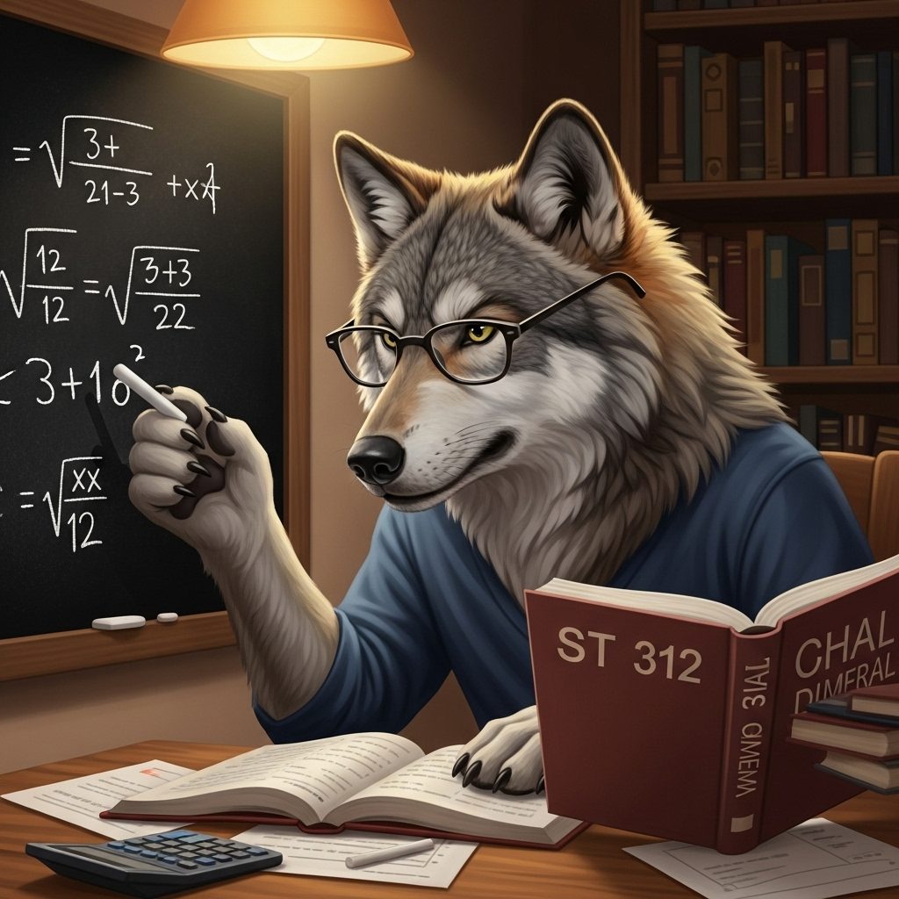

## Goals for Day 1

Get organized + review

-   Get to know the professor
-   Get to know each other
-   Course overview
-   Review of ST 311

## Who Am I?

::: {layout="[[100], [50,-10,50]]"}
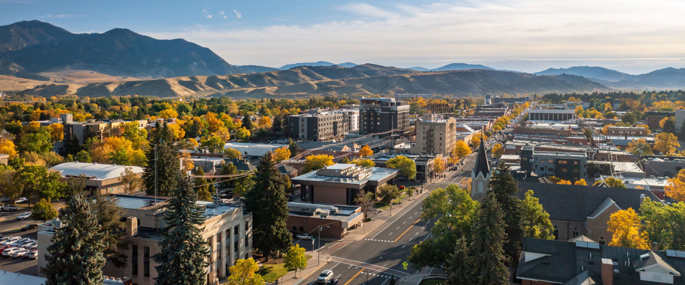{width="1000" height="300"}

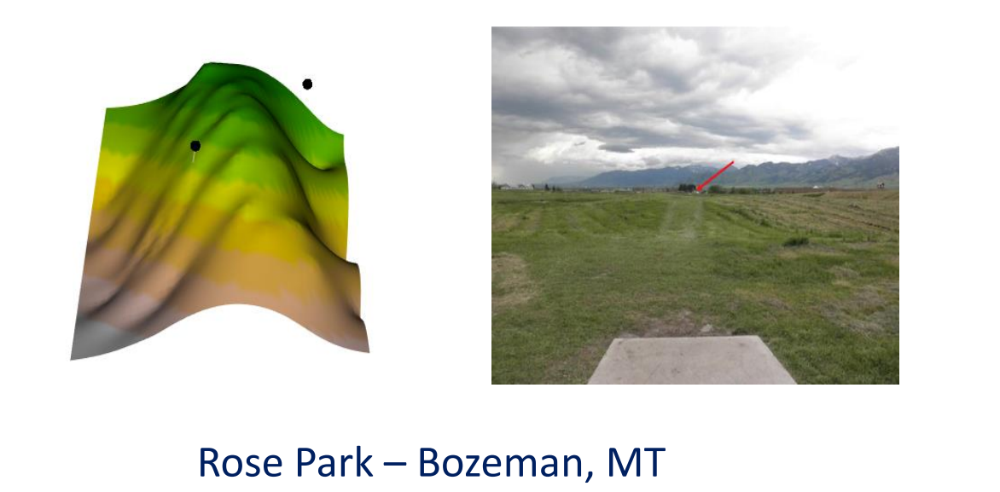{width="400" height="175"}

{width="400" height="175"}
:::

## At NC State 

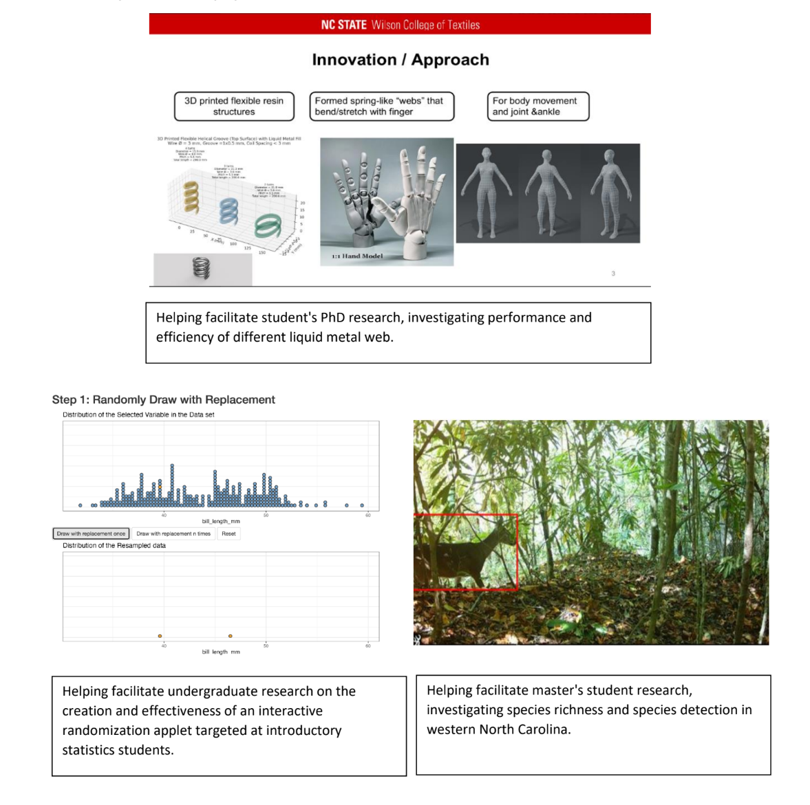

## At NC State 

Project COMPASS (Community Partnership and Assessment for
School Safety). This is a three-year, federally funded initiative focused on developing and piloting a data-driven framework to strengthen collaboration between schools and community partners.

## Who Are You?

Please share with the class

-   Name
-   Major
-   Year (Freshman, Sophomore, etc.)
-   Why you are taking this course
-   Anything else

## ST 312

Fundamental Statistics Concepts

-- Probability

-- Power

-- Error

-- Normality

-- Properties of distributions

## ST 312

Statistical inference

-- Two sample tests

-- One-way ANOVA

-- Two-way ANOVA

-- Inference on regression parameters

## ST 312

Descriptive statistics

-- Calculate summary statistics

-- Interpret regression coefficients

-- Make predictions

## ST 312

Other skills

-- Statistical literacy

-- Pick up some R along the way (optional, but I'll provide resources)

## Where to get help

Office Hours

| Who       | When                                         | Where            |
|-----------|----------------------------------------------|------------------|
| Dr. Meyer | Monday: 1:00-2:00pm  \| Thursday: 10:15 - 11:15am | SAS 5228 or Zoom |
| Yichen Hu      | TBD \| TBD              | SAS 1101   |

## STAT Hub

Hours: Monday - Thursday, 5:30p-8p (except on University holidays and
breaks)

Location: 1101 SAS Hall

Website:
<https://statistics.sciences.ncsu.edu/resources/student/tutors/>

## Videos 

I will also post class videos for you to review... unless attendance takes a nose dive...

## Grades

| Category              | Percentage |
|-----------------------|------------|
| Review Test           | 5%         |
| Rubric Assignment     | 5%         |
| Statistics Experience | 5%         |
| Homework              | 15%        |
| Midterms (2)          | 40%        |
| Final Exam            | 30%        |

## Review Test

-- Revisiting past material helps reinforce it

-- Make sure everyone is set up for success

-- Third-week of class

-- We will review some today and next class (+review material is posted)

## Review test topics{.smaller} 

-- Null and alternative hypotheses 

-- Confidence intervals (create + interpret)

-- p-value 

-- standard normal + t-distribution 

-- z + t statistics

-- categorical vs quantitative 

Closed notes. A formula sheet is posted

This is on 8/27!


## Rubric assignment

You will be given a topic

You will create your own rubric

You will use your rubric on a given response


More information later!

## Statistics Experience

The goal of the statistics experience assignments is to help you engage with the statistics and data science communities outside of the classroom!

1. Have an experience 

2. Make connections between our class, and the experience 

3. Make a slide (poster) summarizing your experience 

Connections can be topics of regression, coding, working with data, etc. 

## Student Example 

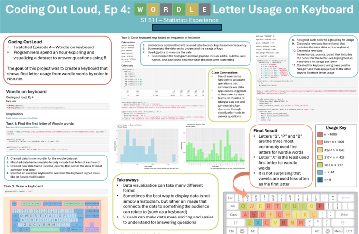

## Student Example 

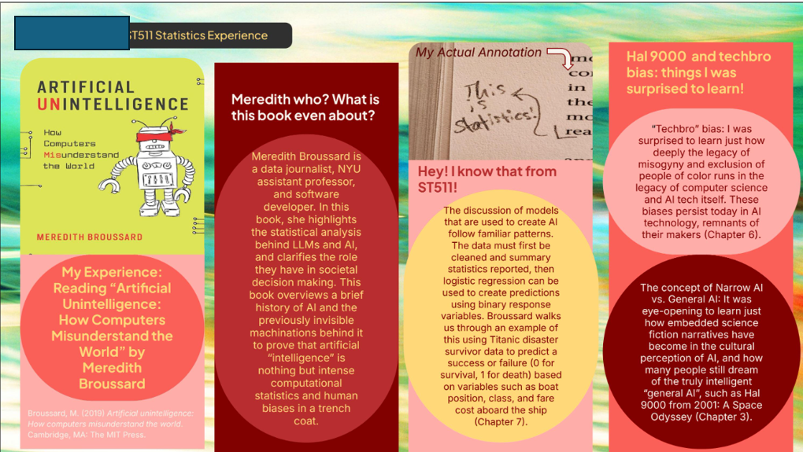

## Research study 

I'm interested in interest-based assessment

You'll be asked to be a part of the study!

## AI in ST 312{.smaller}

There is nothing stopping you from using AI (such as ChatGPT) as an additional resource to help build up your mastery of the material. However, please use it responsibly. 

-- It is suggested that you use AI as a generator for additional practice problems

-- A tool to help uncover a misunderstanding you may have with ST 312 content 

## AI in ST 312{.smaller}

Irresponsible uses of AI

-- Having it think for you 

-- Only asking AI questions 

Any work you turn in must be created by you! I'm interested in your fundemental understandings

## AI in ST 312{.smaller}

[Dialogues with AI Reduce Beliefs in Misinformation but Build No Lasting Discernment Skills](https://dl.acm.org/doi/10.1145/3772318.3790656)

[Your brain on ChatGPT](https://www.media.mit.edu/publications/your-brain-on-chatgpt/)

[How AI is reshaping human skills and thinking
](https://www.apa.org/monitor/2026/07-08/ai-job-skills-thinking)

-- I believe it's disingenuous for people to tell you to jump into using AI

-- I believe it's disingenuous for people to tell you to never use AI

-- I try to be as transparent as possible with all of my in-class decisions, so please do not hesitate to ask questions!

# Questions

## How class runs

Build a community of learners

## Moodle 

Moodle Tour

## How to be successful 

Take advantage of the different forms of help 

**Come to class as an active participant**

-- Take notes

-- Engage in discussion

-- Post questions in the forums

-- Stat Hub

# Questions

## Review toipcs

-- Normal Distribution: probabilities, z-scores, z-table (1.4)

-- Sampling Distribution: for sample means (5.2), sample proportions
(5.3)

-- Confidence Intervals (6.1): for 1-sample mean (7.1), 1-sample
proportion (8.1)

-- Hypothesis Testing (6.2): for 1-sample mean (7.1), 1-sample
proportion (8.1)

-- P-values (6.2)

# Review

## Types of variables 

Categorical or Quantitative? 

-- Height (inches)

-- State you are from 

-- Zip code

## Probability distributions 

A probability distribution --

A random variable --

## Probability distributions 

A probability distribution is a mathematical function that describes the likelihood of different outcomes for a random variable

A random variable, usually written X, is a variable whose possible values are numerical outcomes of a random phenomenon.

## Normal Distribution

What does it look like?

What's the center?

What's the area under the curve?

## Normal Distribution

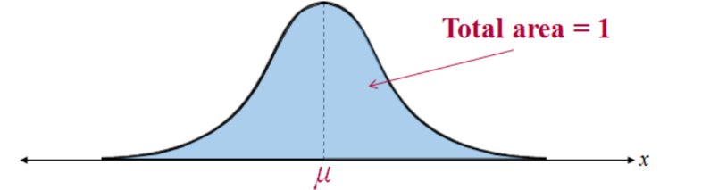

How can we measure spread?

## Spread

Standard deviation - how spread out on average, each value is away from
the center

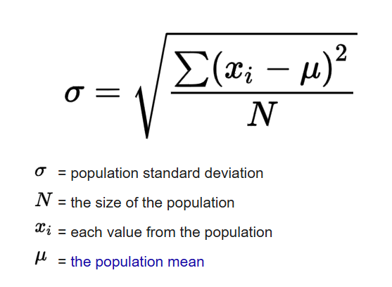

## Population vs sample

What's the difference?

$\mu$ vs $\bar{x}$

$\sigma$ vs $s$

## Question

Which curve has the larger mean?

Which curve has the larger standard deviation?

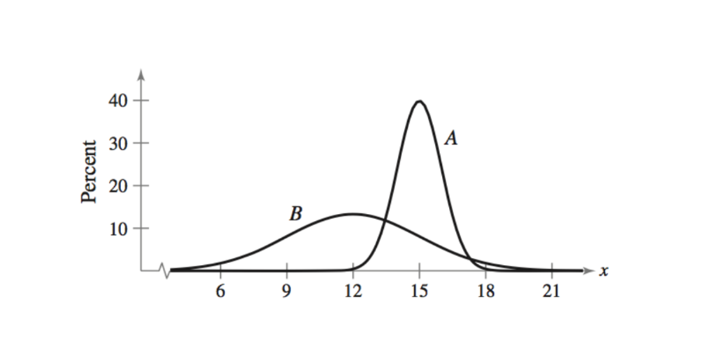

# Standard normal distribution

## 

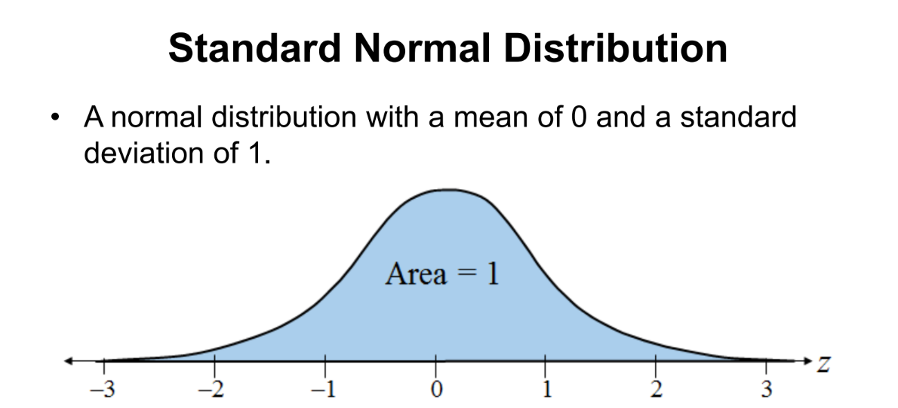

## Standard Normal Distribution

$$ 
z = \frac{x - \mu}{\sigma}
$$ 

This represents how many standard deviations a value (x) is away from
the mean!

We can calculate probabilities using a z-score.

## Probability 

What is probability?

What values can probability take on?

## Probability

Assume that the true mean value of a can of Coke is 500mL, with a true
standard deviation of 9mL. What's the probability that a randomly
sampled can of Coke contains at least 510mL?

Let's draw it out!

```{webr-r}

```

You can use this chunk as a calculator if you would like!

## z-score

`pnorm(your_zcore)`

```{webr-r}

```

pnorm() gives the area to the left, subtract the result from 1 to get
the area to the right.

## z-table

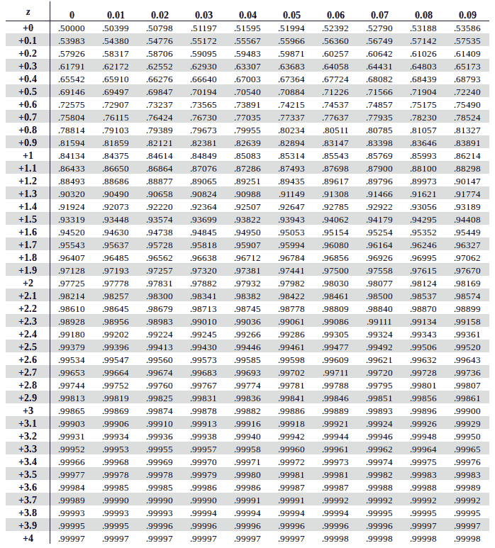


## Probability

What about the probability our can of Coke contains exactly 510mL?

## Setting the stage for research 

-- What's a null hypothesis?

-- What's an alternative hypothesis 

## Context 

Suppose I am a height researcher interested in how tall, on average, NC residents are. It is assumed that the average height for US citizens is 69 inches. I have hunch that NC residents are taller than that... 

$Ho:$

$Ha:$


## Next time

-- More review

-- Probability rules
