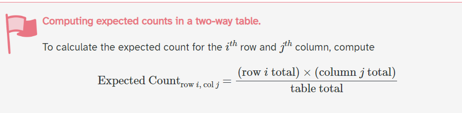
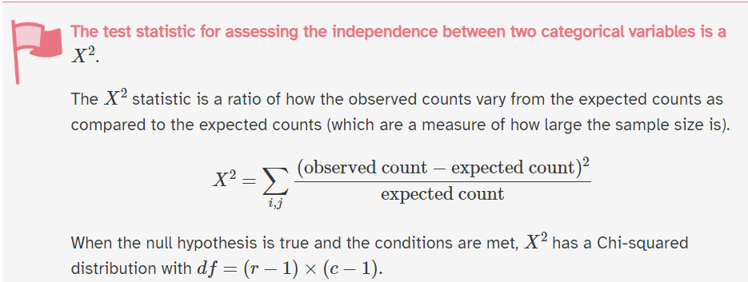
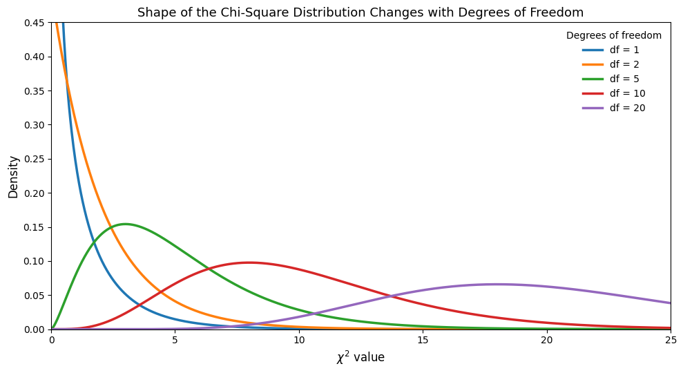
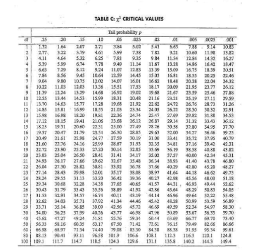

## Checklist{.smaller} 

-- Homework-1 is graded

    > Solutions are on Moodle 
    > Regrade window until Friday 10-9 at 5:00pm
    
-- Don't forget about the Statistics Experience (12-1)

-- Exam-2 is on 10-29

-- Exam-1 will be released by end of next week 

      > I don't plan for a curve
      > If the performance on one question indicates an unfair question I'll fix it
      > Re-grade window will open after grades are released 
      > Solutions are posted on Moodle 
      
## Checklist{.smaller}
      
-- Homework-2 is LIVE and due on Monday (10-12) at 11:59pm 

      > 24-hour late window
      > Please start early
      > Let's talk about homework-2, and the "coding part"

## Warmup 

Last class, we talked all things power analysis. Let's review the terms!

-- Type-1 error 

-- Type-2 error 

-- Power 

## Warm-up 

Last class, we talked all things power analysis. Let's review the terms!

-- Type-1 error: Rejecting the null hypothesis when the null hypothesis was actually true 

-- Type-2 error: Failing to reject the null hypothesis when the null hypothesis was actually false 

-- Power: Rejecting the null hypothesis when the null hypothesis was actually false

## Warm-up

Where are these respective probabilities on the following graph?

What is an **effect size**? What is the value of the effect size in our prompt from last class?

```{r}
#| echo: false
#| message: false
#| warning: false
library(palmerpenguins)
library(tidyverse)

alpha <- 0.05
effect_size <- 5
se <- 1.852

crit <- qnorm(1 - alpha / 2) * se

x <- seq(-6, 11, length.out = 2000)

null <- data.frame(
  x = x,
  y = dnorm(x, mean = 0, sd = se)
)

alternative <- data.frame(
  x = x,
  y = dnorm(x, mean = effect_size, sd = se)
)

beta <- pnorm(crit, mean = effect_size, sd = se) -
        pnorm(-crit, mean = effect_size, sd = se)

power <- 1 - beta

ggplot() +
  # Type I error: two tails under the null distribution
  geom_area(
    data = subset(null, x <= -crit),
    aes(x = x, y = y, fill = "Type I Error (alpha)"),
    alpha = 0.5
  ) +
  geom_area(
    data = subset(null, x >= crit),
    aes(x = x, y = y, fill = "Type I Error (alpha)"),
    alpha = 0.5
  ) +
  # Type II error: central region under the alternative distribution
  geom_area(
    data = subset(alternative, x >= -crit & x <= crit),
    aes(x = x, y = y, fill = "Type II Error (beta)"),
    alpha = 0.6
  ) +
  # Power: two tails under the alternative distribution
  geom_area(
    data = subset(alternative, x <= -crit),
    aes(x = x, y = y, fill = "Power"),
    alpha = 0.5
  ) +
  geom_area(
    data = subset(alternative, x >= crit),
    aes(x = x, y = y, fill = "Power"),
    alpha = 0.5
  ) +
  # Null and alternative distributions
  geom_line(
    data = null,
    aes(x = x, y = y, color = "Null Distribution"),
    linewidth = 1
  ) +
  geom_line(
    data = alternative,
    aes(x = x, y = y, color = "Alternative Distribution"),
    linewidth = 1
  ) +
  # Critical values
  geom_vline(
    xintercept = c(-crit, crit),
    linetype = "dashed",
    color = "black"
  ) +
  # Type I error labels
  annotate(
    "text",
    x = -4.8, y = 0.025,
    label = "alpha/2",
    parse = TRUE,
    size = 4
  ) +
  annotate(
    "text",
    x = 4.5, y = 0.025,
    label = "alpha/2",
    parse = TRUE,
    size = 4
  ) +
  # Type II error label
  annotate(
    "text",
    x = 0, y = 0.035,
    label = paste0("beta = ", round(beta, 2)),
    color = "darkorange3",
    size = 4
  ) +
  # Power label
  #annotate(
   # "text",
    #x = 7.5, y = 0.04,
    #label = paste0("Power = ", round(power, 2)),
    #color = "darkgreen",
    #size = 4
  #) +
  scale_fill_manual(
    name = "Error Regions",
    values = c(
      "Type I Error (alpha)" = "steelblue",
      "Type II Error (beta)" = "orange",
      "Power" = "darkgreen"
    )
  ) +
  scale_color_manual(
    name = "Sampling Distributions",
    values = c(
      "Null Distribution" = "steelblue4",
      "Alternative Distribution" = "darkgreen"
    )
  ) +
  labs(
    title = "Sampling Distributions of the Difference in Means",
    subtitle = "Two-sided test with alpha = 0.05 and a true difference of 5 minutes",
    x = "Difference in Sample Means (minutes)",
    y = "Density"
  ) +
  coord_cartesian(xlim = c(-6, 11)) +
  theme_minimal() +
  theme(legend.position = "none")
```

## Effect size 

Effect size is a quantitative measure of the magnitude of an effect in a population.

The effect size is 5, meaning that the population mean writing time for blue pens  is expected to be 5 minutes higher than the population mean writing time for black pens. 

# Questions 

## Categorical Inference 

So far, we have gone over two different types of categorical inference techniques

-- What are they?

-- Parameters?

-- Statistics?

## Motivation 

We are going to study penguins! This real dataset includes measurements for penguin species, island in Palmer Archipelago, size (flipper length, body mass, bill dimensions), and sex. 


## Penguins{.smaller}

Suppose that we want to look at the relationship between sex and species. That is, we want to test if species of penguin is independent from sex. How is this different than what we’ve done before?

```{r}
penguins |>
  na.omit() |>
  group_by(species, sex) |>
  count()
```

## Type of test

Can we use difference in means?

Difference in proportions?

## Chi-square test

The **big picture** idea is to compare **expected counts, under the assumption of the null hypothesis**, with **observed counts**. This is how we are going to calculate our test statistic.

## Chi-square test 

$Ho:$

$Ha:$

## Chi-square test 

$Ho: \text{sex and species of penguins are independent}$

$Ha: \text{sex and species of penguins are not independent}$

## Chi-square test 

Note: This is a chi-square test of independence. We will learn about a goodness-of-fit-test Thursday!

$Ho: \text{sex and species of penguins are independent}$

$Ha: \text{sex and species of penguins are not independent}$

## Steps of a null hypothesis 

-- Set up the null and alternative hypotheses 

-- Collect data 

-- Check assumptions (so we can trust our theory based tests)

-- Calculate our test statistic 

-- p-value

-- decisions and conclusions

## Table 

What would we expect to see under the assumption of the null hypothesis?

What did we actually observe?

Are the differences "statistically significant"?

|           | Male | Female | Total |
|-----------|------|--------|-------|
| Adelie    |      |        | 146   |
| Chinstrap |      |        | 68    |
| Gentoo    |      |        | 119   |
| Total     | 168  | 165    | 333   |


## Assumptions

--   Independence

--   Expected frequencies (sample size condition)

## Independence

How could this be broken?

What might we do to assume this isn't violated?

# Expected counts

## Expected counts {.smaller}

With a sample size of 333, what would we expect to see in this table under the assumption that species and sex are independent?

**Table of EXPECTED counts**

|           | Male | Female | Total |
|-----------|------|--------|-------|
| Adelie    |      |        | 146   |
| Chinstrap |      |        | 68    |
| Gentoo    |      |        | 119   |
| Total     | 168  | 165    | 333   |

## Expected Formula

{fig-align="center"}

## Expected counts rule

Your book says "average expected cell count is > 5." This will be our rule of thumb. 

If any of the expected values are low the p-values generated by the test start to become less reliable.


## Expected counts {.smaller}

With a sample size of 333, what would we expect to see in this table under the assumption that species and sex are independent?

**Pick one cell, and calculate the expected count!**

**Table of EXPECTED counts**

|           | Male | Female | Total |
|-----------|------|--------|-------|
| Adelie    |      |        | 146   |
| Chinstrap |      |        | 68    |
| Gentoo    |      |        | 119   |
| Total     | 168  | 165    | 333   |


## Expected Table

|           | Male               | Female | Total |
|-----------|--------------------|--------|-------|
| Adelie    | **(146\*168)/333** |        | 146   |
| Chinstrap | **(68\*168)/333**  |        | 68    |
| Gentoo    | **(119\*168)/333** |        | 119   |
| Total     | 168                | 165    | 333   |

## Expected Table

|           | Male       | Female | Total |
|-----------|------------|--------|-------|
| Adelie    | **73.658** |        | 146   |
| Chinstrap | **34.306** |        | 68    |
| Gentoo    | **60.036** |        | 119   |
| Total     | 168        | 165    | 333   |

If there is no difference between sex and species, we would expect to observe this values above from our sample.

## Expected Table {.smaller}

|           | Male   | Female                      | Total |
|-----------|--------|-----------------------------|-------|
| Adelie    | 73.658 | **(146\*165)/333 = 72.343** | 146   |
| Chinstrap | 34.306 | **(68\*165)/333 = 33.694**  | 68    |
| Gentoo    | 60.036 | **(119\*165)/333 = 58.964** | 119   |
| Total     | 168    | 165                         | 333   |

Are these all larger than 5?

## Chi-square test

The **big picture** idea is to compare **expected counts (under the assumption of the null hypothesis** with **observed counts**. This is how we are going to calculate our test statistic.

-- Null hypothesis ✔️

-- Expected ✔️

-- Observed counts

## Observed

|           | Male | Female | Total |
|-----------|------|--------|-------|
| Adelie    | 73   | 73     | 147   |
| Chinstrap | 34   | 34     | 68    |
| Gentoo    | 61   | 58     | 119   |
| Total     | 168  | 165    | 333   |

## Observed vs Expected

Expected values are in ( )

|           | Male        | Female      | Total |
|-----------|-------------|-------------|-------|
| Adelie    | 73 (73.658) | 73 (72.342) | 146   |
| Chinstrap | 34 (34.306) | 34 (33.694) | 68    |
| Gentoo    | 61 (60.036) | 58 (58.964) | 119   |
| Total     | 168         | 165         | 333   |

What do we think? Without doing a formal test, do you think we will reject or fail to reject the null hypothesis? Why?

## Chi-square test

The **big picture** idea is to compare **expected counts (under the assumption of the null hypothesis** with **observed counts**. This is how we are going to calculate our test statistic.

-- Null hypothesis ✔️

-- Expected ✔️

-- Observed counts ✔️

Let's perform the test

## 

{fig-align="center"}

where r is the number of groups for one variable (rows) and c is the number of groups for the second variable (columns)


## Under the hood

The Chi-Square test statistic $\chi^2$ is mathematically based on the normal distribution (specifically, the Chi-Square distribution is the sum of squared standardized normal variables): $Z_1^2 + \cdots + Z_k^2 \sim \chi_k^2$

... because of this, we can derive and understand its shape mathematically (when certain assumptions are met)

## Under the hood 




## Just like before

If our assumptions are not met, the test statistic doesn't actually follow the distribution it's being compared to.... so we can't trust the results. The math behind the scenes of these distributions break down. 

## Chi-square 

[Applet](https://www.stapplet.com/x2dist.html)

I want us to take time and play around with this applet! Explore and learn.

## Chi-square{.smaller}

The CLT isn't what makes a chi-square statistic approximately chi-square. The expected-count conditions are related to that approximation. The CLT explains why the chi-square distribution itself becomes approximately normal as its degrees of freedom increase.

(Difference in means case): Because $\bar X$ is a function of random variables, $\bar X$ is itself a random variable. It's the same thing with Chi-square!

The Central Limit Theorem tells us that sums of many independent random variables tend to become approximately normal, provided they have finite mean and variance.

$\chi^2 = Z_1^2 + \cdots + Z_k^2$ approaches normal as degrees of freedom increase!


## Things we learned{.smaller}

-- The shape of the chi-square distribution curve depends on the degrees of freedom

-- Test statistic can not be negative

-- The chi-square distribution curve is skewed to the right, and the chi-square test is always right-tailed

-- A chi-square test cannot have a directional hypothesis. A chi-square value can only indicate that a relationship exists between two variables, not what the relationship is.

# Questions

## Calculating a p-value {.smaller}

You can use a table...... 

{fig-align="center"}

## Calculating a p-value

You can use an [applet](https://www.stapplet.com/x2dist.html). You can use software. 

```{webr-r}
chisq.test(table(penguins$species, penguins$sex))
```

What does our p-value look like?

## Math{.smaller} 

What does our p-value look like mathematically?

$f(x) = \frac{1}{2^{k/2}\Gamma(k/2)}x^{k/2-1}e^{-x/2}, \qquad x > 0$

$k$ = the degrees of freedom of the chi-square distribution.

$x$ = a possible value of the chi-square random variable. In other words, it is a possible value of the test statistic.

where $\Gamma(\cdot)$ is the gamma function.

$\Gamma(x) = \int_0^\infty t^{x-1}e^{-t}\,dt$ (ensures that the area under the curve = 1)

## p-value{.smaller}  

$$
\begin{aligned}
f(x) &= \frac{1}{2^{k/2}\Gamma(k/2)}x^{k/2-1}e^{-x/2} \\
&= \frac{1}{2^{2/2}\Gamma(2/2)}x^{2/2-1}e^{-x/2} \\
&= \frac{1}{2^1\Gamma(1)}x^0e^{-x/2} \\
&= \frac{1}{2}e^{-x/2} \\
p &= \int_{0.048607}^{\infty}\frac{1}{2}e^{-x/2}\,dx \\
&= e^{-0.048607/2} \\
&\approx 0.97598
\end{aligned}
$$

## Math 

You are not responsible for the math, but I share this to help you see this content from multiple perspectives. 

## Proper notation 

P($\chi^2 \geq X^2$) = p-value 

The probability of observing our statistic, or something larger given the null hypothesis is true. 

$\chi^2$ = map of possible outcomes on the chi-sq distribution (random variable because it is generated from a random process)

$X^2$ = your statistic calculated 

## Let's talk about it

Decision?

Conclusion?

## Let's talk about it

Fail to reject the null hypothesis

Weak evidence to conclude that species and sex are not independent (or that species has an impact on sex)

## Summary

-- Chi-square testing is used when we want to test for independence when we have a categorical variable with \> 2 levels

-- Always right tailed test

-- df of (r-1)\*(c-1)

# Questions?

# See you Thursday

## Homework Slide!

I suggest having the homework up, and looking at the plot as you calculate the probability of a type-II error/power/

pnorm() is used to calculate the area under the curve of a normal distribution. To answer this question, we need: 

-- The critical values from the null distribution 

-- The probability that we fail to reject the null hypothesis **given** the alternative hypothesis is true. Therefore, we can calculate the probability of a Type-II error by using the alternative distribution. We specify the center of the alternative distribution with mean = .2. In the code below: 

-- Replace the critical_value with the correct values for a two sided $\alpha = 0.05$ test. 

-- Replace your_se with the correct standard error you calculated from the null distribution (same shape as the alternative).

-- Click run!

```{webr-R}
pnorm(q = critical_value, mean = .2, your_se) - pnorm(q = critical_value, mean = .2, your_se)
```

