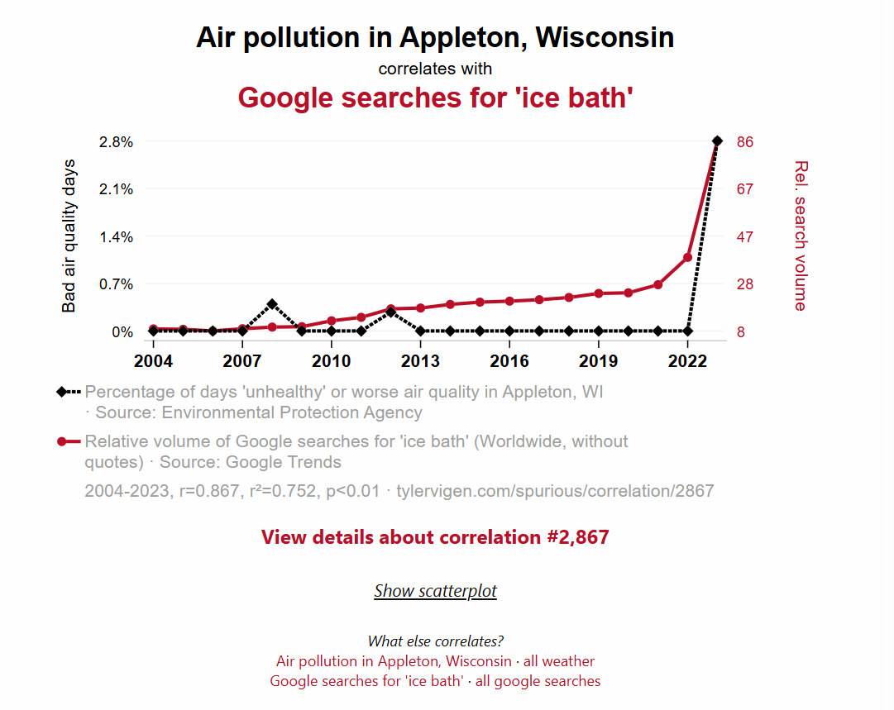

## Checklist

-- Homework-1 released week-4

-- Exam-1 (9/24)

-- Statistics Experience coming Thursday!

      > Interest based assessment 
      > Extra credit opportunity 
      > due on the last day of class
      
## Warm Up



Why can't we say that the air pollution in Appleton Wisconsin causes more Google searches for ice bath?

When can we establish a causal relationship?

## Confounding Variables 
      
Random assignment allows us to isolate the effect of the treatment by balancing other factors across groups, making the observed difference in outcomes a causal effect rather than a correlation.

## Last time 

"If 49 people are randomly assigned to a group, the 50th person has a 100% chance of being assigned to their group" 

-- The last assignment is not random conditional on the first 49 assignments

-- In random assignment, each participant has an equal probability of being assigned to each group before the randomization is carried out

# Questions

# Abuse of Tests

## Abuse of Tests 

-- Choosing and abusing $\alpha$

-- Practical importance vs statistically significant (p-hacking)

-- When not to use statistical inference

## alpha 

Remind me, what is $\alpha$ when we conduct a hypothesis test? 

## alpha 

Type I error rate - probility of rejecting the null hypothesis when the null hypothesis is true 

One reason for the common use of $\alpha = 0.05$ is the great influence of Sir R. A. Fisher, the inventor of formal statistical methods for analyzing experimental data. Here is his opinion on choosing a level of significance: 

“A scientific fact should be regarded as experimentally established only if a properly designed experiment rarely fails to give this level of significance.”


## alpha 

Recently, certain scientific communities, which have historically used $\alpha = 0.05$, have proposed lowering the threshold to $\alpha = 0.05$ to $\alpha = 0.005$. This is in response to the lack of reproducibility of study results. By lowering the threshold, it is argued that an initial discovery has a greater chance of being confirmed in follow-up studies.

## Fixed level testing 

Suppose that the test statistic for a two-sided significance test for a population mean is t = 1.85, with an assocciated p-value of 0.0512. 

What is our decision?

What is our conclusion?

How do we feel about it?

## p-value 

So what do we do?

There is no sharp border between “significant” and “not significant”; there is only increasingly strong evidence as the P-value decreases. Including the P-value with a description of the detected effect allows for a much clearer conclusion. 

Note: I still may ask you to write fixed level testing decisions and conclusions in class (because it is common in practice), but I want us to be very confident in reporting the interpretation of the p-value (less ambigious evidence statement)

## Abuse of alpha 

My colleagues and I recruited actual human subjects in Germany. We ran an actual clinical trial, with subjects randomly assigned to different diet regimes. And the statistically significant benefits of chocolate that we reported are based on the actual data.

[I Fooled Millions Into Thinking Chocolate Helps Weight Loss. Here’s How.](https://gizmodo.com/i-fooled-millions-into-thinking-chocolate-helps-weight-1707251800)

## Abuse of alpha

*Here’s a dirty little science secret: If you measure a large number of things about a small number of people, you are almost guaranteed to get a “statistically significant” result. Our study included 18 different measurements—weight, cholesterol, sodium, blood protein levels, sleep quality, well-being, etc.—from 15 people. (One subject was dropped.) That study design is a recipe for false positives.*

$1 - (1 - \alpha)^m$

We will learn how to correct for this when we learn ANOVA!

# Questions 

## Scenario{.smaller}

A company wants to determine whether a new employee-training program increases productivity. They randomly assign employees to either the old training or the new training. The company has 1,000 employees. Please see the results below.

$$
H_0:\mu=100; H_A:\mu\neq100
$$

$$
n=1{,}000
$$

$$
\bar{x}=100.04
$$

$$
s=10
$$

$$
t=\frac{\bar{x}-\mu_0}{s/\sqrt{n}}
$$


$$
t=\frac{0.04}{0.3162}\approx0.1265; p\text{-value}\approx0.899
$$

What do we make of this?


## Scenario{.smaller}

A company wants to determine whether a new employee-training program increases productivity. They randomly assign employees to either the old training or the new training. The company has 1,000,000 employees. Please see the results below. 

$$
H_0:\mu=100; H_A: \mu \neq 100
$$

$$
n=1{,}000{,}000
$$

$$
\bar{x}=100.04
$$

$$
s=10
$$

$$
t=\frac{\bar{x}-\mu_0}{s/\sqrt{n}}
$$

$$
t=\frac{0.04}{0.01} = 4; p-value<0.001
$$

What do we make of this?

## Practical significance vs statistical significance 

Practical significance - Whether the size of an effect is large enough to matter in the real world.

Statistical significance - Whether the observed effect is unlikely to have occurred by random chance, based on a chosen significance level (such as $\alpha=0.05)$

# Questions 

## When not to use statistical inference

When should we not use statistical inference?

What could we use instead?

## When not to use statistical inference 

-- A good model / test does not fix "bad" data (bias)

-- You cannot legitimately test a hypothesis on the same data that first suggested that hypothesisis (leading)

[Graphs](https://r-graph-gallery.com/)

"Association" 

# Questions 

# Inference 

## Context{.smaller} 

A teacher wants to know whether using a new study app causes students to be more likely to pass an exam.

The teacher has 100 students who agree to participate. She randomly assigns:

| Group        | Passed | Total |
| ------------ | -----: | ----: |
| Study App    |     42 |    50 |
| No Study App |     34 |    50 |

After two weeks, everyone takes the same exam. You may assume each student is independence of each other. 

-- How many variables are we working with? 

-- What are they? 

## Explanatory Vs Resposne 

What's the difference? 

## Start from the beginning 

Random variable - 

## Random Variable 

Random variable - A random variable is a variable that assigns a numerical value to each possible outcome of a random process.

So what is the random variable in this scenario? 

## Random Variable{.smaller} 

$$
X_1 =
\begin{cases}
1 & \text{if a randomly selected student using the study app passes} \\
0 & \text{if a randomly selected student using the study app does not pass}
\end{cases}
$$

$$
X_2 =
\begin{cases}
1 & \text{if a randomly selected student not using the study app passes} \\
0 & \text{if a randomly selected student not using the study app does not pass}
\end{cases}
$$

Are these normal random variables? 

## Non-normal

Does this look normal to you?

```{r}
#| echo: false

library(ggplot2)

data <- data.frame(
  x = c(0, 1),
  probability = c(0.16, 0.84)
)

ggplot(data, aes(x = factor(x), y = probability)) +
  geom_col(fill = "steelblue") +
  labs(
    title = "Hypothetical Population Distribution",
    x = expression(X[1]),
    y = "Probability"
  ) +
  scale_y_continuous(
    limits = c(0, 1),
    labels = scales::percent
  ) +
  theme_minimal()
```


## Bernoulli 

To be a Bernoulli random variable, the following needs to hold: 

-- One trial: we're considering one randomly selected student.

-- Two possible outcomes: pass or fail.

-- The outcomes are coded as 1 and 0.

-- There is a fixed probability of success (p)

## Context{.smaller} 

A teacher wants to know whether using a new study app causes students to be more likely to pass an exam.

The teacher has 100 students who agree to participate. She randomly assigns:

| Group        | Passed | Total |
| ------------ | -----: | ----: |
| Study App    |     42 |    50 |
| No Study App |     34 |    50 |

-- What is $\hat{p_1}$

-- What is $\hat{p_2}$

-- What is $H_o$

-- What is $H_a$

## Z-test{.smaller} 

One of the assumptions of our z-test is that our distribution is normally approximated. 

But we know that the population looks (something) like this for each of our random variables....

What's going on here?


```{r}
#| echo: false

library(ggplot2)

data <- data.frame(
  x = c(0, 1),
  probability = c(0.16, 0.84)
)

ggplot(data, aes(x = factor(x), y = probability)) +
  geom_col(fill = "steelblue") +
  labs(
    title = "Hypothetical Population Distribution",
    x = expression(X[1]),
    y = "Probability"
  ) +
  scale_y_continuous(
    limits = c(0, 1),
    labels = scales::percent
  ) +
  theme_minimal()
```


## Central Limit Theorem 

[Let's learn about it](https://www.statcrunch.com/applets/type3&samplingdist)

## Central Limit Theorem 

Independence of observations

For quantitative data:

-- n > 30

For categorical data:

-- Success/Failure Condition (> 10)

## Checking assumptions 

Success/Failure 

-- How many successes would you expect to see under the assumption of your null hypothesis?

-- How many failures would you expect to see under the assumption of your null hypothesis?

## Checking assumptions 

$H_o$: $p_1 = p_2$

Without the jargon, this means that the groups don't matter! It doesn't matter if you were assigned to use the study app or not. 

If the groups don't matter, how many successes did we observe? How many failures? 

## Checking assumptions 

$p_{pooled}$ = $\hat{p}_{\text{pooled}} = \frac{\text{success}_1 + \text{success}_2}{n_1 + n_2}$


$$
\hat{p}_{\text{pooled}}
=
\frac{\text{success}_1+\text{success}_2}{n_1+n_2}
=
\frac{42+34}{50+50}
=
0.76
$$

## Checking assumptions 

$$
n_1\hat{p}_{\text{pooled}} = 50(0.76) = 38
$$
$$
n_1(1-\hat{p}_{\text{pooled}}) = 50(0.24) = 12 
$$
$$
n_2\hat{p}_{\text{pooled}} = 50(0.76) = 38 
$$

$$
n_2(1-\hat{p}_{\text{pooled}}) = 50(0.24) = 12
$$

$$
38,\ 12,\ 38,\ 12 \geq 10
$$


## Sampling Distribution 

```{r}
library(ggplot2)

# Null hypothesis: p1 = p2
p_pooled <- 0.76
n1 <- 50
n2 <- 50

# Standard error under H0
SE <- sqrt(p_pooled * (1 - p_pooled) * (1/n1 + 1/n2))

# Create values for the sampling distribution
x <- seq(-0.5, 0.5, length.out = 1000)

# Normal density under H0
data <- data.frame(
  x = x,
  density = dnorm(x, mean = 0, sd = SE)
)

ggplot(data, aes(x = x, y = density)) +
  geom_line(linewidth = 1.2, color = "steelblue") +
  geom_vline(xintercept = 0, linetype = "dashed") +
  labs(
    title = "Null Sampling Distribution of p̂₁ − p̂₂",
    subtitle = "Assuming the null hypothesis is true",
    y = "Density"
  ) +
  theme_minimal()
```

What's the spread of the distribution? 

## Standard Error{.smaller} 

$$
SE_{\hat{p}_1-\hat{p}_2}
=
\sqrt{
\hat{p}_{\text{pooled}}
(1-\hat{p}_{\text{pooled}})
\left(
\frac{1}{n_1}+\frac{1}{n_2}
\right)
}
$$

$$
SE_{\hat{p}_1-\hat{p}_2}
=
\sqrt{
(0.76)(0.24)
\left(
\frac{1}{50}+\frac{1}{50}
\right)
}
$$

$$
SE_{\hat{p}_1-\hat{p}_2}
=
\sqrt{0.007296}
\approx 0.0854
$$

## Sampling Distribution 

```{r}
library(ggplot2)

# Null hypothesis: p1 = p2
p_pooled <- 0.76
n1 <- 50
n2 <- 50

# Standard error under H0
SE <- sqrt(p_pooled * (1 - p_pooled) * (1/n1 + 1/n2))

# Create values for the sampling distribution
x <- seq(-0.5, 0.5, length.out = 1000)

# Normal density under H0
data <- data.frame(
  x = x,
  density = dnorm(x, mean = 0, sd = SE)
)

ggplot(data, aes(x = x, y = density)) +
  geom_line(linewidth = 1.2, color = "steelblue") +
  geom_vline(xintercept = 0, linetype = "dashed") +
  labs(
    title = "Null Sampling Distribution of p̂₁ − p̂₂",
    subtitle = "Assuming the null hypothesis is true",
    y = "Density"
  ) +
  theme_minimal()
```

Centered at 0, with a standard error of $\approx 0.0854$

## Hypothesis Test 

And we could conduct the hypothesis test here! 

BUT 

We tend to standardize so we can to: 

-- Compare against other studies 

-- Nice z-statistic interpretation 

So let's do it! 

## z-statistic 

How do we standardize our statistic? 

## z-statistic 

$$
z =
\frac{\text{observed statistic} - \text{null value}}
{\text{standard error}}
$$
... and we know these things!

## z-statistic 

$$
z =
\frac{
\hat{p}_1-\hat{p}_2 - (p_{1o} - p_{2o})
}{
\sqrt{
\hat{p}_{\text{pooled}}
(1-\hat{p}_{\text{pooled}})
\left(
\frac{1}{n_1}+\frac{1}{n_2}
\right)
}
}
$$

## z-statistic 

$$
z =
\frac{
(0.84-0.68)-0
}{
\sqrt{
(0.76)(0.24)
\left(
\frac{1}{50}+\frac{1}{50}
\right)
}
}
= \approx 1.87
$$

## Hypothesis Test

For this, assume that $\alpha = 0.05$


Draw how the p-value is calculated

## Hypothesis Test

```{r}
#| echo: false
library(ggplot2)

# Create standard normal distribution
data <- data.frame(
  z = seq(-4, 4, length.out = 1000)
)

data$y <- dnorm(data$z)

# Data for the shaded p-value region
shade <- subset(data, z >= 1.87)

ggplot(data, aes(x = z, y = y)) +
  geom_line(linewidth = 1.2, color = "black") +
  
  # Shade the p-value
  geom_area(
    data = shade,
    aes(x = z, y = y),
    fill = "steelblue",
    alpha = 0.6
  ) +
  
  # Mark z = 1.87
  geom_vline(
    xintercept = 1.87,
    linetype = "dashed",
    color = "red",
    linewidth = 1
  ) +
  
  # Label
  annotate(
    "text",
    x = 2.35,
    y = 0.08,
    label = "p-value",
    color = "steelblue",
    size = 5
  ) +
  
  annotate(
    "text",
    x = 1.87,
    y = 0.42,
    label = "z = 1.87",
    color = "red",
    size = 5
  ) +
  
  labs(
    title = "Standard Normal Distribution",
    subtitle = "Right-tailed test",
    x = "z",
    y = "Density"
  ) +
  
  theme_minimal()
```

## p-value 

Before clicking that button, guess what the p-value is going to be!

```{webr-r}
pnorm(1.87, 0, 1, lower.tail = FALSE)
```

## p-value 

-- Decision

-- Conclusion 

-- Interpretation 

# Questions 

## Practice 

A school claims that at least 60% of its students recycle regularly. A student group wants to test whether the true proportion is actually less than 60%.

They randomly survey 100 students and find that 53 students say they recycle regularly.

$Ho:$

$Ha:$

## Practice 

A company wants to determine whether a new website design changes the proportion of visitors who make a purchase.

The company randomly assigns 1,000 website visitors to one of two website designs. 500 visitors see the new design, and 500 visitors see the old design. Of the visitors who saw the new design, 75 made a purchase. Of the visitors who saw the old design, 60 made a purchase.

$Ho:$

$Ha:$


## Practice{.smaller} 

A delivery company wants to determine whether a new routing system changes the average delivery time for its drivers.

The company randomly assigns 60 delivery routes to one of two routing systems. 30 routes use the new routing system, and 30 routes use the current routing system. After completing the routes, the average delivery time for routes using the new system is 28.4 minutes, while the average delivery time for routes using the current system is 31.7 minutes.

$Ho:$

$Ha:$

# See you Thursday!


