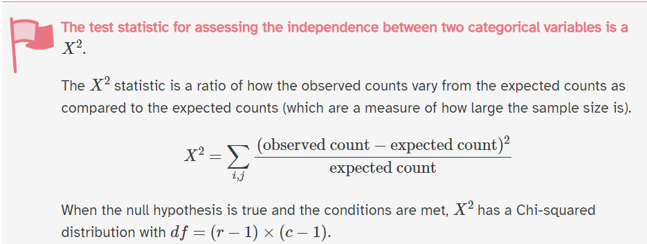
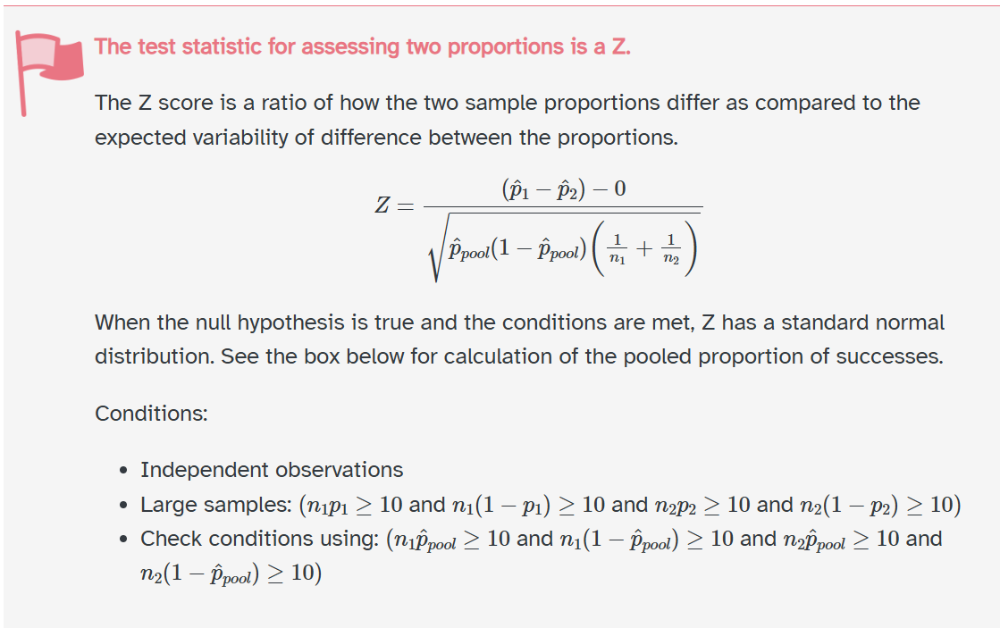

## Checklist

-- Homework-2 is LIVE and due on Friday (10-16) at 11:59pm 

      > 24-hour late window
      > Please start early

-- Homework-1 is graded

    > Solutions are on Moodle 
    > Regrade window until Friday 10-9 at 5:00pm
    
-- Don't forget about the Statistics Experience (12-1)

-- Exam-2 is on 10-29

-- Exam-1 will be released by end of next week 

## Warm-up 

We know the terms Type-I error, Type-II error, and Power. 

In practice, why is a power analysis useful? What can it help us decide as a researcher? 

## Warm-up 

How is a chi-square test different than a test for difference in proportions?

## Last Time{.smaller}

Suppose that we want to look at the relationship between sex and species. That is, we want to test if species of penguin is independent from sex. How is this different than what we've done before?

```{r}
#| echo: false

library(palmerpenguins)
library(tidyverse)

penguins <- na.omit(penguins)

penguins |>
  group_by(species, sex) |>
  summarise(count = n())
```

## Null and alternative hypothesis

$Ho: \text{sex and species of penguins are independent at the population level}$

$Ha: \text{sex and species of penguins are not independent at the population level}$

## Assumptions 

What are they?

## Assumptions

-- Expected counts > 5

-- Independence

## Observed vs Expected

Expected values are in ( )

|           | Male        | Female      | Total |
|-----------|-------------|-------------|-------|
| Adelie    | 73 (73.658) | 73 (72.342) | 146   |
| Chinstrap | 34 (34.306) | 34 (33.694) | 68    |
| Gentoo    | 61 (60.036) | 58 (58.964) | 119   |
| Total     | 168         | 165         | 333   |

What is the fundemental idea behind a chi-square test?

## 

{fig-align="center"}

## Calculating a p-value

You can use an [applet](https://www.stapplet.com/x2dist.html). You can use software. 

```{webr-r}
chisq.test(table(penguins$species, penguins$sex))
```

## chi-square connection{.smaller} 

Chi-square is an extension of difference in proportions test... but we can analyze 2 categorical variables with binary levels using a chi-square test!

**Recall: two categorical case**

Time magazine reported the result of a telephone poll of 800 adult Americans. The question posed of the Americans who were surveyed was: "Should the federal tax on cigarettes be raised to pay for health care reform?" For this example assume that these 800 adult Americans were taken as a random sample. We are interested in if there is a difference of opinion between non-smokers and smokers on this issue. Of the 800 Americans, 605 of them were non-smokers. 351 of the 605 answered "yes" to this question. Of the smokers, 41 said "yes" to this question. For this question, use the order of subtraction non-smoker - smoker.

## Difference in proportions 

Variables: Do you smoke vs response to the tax question 

$n_s = 195; \hat{p_s} = \frac{41}{195}$

$n_n = 195; \hat{p_n} = \frac{351}{605}$

$.58 - .21 = .37$

## Null and alternative 

$H_o: \pi_n - \pi_s = 0$ 

$H_a: \pi_n - \pi_s \neq 0$

## z-test

Calculate our z-statistic!



## Our-statistic 

$Z = \frac{\frac{351}{605} - \frac{41}{195} - 0}{\sqrt{(.49*.51) * \left(\frac{1}{605} + \frac{1}{195}\right)}} = 8.9859$


What is our p-value going to be?

## p-value 

```{webr-4}
pnorm(8.9859, 0 , 1 , lower.tail = FALSE) * 2
```


# chi-square test 

```{r}
#| echo: false
library(tibble)
library(tidyr) # Need tidyr for the uncount() function
library(infer)

# 1. Define the data in the aggregate count format
data_aggregate <- tibble(
  working = c("Non-Smoker", "Non-Smoker", "Smoker", "Smoker"),
  outcome = c("yes", "no", "yes", "no"),
  count = c(
    351,  # Non-Smoker, yes
    254,  # Non-Smoker, no
    41,   # Smoker, yes
    154   # Smoker, no
  )
)

# 2. Transform to the TRUE Long Format (one row per person)
data_true_long <- data_aggregate %>%
  uncount(count) |>
  mutate(working = factor(working),
         outcome = factor(outcome))# This replicates each row by the value in the 'count' column

# Print the first few rows (head) of the result
# head(data_true_long)
# Print the dimensions to confirm 800 total rows
# dim(data_true_long)

chisq.test(data_true_long$working, data_true_long$outcome, correct = FALSE)
```

Do we get the same decision and conclusion? 

There is something similar about these two tests...

## Under the hood

The Chi-Square test statistic $\chi^2$ is mathematically based on the normal distribution (specifically, the Chi-Square distribution is the sum of squared standardized independent normal variables): $Z_1^2 + \cdots + Z_k^2 \sim \chi_k^2$

$Z_1^2 = \chi_1^2$ ? 

## Yes! 

```{r}
8.9859^2
```

## Under the hood

The Chi-Square test statistic $\chi^2$ is mathematically based on the normal distribution (specifically, the Chi-Square distribution is the sum of squared standardized **independent** normal variables): $Z_1^2 + \cdots + Z_k^2 \sim \chi_k^2$

## Under the hood

The Chi-Square test statistic $\chi^2$ is mathematically based on the normal distribution (specifically, the Chi-Square distribution is the sum of squared standardized **INDEPENDENT** normal variables): $Z_1^2 + \cdots + Z_k^2 \sim \chi_k^2$
      
## Penguins 

| Comparison         |      Z |
| ------------------ | ---------: |
| Adelie − Chinstrap | ~ 0.0000 |
| Adelie − Gentoo    | ~ 0.2041 |
| Chinstrap − Gentoo | ~ 0.1659 |

$0^2 + 0.2041^2 + 0.1659^2 \approx 0.0692$

## Penguins 

$0^2 + 0.2041^2 + 0.1659^2 \approx 0.0692$

vs

$\chi^2 = 0.048607$

Explain why this didn't work. Unpack the word independent.


## Not independent

The three pairwise $Z$-statistics are not independent because the comparisons reuse the same observations. For example, the Adelie--Chinstrap comparison and the Adelie--Gentoo comparison both use the same Adelie observations. Therefore, the outcomes of these tests are related.

## Under the hood 

$Z_1^2 + \cdots + Z_k^2 \sim \chi_k^2$

[The math](https://rinterested.github.io/statistics/chi_square_same_as_z_test.html)

# Questions 

## New Example 

You suspect a six-sided die is loaded (is an unfair die). You decide to roll it 60 times and record the outcome of each roll to investigate.

What's my variable? 

How is this a difference scenario vs chi-square Goodness test of independence?

## New Example 

-- Only one variable 

-- Multiple levels 

## Big picture 

For this test, we compare: 

-- Observed data

-- What we would expect under some hypothetical distribution 

This is called a Chi-square goodness of fit test

## Dice example 

What would the hypothesized distribution for the die?

Draw it out. 

If we were to roll the dice 60 times, how many 3s would you expect? How many 4s?

## Null and alternative 

$Ho:$

$Ha:$

## Null and alternative 

$Ho:$ The die is fair. The observed frequencies follow the uniform theoretical distribution (i.e., all six sides have an equal probability of 1/6).

$Ha:$ The die is not fair. The observed frequencies do not follow the uniform distribution.

What do we do next?

## Assumptions 

## Assumptions 

-- Independence 

-- Expected counts > 5

## Data

```{r}
#| echo: false
# 1. Observed Counts (O) from the experiment
observed_counts <- c(8, 12, 7, 15, 11, 7)

# 2. Hypothesized (Expected) Proportions (p) for a fair die (1/6)
expected_proportions <- rep(1/6, 6) # Creates a vector of six 1/6 values

# 3. Expected Counts (E) for n=60 rolls
n_total <- 60
expected_counts <- n_total * expected_proportions # Should all be 10

# 4. Create a clean data frame for review
die_roll_data <- data.frame(
  Side = 1:6,
  Observed = observed_counts,
  Expected = expected_counts,
  Hypothesized_P = expected_proportions
)

die_roll_data
```

How do we calculate our chi-squared statistic? 

## Results 

```{r}
#| echo: false
chisq.test(x = observed_counts, p = expected_proportions)
```

where we now just have k-1 degrees of freedom

## Talk about it

-- Decision 

-- Conclusion 

-- Interpretation 

## Degrees of freedom 

Think of degrees of freedom as how many cell counts can vary independently.

-- Goodness of Fit 

-- Test of Independence 

## Degrees of freedom{.smaller} 

|           |  Male | Female | Total |
| --------- | ----: | -----: | ----: |
| Adelie    |     ? |      ? | fixed |
| Chinstrap |     ? |      ? | fixed |
| Gentoo    |     ? |      ? | fixed |
| Total     | fixed |  fixed | fixed |

Once the row totals and column totals are fixed, only 2 cells can vary freely. The rest are determined.

Once we choose the first 2 cells (for example, Adelie-Male and Chinstrap-Male), all 4 remaining cells are forced.

## Degrees of freedom 

Goodness of fit - you only have 1 categorical variable with k-levels.

The $-1$ occurs because the category counts must add up to the fixed total. If you know $k-1$ counts, the last one is determined.

## Degrees of freedom 

```{r}
#| echo: false
# 1. Observed Counts (O) from the experiment
observed_counts <- c(8, 12, 7, 15, 11, 7)

# 2. Hypothesized (Expected) Proportions (p) for a fair die (1/6)
expected_proportions <- rep(1/6, 6) # Creates a vector of six 1/6 values

# 3. Expected Counts (E) for n=60 rolls
n_total <- 60
expected_counts <- n_total * expected_proportions # Should all be 10

# 4. Create a clean data frame for review
die_roll_data <- data.frame(
  Side = 1:6,
  Observed = observed_counts
)

die_roll_data
```


## Extension 

It doesn't have to be uniform. You can specifiy the distribution (what you would expect), and perform the test!

## Extension 

Suppose a population is expected to have the following blood-type distribution:

| Blood type | Expected proportion |
| ---------- | ------------------: |
| A          |                 40% |
| B          |                 10% |
| AB         |                  5% |
| O          |                 45% |

In a random sample of 200, what are the expected counts?


## Extension 

$H_0: (p_A,p_B,p_{AB},p_O)=(0.40,0.10,0.05,0.45)$

$H_A:$ The population distribution differs from $(0.40,0.10,0.05,0.45)$

## Takeaway 

Goodness-of-fit does not mean "are the categories equally common?"

It means does the observed distribution fit a specified categorical distribution?

# Questions?

## New Example (if time)

Results from an experiment to compare yields (as measured by dried weight of plants) obtained under a control and two different treatment conditions.

```{r}
library(tidyverse)
tibble(PlantGrowth) |>
  group_by(group) |>
  summarize(count = n(),
            mean = mean(weight))
```

What are the variables? How can we answer this question? What scenario?

## Extension 

ANOVA is an extension from difference in means, where the test statistic is the variability within group vs the variability across groups. 

## Example 

```{r}
#| echo: false
# 1. Load necessary libraries
library(tidyverse)

# --- Data Generation ---

# Set parameters for the simulation
set.seed(42) # For reproducibility
N <- 50      # Sample size per group
std_dev <- 2 # Low variability within groups

# Generate data for three groups (High variability across means)
data_a <- rnorm(N, mean = 10, sd = std_dev)
data_b <- rnorm(N, mean = 25, sd = std_dev)
data_c <- rnorm(N, mean = 40, sd = std_dev)

# 2. Structure data in long format (tidy data)
df_variability <- tibble(
  Group = factor(c(rep("A (Mean=10)", N),
                   rep("B (Mean=25)", N),
                   rep("C (Mean=40)", N))),
  Value = c(data_a, data_b, data_c)
)

# 3. Create the side-by-side boxplots using ggplot2
ggplot(df_variability, aes(x = Group, y = Value, fill = Group)) +
  geom_boxplot(width = 0.5) + # Add the boxplots
  labs(
    title = "Boxplots Demonstrating High Between-Group and Low Within-Group Variability",
    x = "Group",
    y = "Value (Units)"
  ) +
  scale_fill_viridis_d() + # Use a pleasant color palette
  theme_minimal() + # Use a clean theme
  theme(
    plot.title = element_text(hjust = 0.5), # Center the title
    legend.position = "none" # Hide the legend as Group is on the x-axis
  )
```

##

```{r}
# 1. Load necessary libraries
library(tidyverse)

# --- Data Generation ---

# Set parameters for the simulation
set.seed(100) # Set a new seed for a different visualization
N <- 50       # Sample size per group
std_dev <- 8  # HIGH variability within groups

# Generate data with LOW separation (low between-group variability)
data_a <- rnorm(N, mean = 28, sd = std_dev) # Mean 28
data_b <- rnorm(N, mean = 30, sd = std_dev) # Mean 30
data_c <- rnorm(N, mean = 32, sd = std_dev) # Mean 32

# 2. Structure data in long format
df_variability <- tibble(
  Group = factor(c(rep("A (Mean=28)", N),
                   rep("B (Mean=30)", N),
                   rep("C (Mean=32)", N))),
  Value = c(data_a, data_b, data_c)
)

# 3. Create the side-by-side boxplots using ggplot2
ggplot(df_variability, aes(x = Group, y = Value, fill = Group)) +
  geom_boxplot(width = 0.5) + # Add the boxplots
  labs(
    title = "Boxplots Demonstrating High Within-Group and Low Across-Group Variability",
    subtitle = "The variation within each group masks any difference between the groups.",
    x = "Group",
    y = "Value (Units)"
  ) +
  scale_fill_brewer(palette = "Set1") + # Use a contrasting color palette
  theme_minimal() +
  theme(
    plot.title = element_text(hjust = 0.5),
    legend.position = "none"
  )
```

# Questions?

# See you Thursday!