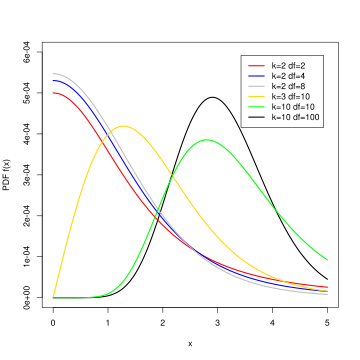

## Checklist

-- Homework-2 is LIVE and due on Friday (10-16) at 11:59pm 

      > 24-hour late window
      > Please start early
    
-- Don't forget about the Statistics Experience (12-1)

-- Exam-2 is on 10-29

-- Please see the exam-1 moodle announcement if you haven't!

## Warm-up 

What is the difference between the scenarios: 

-- Difference in means 

-- Difference in proportions 

-- One-way ANOVA

... using the terms variables; levels; explanatory; response

## Warm-up 

## Warm-up

ANOVA big picture: Using the term variability, explain why you believe these group means are different than each other.

```{r}
#| echo: false
# 1. Load necessary libraries
library(tidyverse)

# --- Data Generation ---

# Set parameters for the simulation
set.seed(42) # For reproducibility
N <- 50      # Sample size per group
std_dev <- 2 # Low variability within groups

# Generate data for three groups (High variability across means)
data_a <- rnorm(N, mean = 10, sd = std_dev)
data_b <- rnorm(N, mean = 25, sd = std_dev)
data_c <- rnorm(N, mean = 40, sd = std_dev)

# 2. Structure data in long format (tidy data)
df_variability <- tibble(
  Group = factor(c(rep("A (Mean=10)", N),
                   rep("B (Mean=25)", N),
                   rep("C (Mean=40)", N))),
  Value = c(data_a, data_b, data_c)
)

# 3. Create the side-by-side boxplots using ggplot2
ggplot(df_variability, aes(x = Group, y = Value, fill = Group)) +
  geom_boxplot(width = 0.5) + # Add the boxplots
  labs(
    title = "Boxplots Demonstrating High Between-Group and Low Within-Group Variability",
    x = "Group",
    y = "Value (Units)"
  ) +
  scale_fill_viridis_d() + # Use a pleasant color palette
  theme_minimal() + # Use a clean theme
  theme(
    plot.title = element_text(hjust = 0.5), # Center the title
    legend.position = "none" # Hide the legend as Group is on the x-axis
  )
```

# Questions 

# Last Time 

## Plants{.smaller} 

Results from an experiment to compare yields (as measured by dried weight of plants) obtained under a control and two different treatment conditions. We are interested in seeing if the dried weight of plants is different across the three yields. 

Results from an experiment to compare yields (as measured by dried weight of plants) obtained under a control and two different treatment conditions.

```{r}
library(tidyverse)
tibble(PlantGrowth) |>
  group_by(group) |>
  summarize(count = n(),
            mean = mean(weight))
```

## Assumptions

-- Independence

-- Normality (not just going to look at sample size)

-- Equal Variance

## Normal Q-Q plot 

```{r}
#| echo: false
# 1. Load necessary libraries
library(ggplot2)
library(dplyr)
library(tidyr)
library(qqplotr) # A specialized package for ggplot2 Q-Q plots

# The PlantGrowth dataset is built-in, so no need to load data manually.

# 2. Convert 'group' to a factor (it already is, but good practice)
PlantGrowth$group <- factor(PlantGrowth$group)

library(tidyverse)

qq_data <- PlantGrowth %>%
  group_by(group) %>%
  arrange(weight, .by_group = TRUE) %>%
  mutate(
    rank = row_number(),
    theoretical = qnorm((rank - 0.5) / n())
  ) %>%
  ungroup()

# Calculate a separate reference line for each group
line_data <- qq_data %>%
  group_by(group) %>%
  summarise(
    intercept = mean(weight) - sd(weight) * 0,
    slope = sd(weight),
    x_min = min(theoretical),
    x_max = max(theoretical),
    .groups = "drop"
  ) %>%
  mutate(
    y_min = intercept + slope * x_min,
    y_max = intercept + slope * x_max
  )

ggplot(qq_data, aes(x = theoretical, y = weight, color = group)) +
  geom_point(size = 2) +
  geom_segment(
    data = line_data,
    aes(
      x = x_min, y = y_min,
      xend = x_max, yend = y_max,
      color = group
    ),
    linetype = "dashed",
    inherit.aes = FALSE
  ) +
  facet_wrap(~ group, ncol = 3) +
  labs(
    title = "Normal Q-Q Plot for PlantGrowth Data by Group",
    x = "Theoretical Quantiles",
    y = "Sample Quantiles"
  ) +
  theme_bw() +
  theme(legend.position = "none")

```


-- What are Sample Quantiles?

-- What are Theoretical Quantiles?

-- What are we looking for?

## Summary 

Your qq-plots can take on many different shapes. There is not right/wrong cut-off. It's up to you to make a justifiable call

--    Right-skewed: The upper tail extends farther above the reference line than expected under normality.

--    Left-skewed: The lower tail extends farther below the reference line than expected under normality.

## Equal Variance 

```{r}
model <- aov(weight ~ group, data = PlantGrowth)

plot(
  fitted(model),
  residuals(model),
  xlab = "Fitted Values",
  ylab = "Residuals",
  main = "Residuals vs. Fitted Values"
)
abline(h = 0, lty = 2)
```

What's a residual? 

What's a fitted value?

What are we looking for?

## Summary{.smaller} 

A residual is the difference between an observed value and its predicted/fitted value: $e_i = y_i - \hat_i$.

In a one-way ANOVA, a fitted value is the predicted response for an observation, calculated as the sample mean of the group that observation belongs to: $\hat_ = \bar_j$.

"If you are a plant in group 1, I'd predict your weight to be $\bar{x_1}$."

## New statistic

$F = \frac{\text{MS}_{\text{Between}}}{\text{MS}_{\text{Within}}}$

$\mathbf{F} = \frac{\frac{\text{SS}_{\text{Between}}}{k - 1}}{\frac{\text{SS}_{\text{Within}}}{N - k}}$

$\text{SS}_{\text{Between}} = \sum_{i=1}^{k} n_i (\bar{X}_i - \bar{X}_{\text{grand}})^2$

$\text{SS}_{\text{Within}} = \sum_{i=1}^{k} \sum_{j=1}^{n_i} (X_{ij} - \bar{X}_i)^2$

## Draw it out

What would this look like?

That is, draw out how each SS would be calculated.

## Plants

```{r}
#| echo: false
set.seed(123)
a <- PlantGrowth |>
  group_by(group) |>
  summarize(mean = mean(weight))

PlantGrowth |>
  ggplot(
    aes(x = group, y = weight)) +
  geom_jitter(width = .1) + 
  facet_wrap(~ group) +
  geom_hline(yintercept = 5.073, color = "red" , lwd = 1) +     
  geom_hline(data = a, aes(yintercept = mean), color = "blue", linetype = "solid") + 
  labs(title = "Anova example", 
       subtitle = "Red line is overall mean; blue lines are group means")

```

## Anova

```{r}
#| echo: false

anova_model <- aov(weight ~ group, data = PlantGrowth)

summary(anova_model)
```

## F-distribution

[applet](https://www.stapplet.com/fdist.html)

A continuous, positively skewed probability distribution, characterized
by two degrees of freedom (numerator and denominator) that determine its
shape.

## Anova

Where did all of this come from?

The goal is not for you to be able to calculate these values by hand
(besides Df). The goal is for you to understand the relationships
between the values of the Anova table.

```{r}
#| echo: false

anova_model <- aov(weight ~ group, data = PlantGrowth)

summary(anova_model)
```

## Definitions {.smaller}

Degrees of Freedom (df) is the number of independent pieces of
information used to calculate the statistic

The Sum of Squares (SS) is a measure of total variability (between or
within)

The Mean Squares (MS) is an estimate ($s^2$) of the population variance
($\sigma^2$)

It's a generalized form of $s^2 = \frac{\sum(x_i - \bar{x})^2}{n-1}$

## Anova table

Where did we get df = 2 for between? Where did we get df = 27 for
within?

```{r}
#| echo: false

PlantGrowth |>
  group_by(group) |>
  summarise(n = n())
```

## degrees of freedom 

When we estimate the population (grand) mean, there are k-1 independent pieces of information 

When we estimate the population means within each group, there are n - k independent pieces of information


## Anova: MS {.smaller}

The Mean Squares (MS) is an estimate ($s^2$) of the population variance
($\sigma^2$)

It's a generalized form of $s^2 = \frac{\sum(x_i - \bar{x})^2}{n-1}$

In Anova, it's calculated by taking $\frac{SS}{df}$

```{r}
#| echo: false

anova_model <- aov(weight ~ group, data = PlantGrowth)

summary(anova_model)
```

## Anova: F-statistic

The whole goal of Anova is to compare the variability between groups vs
the variability within groups. How can we calculate our F-statistic?

```{r}
#| echo: false

anova_model <- aov(weight ~ group, data = PlantGrowth)

summary(anova_model)
```

## Decision and conclusions

What are they? At the $\alpha$ = 0.05 level.

## 

So what's actually different?

## Tukeys HSD

The main idea of the hsd is to compute the honestly significant
difference (hsd) between all pairwise comparisons

Why do we need to use this thing called Tukeys hsd? Why can't we just
conduct a bunch of individual hypothesis tests?

## Type 1 error

$\alpha$ is our significance level. It's also our **Type 1 error rate**.

a Type 1 error is:

-- rejecting the null hypothesis

-- when the null hypothesis is actually true

## Family-wise error rate

FWER = $1 - (1-\alpha)^m$

where m is the number of comparisons

## Family-wise error rate

"k choose 2" = $\frac{k(k-1)}{2}$ (write this down)

```{r}
#| echo: false
# Load the ggplot2 library for plotting
library(ggplot2)

# Set the individual test significance level (alpha)
alpha <- 0.05

# Define the range of comparisons (m) from 1 to 10
m_values <- 1:10

# Calculate the Familywise Error Rate (FWER) for each m
# FWER = 1 - (1 - alpha)^m
fwer_values <- 1 - (1 - alpha)^m_values

# Create a data frame for plotting
plot_data <- data.frame(
  m = m_values,
  FWER = fwer_values
)

# Plot the FWER vs. the number of comparisons (m)
ggplot(plot_data, aes(x = m, y = FWER)) +
  
  # Add the line and points for the FWER
  geom_line(color = "blue", linewidth = 1) +
  geom_point(color = "darkblue", size = 3) +
  
  # Add a horizontal line at the nominal alpha level (0.05)
  geom_hline(yintercept = alpha, linetype = "dashed", color = "red") +
  
  # Add labels and title
  labs(
    title = expression(paste("Inflation of Familywise Error Rate (FWER) as m Increases (", alpha, " = 0.05)")),
    x = "Number of Comparisons (m)",
    y = "Familywise Error Rate (FWER)"
  ) +
  
  # Customize scales
  scale_x_continuous(breaks = m_values) +
  scale_y_continuous(breaks = seq(0, max(fwer_values) + 0.05, 0.05)) +
  
  # Apply a clean theme
  theme_minimal()
```


## Chocolate study

{fig-align="center"}

[Article](https://gizmodo.com/i-fooled-millions-into-thinking-chocolate-helps-weight-1707251800)

## Learning objectives

-- Why we use tukeysHSD 

-- What distribution we use to account for the inflated type-1 error rate 

-- How to read output

## Pairwise comparisons {.smaller}

Commonly report confidence intervals to **estimate** which means are
actually different (also reports p-values).

tukey's hsd (technically Tukey-Kramer with unequal sample size)

$\bar{x_1} - \bar{x_2} \pm \frac{q^*}{\sqrt{2}}* \sqrt{MSE*\frac{1}{n_j} + \frac{1}{n_j`}}$

Where

-- $q^*$ is a value from the studentized range distribution

-- (MSE) refers to the average of the squared differences between
individual data points within each group and their respective group mean, divided by the degrees of freedom. Also known as the estimated variance by pooling all the groups.

$$\text{MSE} = \frac{\sum_{i=1}^{k} (n_i - 1)s_i^2}{N - k}$$

## Pairwise comparisons {.smaller}

$q^*$ can be found using the `qtukey` function in R, or
[here](https://www.socscistatistics.com/pvalues/qcalculator.aspx)

Typically, we use pre-packaged functions/applets to do the above
calculations for us.

```{r}
qtukey(p = 0.95, nmeans = 3, df = 27)
```

## test-statsitic

$$Q = \frac{\bar{x}_i - \bar{x}_j}{\sqrt{\frac{MSE}{2} \left(\frac{1}{n_i} + \frac{1}{n_j}\right)}}$$

## Results {.smaller}

```{r}
anova_model <- aov(weight ~ group, data = PlantGrowth)

plant_tukey <- TukeyHSD(anova_model)

plant_tukey
```

## 

{fig-align="center"}

## Summary

Tukey's Honest Significant Difference (HSD) test is a post hoc test
commonly used to assess the significance of differences between pairs of group means. Tukey HSD is often a follow up to one-way ANOVA, when the F-test has revealed the existence of a significant difference between some of the tested groups.

This correction makes sure that our collective type-1 error rate is $\alpha$.

## Other corrections: Bonferonni 

Adjust $\alpha$: $\frac{\alpha}{m}$ 

This makes it harder to reject, and re-calibrates your hypothesis test for multiple comparisons! 

The $\alpha$ (ex. 0.05) is the collective type I error rate across all the tests combined (called the family-wise error rate), not the rate for each individual test.

## When to use which 

Bonferroni: Adjust the significance level or p-values to account for multiple hypothesis tests.

Tukey: Use a procedure specifically designed for comparing all pairs of means.

## Why{.smaller} 

-- Tukey’s HSD is generally more powerful (reject correctly) when testing every single pair of means.

-- Bonferroni is more conservative, especially as the number of comparisons grows large. Bonferroni haveis designed to have more power if you are only testing a tiny, select number of specific comparisons rather than all possible pairs

## Example{.smaller}

The uncorrected p-values can be seen below. Suppose we wanted to only look at the comparison of the control vs the other two treatments. A Bonferonni correction may be more appropriate! We would compare $\frac{\alpha}{2}$ to the two p-values below. 

```{r}
pairwise.t.test(
  PlantGrowth$weight,
  PlantGrowth$group,
  p.adjust.method = "none"
)
```


# Questions 

# Anova vs Post-Hoc 

## A conversation 

There is (some) debate on if Anova is necessary to perform before using tukeyHSD to find which means are different. 

## Anova first 

**Logistic guardrail** 

Applying a global test first is pretty solid protection against the risk of (even inadvertently) uncovering spurious "significant" results from post-hoc data snooping.

It is known that a global ANOVA F test can detect a difference of means even in cases where no individual test of any of the pairs of means will yield a significant result. In other words, in some cases the data can reveal that the true means likely differ but it cannot identify with sufficient confidence which pairs of means differ.

## Example{.smaller} 

```{r}
#| echo: false
set.seed(249);  group = rep(1:3, each=2); y = group + rnorm(6); mod = aov(y~factor(group)); summary(mod); TukeyHSD(mod)
```

# Questions?

# Enjoy Fall Break!