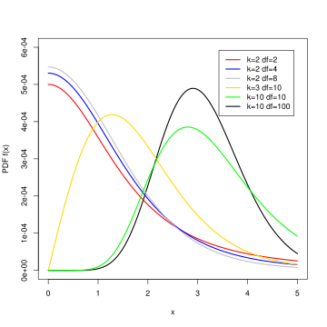

## Checklist{.smaller}

-- No homework-3 until after exam-2
    
-- Don't forget about the Statistics Experience (12-1)

-- Exam-2 is on 10-29

      > Cumulative with emphasis on unit-2
      > Closed notes, bring a calculator you know how to use
      
-- Vote on the review quiz via Moodle if you would like!

-- Question 2a regraded on all exams
      
## Warm up{.smaller} 

Last time: 

Results from an experiment to compare yields as measured by dried weight of plants) obtained under a control and two different treatment conditions. We are interested in seeing if the dried weight of plants is different across the three yields. 

Results from an experiment to compare yields (as measured by dried weight of plants) obtained under a control and two different treatment conditions.


```{r}
library(tidyverse)
tibble(PlantGrowth) |>
  group_by(group) |>
  summarize(count = n(),
            mean = mean(weight))
```

$Ho:$ 

$Ha:$ 

## F-test{.smaller} 

First, build your own definition to each of the following terms. Use the next slide for a hint:

-- Degrees of freedom: 

-- Sums of squares error (residuals): 

-- Sums of squares treatment (group):

-- Mean square error (residuals):

-- Mean square treatment (group): 

-- F-value: 

-- p-value:

## New statistic{.smaller}

$F = \frac{\text{MS}_{\text{Between}}}{\text{MS}_{\text{Within}}}$

$\mathbf{F} = \frac{\frac{\text{SS}_{\text{Between}}}{k - 1}}{\frac{\text{SS}_{\text{Within}}}{N - k}}$

$\text{SS}_{\text{Between}} = \sum_{i=1}^{k} n_i (\bar{X}_i - \bar{X}_{\text{grand}})^2$

We multiply by $n_i$ in the between-groups sum of squares because each group mean represents \(n_i\) observations, and we need to account for all of them.

$\text{SS}_{\text{Within}} = \sum_{i=1}^{k} \sum_{j=1}^{n_i} (X_{ij} - \bar{X}_i)^2$

ith - group

jth - observation

## F-test{.smaller} 

- Degrees of freedom: The number of independent pieces of information available to estimate variability (within and between).

- Sum of squares error (residuals): The sum of the squared differences between observed responses and the values predicted by the model.

- Sum of squares treatment (group): The sum of the squared differences between each group mean and the overall mean, weighted by the number of observations in each group. It measures variability explained by differences between groups.

## F-test{.smaller} 

- Mean square error (residuals): The sum of squares error divided by its degrees of freedom. It estimates the common variance of the errors.

- Mean square treatment (group): The sum of squares treatment divided by its degrees of freedom. It measures the variation among group means, accounting for the number of groups and observations.

- F-value: The ratio of the mean square treatment to the mean square error. It compares the variation between groups to the variation within groups.

Note: We use MSE to account for how much information was used to calculate the sums of squares

- p-value: Assuming the population group means are all equal, the probability of observing an F-value at least as large as the one calculated from the sample.

## anova table 

Next fill in the partial ANOVA table below in the context of the `plant` dataset.


|            | Df | Sum Sq | Mean Sq | F value | Pr(>F) |
|:-----------|:--:|:------:|:-------:|:-------:|:------:|
| group      | .  |   .     | 1.8832  |    .     | 0.0159 |
| Residuals  | . | 10.492 |     .    |         |        |

# Don't look!

## Anova

```{r}
#| echo: false

anova_model <- aov(weight ~ group, data = PlantGrowth)

summary(anova_model)
```

## F-distribution 

Talk to me about the F-distribution. What are some characteristics? 

## F-distribution

[applet](https://www.stapplet.com/fdist.html)

A continuous, positively skewed probability distribution, characterized
by two degrees of freedom (numerator and denominator) that determine its
shape.

## F-statistic{.smaller} 

And we calculate an F-statistic that "follows a F-distribution." This is what I mean...

The F-distribution describes the possible values of the F-statistic we COULD obtain from random samples, assuming the null hypothesis is true and the model assumptions hold.

Although we only collect one sample, probability theory (hard math) tells us what the distribution of F-statistics would look like across all possible random samples. This gives us a reference distribution against which we can compare our observed F-statistic.

# Questions

## Last time 

```{r}
#| echo: false

anova_model <- aov(weight ~ group, data = PlantGrowth)

summary(anova_model)
```

$Ho: \mu_t = \mu_1 = \mu_2$

$Ha:$ at least one population mean dried weight is different across the three groups

Decision at the $alpha = 0.05$ level? 

## 

So what's actually different?

## Tukeys HSD

The main idea of the hsd is to compute the honestly significant
difference (hsd) between all pairwise comparisons

Why do we need to use this thing called Tukeys hsd? Why can't we just
conduct a bunch of individual hypothesis tests?

## Type 1 error

$\alpha$ is our significance level. It's also our **Type 1 error rate**.

a Type 1 error is:

-- rejecting the null hypothesis

-- when the null hypothesis is actually true

## Family-wise error rate

FWER = $1 - (1-\alpha)^m$

where m is the number of comparisons

## Family-wise error rate

"k choose 2" = $\frac{k(k-1)}{2}$

```{r}
#| echo: false
# Load the ggplot2 library for plotting
library(ggplot2)

# Set the individual test significance level (alpha)
alpha <- 0.05

# Define the range of comparisons (m) from 1 to 10
m_values <- 1:10

# Calculate the Familywise Error Rate (FWER) for each m
# FWER = 1 - (1 - alpha)^m
fwer_values <- 1 - (1 - alpha)^m_values

# Create a data frame for plotting
plot_data <- data.frame(
  m = m_values,
  FWER = fwer_values
)

# Plot the FWER vs. the number of comparisons (m)
ggplot(plot_data, aes(x = m, y = FWER)) +
  
  # Add the line and points for the FWER
  geom_line(color = "blue", linewidth = 1) +
  geom_point(color = "darkblue", size = 3) +
  
  # Add a horizontal line at the nominal alpha level (0.05)
  geom_hline(yintercept = alpha, linetype = "dashed", color = "red") +
  
  # Add labels and title
  labs(
    title = expression(paste("Inflation of Familywise Error Rate (FWER) as m Increases (", alpha, " = 0.05)")),
    x = "Number of Comparisons (m)",
    y = "Familywise Error Rate (FWER)"
  ) +
  
  # Customize scales
  scale_x_continuous(breaks = m_values) +
  scale_y_continuous(breaks = seq(0, max(fwer_values) + 0.05, 0.05)) +
  
  # Apply a clean theme
  theme_minimal()
```


## Chocolate study

{fig-align="center"}

[Article](https://gizmodo.com/i-fooled-millions-into-thinking-chocolate-helps-weight-1707251800)

"Here’s a dirty little science secret...."

## Learning objectives

-- Why we use tukeysHSD 

-- What distribution we use to account for the inflated type-1 error rate 

-- How to read output

## Pairwise comparisons {.smaller}

Commonly report confidence intervals to **estimate** which means are
actually different (also reports p-values).

tukey's hsd (technically Tukey-Kramer with unequal sample size)

$\bar{x_1} - \bar{x_2} \pm \frac{q^*}{\sqrt{2}}* \sqrt{MSE*\frac{1}{n_j} + \frac{1}{n_j`}}$

Where

-- $q^*$ is a value from the studentized range distribution

-- (MSE) refers to the average of the squared differences between
individual data points within each group and their respective group mean, divided by the degrees of freedom. Also known as the estimated variance by pooling all the groups.

$$\text{MSE} = \frac{\sum_{i=1}^{k} (n_i - 1)s_i^2}{N - k}$$

## Pairwise comparisons {.smaller}

$q^*$ can be found using the `qtukey` function in R, or
[here](https://www.socscistatistics.com/pvalues/qcalculator.aspx)

Typically, we use pre-packaged functions/applets to do the above
calculations for us.

```{r}
#| echo: true
qtukey(p = 0.95, nmeans = 3, df = 27)
```

## test-statsitic

$$Q = \frac{\bar{x}_i - \bar{x}_j - \text{null value}}{\sqrt{\frac{MSE}{2} \left(\frac{1}{n_i} + \frac{1}{n_j}\right)}}$$

## Distribution

{fig-align="center"}

## Results {.smaller}

```{r}
anova_model <- aov(weight ~ group, data = PlantGrowth)

plant_tukey <- TukeyHSD(anova_model)

plant_tukey
```

What does this information tell us? 

How can we interpret -1.0622161, 0.3202161? 

## Solution{.smaller} 

"We are 95% confident that the population mean plant weight for plants receiving treatment 1 is between 1.062 units lower and 0.320 units higher than the population mean plant weight for plants in the control group, **accounting for the multiple pairwise comparisons**."

Because the interval contains 0, there is not sufficient evidence of a statistically significant difference in mean plant weight between treatment 1 and the control group at the 5% familywise significance level, after accounting for multiple comparisons using Tukey's HSD.

# Questions

## Takeaways

Hypothesis Testing

Tukey's HSD uses the studentized range distribution to account for the family of pairwise comparisons, controlling the family-wise error rate.

The ordinary t-test evaluates one comparison. If you perform many pairwise t-tests, your overall probability of making at least one Type I error increases.


## Takeaways

Confidence Intervals 

We are using a new multiplier from a different distribution (see equation) to make sure that we have an appropriate amount of area captured on our sampling distribution of the difference in means to account for the multiple comparisons we are doing. 

Tukey's HSD uses the same estimated difference between sample means and its standard error, but replaces the ordinary $t^*$ multiplier with a studentized-range ($q^*$) multiplier to obtain simultaneous confidence intervals for all pairwise differences.

## Summary 

| | Ordinary t-test | Tukey's HSD |
|:---|:---|:---|
| Test statistic | t | Q |
| Reference distribution | t-distribution | Studentized range distribution |
| Purpose | A particular mean comparison | Pairwise comparisons following ANOVA, with familywise error control |

## Summary

Tukey's Honest Significant Difference (HSD) test is a post hoc test
commonly used to assess the significance of differences between pairs of group means. Tukey HSD is often a follow up to one-way ANOVA, when the F-test has revealed the existence of a significant difference between some of the tested groups.

This correction makes sure that our collective type-1 error rate is $\alpha$.

## Other corrections: Bonferonni 

Adjust $\alpha$: $\frac{\alpha}{m}$ 

This makes it harder to reject, and re-calibrates your hypothesis test for multiple comparisons! 

The $\alpha$ (ex. 0.05) is the collective type I error rate across all the tests combined (called the family-wise error rate), not the rate for each individual test.

## When to use which 

Bonferroni: Adjust the significance level or p-values to account for multiple hypothesis tests.

Tukey: Use a procedure specifically designed for comparing all pairs of means.

## Why{.smaller} 

-- Tukey’s HSD is generally more powerful (reject correctly) when testing every single pair of means.

-- Bonferroni is more conservative, especially as the number of comparisons grows large. Bonferroni haveis designed to have more power if you are only testing a tiny, select number of specific comparisons rather than all possible pairs

## Example{.smaller}

The uncorrected p-values can be seen below. **Suppose we wanted to only look at the comparison of the control vs the other two treatments**. A Bonferonni correction may be more appropriate! We would compare $\frac{\alpha}{2}$ to the two p-values below. 

```{r}
pairwise.t.test(
  PlantGrowth$weight,
  PlantGrowth$group,
  p.adjust.method = "none"
)
```

We now compare those two p-values vs an $\alpha = 0.025$!

# Questions

## Confidence Intervals 

You can also calculate confidence intervals with Bonferonni if you would like!


## Example: 3 groups

With 3 groups, there are

$m = \binom{3}{2} = 3$

pairwise comparisons. To obtain 95% familywise confidence:

$\alpha^* = \frac{0.05}{3} = 0.0167$

Each interval is therefore constructed at approximately 98.33% confidence, using a $t^*$ critical value with $0.0167/2$ in each tail.

This controls the familywise error rate to be 95%


# Questions 

# Anova vs Post-Hoc 

## A conversation 

There is (some) debate on if Anova is necessary to perform before using tukeyHSD to find which means are different. 

## Anova first 

**Logistic guardrail** 

Applying a global test first is pretty solid protection against the risk of (even inadvertently) uncovering spurious "significant" results from post-hoc data snooping.

It is known that a global ANOVA F test can detect a difference of means even in cases where no individual test of any of the pairs of means will yield a significant result. In other words, in some cases the data can reveal that the true means likely differ but it cannot identify with sufficient confidence which pairs of means differ.

## Example{.smaller} 

```{r}
#| echo: false
set.seed(249);  group = rep(1:3, each=2); y = group + rnorm(6); mod = aov(y~factor(group)); summary(mod); TukeyHSD(mod)
```

# Questions?

# See you Tuesday for the review

