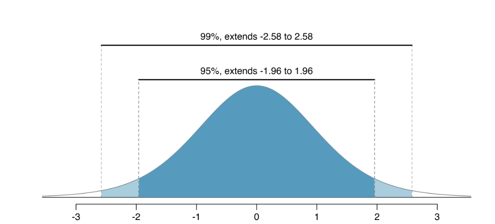

\vspace{-1cm}

|                                                          |                                                           |
|------------------------------------|------------------------------------|
|                                                          |                                                           |
| First name: \_\_\_\_\_\_\_\_\_\_\_\_\_\_\_\_\_\_\_\_\_\_ | Last name: \_\_\_\_\_\_\_\_\_\_\_\_\_\_\_\_\_\_\_\_\_\_\_ |

> I hereby state that I have not communicated with or gained information in any way from my classmates during this exam, and that all work is my own.

\vspace{5 mm}

> Signature: \_\_\_\_\_\_\_\_\_\_\_\_\_\_\_\_\_\_\_\_\_\_\_\_\_\_\_\_\_\_\_\_\_

\vspace{2 mm}

**Any potential violation of NC State's policy on academic integrity will be reported to the Office of Student Conduct & Community Standards. All work on this exam must be your own.**

1.  You have 75 minutes to complete the exam.
2.  You have a formula sheet on the back of this exam. You may also use this as scratch paper.
3.  You may use a calculator 
4.  Every MC question is worth 3-points unless otherwise specified. 
5.  Every True/False question is worth 2-points unless otherwise specified.
6.  You are **not** allowed a cell phone, even if you intend to use it for checking the time, music device or headphones, notes, books, or other resources, or to communicate with anyone other than the professor during the exam.
7.  Show your work. Partial credit can not be earned without any work shown.
8.  Round all answers to 4 digits (ex. 2.34245 = 2.3425)
9.  For True or False / MC questions, please circle your answer clearly. 


Good luck!

```{r}
#| echo: false
#| message: false
#| warning: false

library(tidyverse)
```




## Multiple Choice (15 points)

\vspace{3 mm}

1.  Suppose you calculate a p-value of -0.147. From this, you can determine that...

<!-- -->

(a) You have an observed statistic that is really unlikely to be observed under the assumption of the null hypothesis

(b) You made some arithmetic mistake. P-values can not be negative

(c) Your test statistic is negative

(d) Every value in your data set is negative

\vspace{5 mm}

<!-- -->

2.  Suppose you calculate a sample standard deviation of -2.87. From this, you can determine that...

<!-- -->

(a) Your data are very spread out

(b) Your data are not very spread out

(c) You made some arithmetic mistake. Standard deviation can not be negative

(d) Every value in your data set is negative

\vspace{5 mm}

<!-- -->

3.  Suppose you calculate a Z-statistic of -6.78. From this, you can determine that...

<!-- -->

(a) You made some arithmetic mistake. Z-statistics can not be negative

(b) You have an observed statistic that is really unlikely to be observed under the assumption of the null hypothesis

(c) Every value in your data set is negative

(d) You would fail to reject the null hypothesis, because the test statistic is negative

\vspace{5 mm}

<!-- -->

4.  Suppose a researcher, using a t-distribution with 20 degrees of freedom, calculated a p-value to be 0.076. Assuming that everything else regarding the study stayed exactly the same, what would happen to the p-value if we used a t-distribution with 5 degrees of freedom...

<!-- -->

(a) The p-value would be larger

(b) The p-value would be smaller

(c) The p-value would stay exactly the same

5. A researcher conducts a two-sided hypothesis test using a significance level of $\alpha = 0.10$. They also construct a $95\%$ confidence interval for the parameter of interest. Would you expect the hypothesis test and confidence interval to always lead to the same conclusion?

(a) Yes. They will always agree because both use the same sample data.

(b) Yes. A two-sided test with $\alpha = 0.10$ corresponds exactly to a $95\%$ confidence interval.

(c) No. A significance level of $\alpha = 0.10$ corresponds to a $90\%$ confidence interval, not a $95\%$ confidence interval.

(d) No. Hypothesis tests and confidence intervals cannot be compared because they answer different questions.



## Question 1 (18 points)

**Bus arrival time**: Suppose a bus in a very small time is known to arrive sometime between 1:00PM and 1:10PM at a specific bus stop. There is no reason to believe it's more likely to arrive at any one specific time vs the other. 0.0 represents 1:00PM and 10 represents 1:10PM. The probability distribution can be found below. The parameters of the probability distribution are $\mu = 5$ and $\sigma = 2.89$.

```{r}
#| echo: false
#| warning: false
# Load the ggplot2 package
library(ggplot2)

# Define the parameters for the uniform distribution
a <- 0  # The start of the distribution
b <- 10 # The end of the distribution

# Calculate the height of the rectangle
height <- 1 / (b - a)

# Create a data frame for the top line of the rectangle
rect_data <- data.frame(
  x = c(a, b),
  y = c(height, height)
)

# Plot the uniform distribution as a rectangle
ggplot(data = rect_data, aes(x = x, y = y)) +
  # Use geom_rect to draw the shaded rectangle
  geom_rect(aes(xmin = a, xmax = b, ymin = 0, ymax = height), fill = "skyblue", alpha = 0.5) +
  # Add a line for the top edge of the rectangle
  geom_line(data = rect_data, aes(x = x, y = y), color = "blue", linewidth = 1) +
  # Add vertical lines at the boundaries
  geom_vline(xintercept = c(a, b), color = "blue", linetype = "solid", linewidth = 1) +
  # Manually set the x-axis limits
  scale_x_continuous(limits = c(0, 10)) + 
  labs(
    title = "Probability Distribution of X",
    subtitle = paste0("Range from ", a, " to ", b),
    x = "x",
    y = "Probability Density"
  ) +
  theme_minimal()
```

a. What is the shape of this distribution? Circle your answer below. 

    -- Normally distributed 

    -- Left skewed 

    -- Right skewed

    -- Uniform 

    -- Bimodel




b. Interpret $\sigma$ = 2.89 in the context of the problem. Circle your answer below. 

      -- The typical bus arrival is approximately 2.89 minutes away from the average time of 1:05PM.
      
      -- 2.89 represents the exact range of the data 
      
      -- If you were to take many different random samples of bus arrival times, you would expect the average arrival time calculated from each of those samples to be, on average, about 2.89 minutes away from the true,            long-run average arrival time of 1:05 PM.
      
      -- Approximately 68% of the data falls within 1 SD (2.89 minutes) away from the average time of 1:05PM.

\vspace{5 mm}

c. The above graph is a probability distribution. In general, what is a **sampling distribution**? Answer this question in 1-3 sentences.

\vspace{20 mm}

For the remaining questions, assume that n = 50, and observations (times recorded) were randomly sampled 

d. The central limit theorem suggested that the sampling distribution of $\bar{x}$ will be normally distributed, even if the population distribution is not, IF two conditions are met. Please list the two conditions below. 
\vspace{5 mm}

1. 

\vspace{5 mm}

2. 

\vspace{5 mm}


e. True or False: The central limit theorem only works for the sample mean. 

      -- True
      
      -- False
      
\vspace{5 mm}

f. Where would we expect the sampling distribution of $\bar{x}$ to be centered? Please provide the value. 

\vspace{10 mm}

g. Calculate the standard error for the sampling distribution of $\bar{x}$. Show your work. 

\vspace{10 mm}



## Question 2 (22 points)

The Iris Dataset contains measurements of a flower's sepal and petal. There are 50 randomly selected flowers for each of the three species of Iris flowers (150 in total across the Iris setosa, Iris virginica and Iris versicolor species). A sepal is the outer parts of the flower (often green and leaf-like) that enclose a developing bud. The petal are parts of a flower that are the pollen producing part of the flower that are often conspicuously colored. The difference between sepals and petals can be seen below.

{fig-align="center" width="500"}

**For this question, we are only going to look at Iris setosa, and Iris versicolor**. We are interested in estimating the mean difference in petal length between setosa and versicolor. Please use the order of subtraction setosa - versicolor for this question. **The unit of measurement for petal length is centimeters**. See your data table below.

#### Data Table

```{r}
#| echo: false

round_df <- function(df, digits) {
  nums <- vapply(df, is.numeric, FUN.VALUE = logical(1))

  df[,nums] <- round(df[,nums], digits = digits)

  (df)
}

iris |>
  filter(Species %in% c("setosa", "versicolor")) |>
  group_by(Species) |>
  summarize(mean_PL = mean(Petal.Length),
            sd_PL = sd(Petal.Length),
            n = n()) |>
  round_df(3)
  
```

a)  Using your data table, report the value of your sample statistic (difference in sample means). Use proper notation.

\vspace{15 mm}

b)  The following questions are going to have you calculate a theory based confidence interval. Use the context of this problem to justify why we are going to calculate a confidence interval, instead of conducting a hypothesis test to answer our research question, in 1-2 sentences.


\newpage

c)  Assuming the Central Limit Theorem assumptions are met, what would you expect the shape of the population distribution be of all differences in setosa and versicolor Iris flower's petal length?

<!-- -->

(a) Normally distributed

(b) Left skewed

(c) Right skewed

(d) Non-normal (but can't specify exact shape)

(e) Not enough information to answer the question

\vspace{5mm}

d)  Assuming the Central Limit Theorem assumptions are met, what would you expect the shape of the sampling distribution for the difference in mean petal lengths be?

<!-- -->

(a) Normally distributed

(b) Left skewed

(c) Right skewed

(d) Non-normal (but can't specify exact shape)

(e) Not enough information to answer the question

e)  Using 1.66 as your $t^*$ multiplier, set up the equation for a 90% confidence interval with the appropriate values from our data. You do not need to calculate the exact CI.

\newpage

f) Regardless of your answer part e, assume you calculated the following 90% confidence interval for the population mean difference in petal length (-2.9424, -2.6576). On the sampling distribution below, label the following that correspond the the calculated interval: 

-- x-axis

-- lower + upper bound 

-- center of the distribution

```{r}
#| echo: false
#| eval: true
library(ggplot2)

ggplot(data.frame(x = c(-4, 4)), aes(x)) +
  stat_function(
    fun = dnorm,
    linewidth = 1
  ) +
  scale_x_continuous(
    breaks = 0,
    labels = "",
    limits = c(-4, 4)
  ) +
  labs(
    x = NULL,
    y = "Normal density"
  ) +
  theme_classic() +
  theme(
    axis.text.x = element_blank(),
    axis.ticks.x = element_line(),
    axis.title.x = element_blank()
  )
```


\vspace{40 mm}


g.  Regardless of your answer part e, assume you calculated the following 90% confidence interval for the population mean difference in petal length (-2.9424, -2.6576). Interpret this confidence interval in the context of the problem.

\newpage

## Question 3 (14 points)

a.  Recall your 90% confidence interval from question 2: (-2.9424, -2.6576). If you instead calculated a 99% confidence interval using the exact same data, what would change about your interval? **Circle all that apply**.

<!-- -->

(a) The width of the interval would become narrower

(b) The width of the interval would become wider

(c) The center

(d) The interval remains the same

\vspace{5 mm}

b.  Recall your 90% confidence interval from question 2: (-2.9424, -2.6576). If the researchers instead collected a sample size of 100 flowers for each species, what would change about your interval? Assume that everything else stayed the exact same from the study except for the sample size. Circle all that apply.

<!-- -->

(a) The width of the interval would become more narrow

(b) The width of the interval would become wider

(c) The center

(d) The interval remains the same

\vspace{5 mm}


3.  Suppose a different researcher went out and collected a very very large sample of 1000 flowers for each species and calculated a 99% confidence interval: (-3.25, -1.5)


What is the value of this new researcher's difference in means for the 99% confidence interval above? Show your work. Assume the order of subtraction is still setosa - versicolor.

\vspace{45 mm}

What is the **approximate** value of this new researcher's t\* multiplier for the 99% confidence interval above? Justify your answer in 1-2 sentences.

\vspace{40 mm}

\newpage

## Question 4 (15 points)

A university wants to determine whether the proportion of students who prefer
online classes differs between freshmen and seniors.

A random sample of 40 freshmen finds that 8 prefer online classes, while a
random sample of 50 seniors finds that 6 prefer online classes.

Use this information to answer the following questions: 

a. Set up the correct null and alternative hypotheses **using proper notation** 

\vspace{5 mm}

$H_o:$

\vspace{5 mm}

$H_a:$

\vspace{5 mm}

b. Suppose the p-value comes out to be 0.0521. Can we trust this p-value? Justify your answer below. Show your work. 

\vspace{40 mm}

3. Suppose your friend compares your p-value of 0.0521 with an $\alpha$ value equal to 0.05, and fails to reject the null hypothesis. 

-- Do you have an issue with the way the results were reported?

-- How might you suggest the results be reported instead?

\newpage

## Question 5 (10 points)

Please see the data table below: 

|            | **Ordered Dessert** | **Did Not Order Dessert** | **Total** |
| ---------- | ------------------: | ------------------------: | --------: |
| **Dinner** |                  45 |                        30 |        75 |
| **Lunch**  |                  15 |                        60 |        75 |
| **Total**  |                  60 |                        90 |       150 |

1. Define the each even in the context of the problem.

\vspace{25 mm}

2. Calculate the probability a randomly selected individual ordered desert. Show your work.

\vspace{25 mm}

3. Calculate the probability that a randomly selected person who is having lunch, does not order dessert. Show your work. 

\vspace{25 mm}

\newpage

#### Formula sheet 

$df$ = n - 1

$df$ = $min(n_1 - 1, n_2 - 1)$

$s = \sqrt{\frac{\sum_{i=1}^{n}(x_i-\bar{x})^2}{n-1}}$

$\sigma = \sqrt{\frac{\sum_{i=1}^{N}(x_i-\mu)^2}{N}}$

Confidence intervals: 

$\text{statistic} \pm \text{critical value} * \text{standard error}$

Critical value can be $t^*$ or $z^*$ depending on the distribution we are using

$SE(\hat{p}) = \sqrt{\frac{\hat{p}(1-\hat{p})}{n}}$

$SE(\hat{p}_1-\hat{p}_2) = \sqrt{\frac{\hat{p}_1(1-\hat{p}_1)}{n_1}+\frac{\hat{p}_2(1-\hat{p}_2)}{n_2}}$

$SE(\hat{p}) = \sqrt{\frac{p_0(1-p_0)}{n}}$

$SE(\hat{p}1-\hat{p}2) = \sqrt{\frac{\hat{p}{pool}(1-\hat{p}{pool})}{n_1}+\frac{\hat{p}{pool}(1-\hat{p}{pool})}{n_2}}$

$SE(\bar{x}) = \frac{s}{\sqrt{n}}$

$SE(\bar{x}_1-\bar{x}_2) = \sqrt{\frac{s_1^2}{n_1}+\frac{s_2^2}{n_2}}$


{fig-align="center"}

