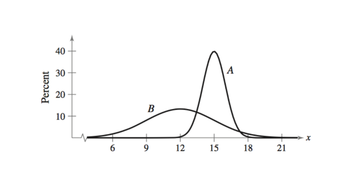

\vspace{-1cm}

|                                                          |                                                           |
|------------------------------------|------------------------------------|
|                                                          |                                                           |
| First name: \_\_\_\_\_\_\_\_\_\_\_\_\_\_\_\_\_\_\_\_\_\_ | Last name: \_\_\_\_\_\_\_\_\_\_\_\_\_\_\_\_\_\_\_\_\_\_\_ |

> I hereby state that I have not communicated with or gained information in any way from my classmates during this exam, and that all work is my own.

\vspace{5 mm}

> Signature: \_\_\_\_\_\_\_\_\_\_\_\_\_\_\_\_\_\_\_\_\_\_\_\_\_\_\_\_\_\_\_\_\_

\vspace{2 mm}

**Any potential violation of NC State's policy on academic integrity will be reported to the Office of Student Conduct & Community Standards. All work on this exam must be your own.**

1.  You have 75 minutes to complete the exam.
2.  You have a formula sheet on the back of this exam. You may also use this as scratch paper.
3.  You may use a calculator 
3.  You are **not** allowed a cell phone, even if you intend to use it for checking the time, music device or headphones, notes, books, or other resources, or to communicate with anyone other than the professor during the exam.
4.  Show your work. Partial credit can not be earned without any work shown.
5.  Round all answers to 3 digits (ex. 2.34245 = 2.342)
6.  For True or False questions, please circle True or False clearly. 


Good luck!



## Multiple Choice (2-points each)

1. In hypothesis testing, our significance level ($\alpha$) is our... 

      a. Type I error rate. 

      b. Type II error rate. 

      c. Probability to accept the null hypothesis. 

      d. Probability to reject the null hypothesis. 

2. What is the primary goal of statistical inference?

      a. To calculate the exact mean and standard deviation of the entire population by measuring every single individual within it.

      b. To organize and summarize the data from a specific sample using charts, graphs, and tables.

      c. To use information collected from a sample to make a generalization or prediction about the broader population.

      d. To ensure that no errors or variability occur during the process of data collection. 

3. The average annual income per person in NC is reported to be \$41,385. Suppose a researcher was interested in **estimating** the income of the residents in North Carolina. What type of statistical procedure could they use to answer their research question?

      a. Single proportion confidence interval. 

      b. Single mean confidence interval. 

      c. Single proportion hypothesis test. 

      d. Single mean hypothesis test.

4. Compared with the standard normal (z) distribution, a t-distribution with 5 degrees of freedom is:

      a. Narrower, with lighter tails.

      b. Roughly the same width and shape.

      c. Wider, with heavier tails.

      d. Wider, with lighter tails.
      
5. Compared with the standard normal (z) distribution, a t-distribution with 100 degrees of freedom is:

      a. Narrower, with lighter tails.

      b. Roughly the same width and shape.

      c. Wider, with heavier tails.

      d. Wider, with lighter tails.



## Question 1 (7-points)

A farmer is interested in the proportion of corn in his corn fields that are stricken with a certain
disease. He randomly selects 90 ears of corn and sees if they have the disease. It turns out 15
of them do. **Construct and interpret** a 99% confidence interval for the true proportion of corn
that has the disease.  You may use $z_{.995}$ = 2.575 for this calculation.


\newpage


## Question 2 (12-points)

Grand Auto Corporation produces auto batteries. The company claims that its top-of-the-line
batteries are good, on average, for at least 6000 minutes. A consumer protection agency tested 45
such batteries to check this claim. You have a theory that these batteries do not last as long as the owner claims. You take a random sample of 45 batteries from the store, and found that the sample mean life of these 45 batteries is 5478 minutes, and the sample standard deviation is 800 minutes. Use this information to answer the following questions below. You may assume $\alpha$ = 0.05 for this question.

a. What is the null and alternative hypothesis for this problem? Write this out in proper notation below. 

$H_o:$

\vspace{5 mm}

$H_a:$

\vspace{5 mm}

b. Assume that your test statistic was -4.38 that follows a t-distribution with 44 degrees of freedom. Is your p-value going to be larger or small? Justify your answer. Hint: Use information from the distribution and from your alternative hypothesis to justify your answer.

\vspace{60 mm}

c. Based on your justification in part c, write a conclusion in the context of the problem. 


\vspace{30 mm}


e. True or False: If the alternative hypothesis sign were changed to $\neq$, the p-value would double.

      True
      
      False

\vspace{5 mm}

\newpage

## Question 3 (10-points)

A psychology class has an exam with a mean score of 75 and a standard deviation of 7. Sarah scored 85 on the exam. A math class has an exam with a mean score of 82 and a standard deviation of 5. Scott scored 88 on the exam. Using z-scores, make an argument for what score is more impressive. 

\newpage

## Question 4 (12-points)

A basketball team claims that at least 70% of its free throws are made during games. A sports analyst believes the team's true free-throw percentage is actually lower than 70%. The analyst randomly selects 100 free-throw attempts from the team's games and finds that the team made 63 of them. You may assume $\alpha$ = 0.05 for this question.

a. What is the null and alternative hypothesis for this problem? Write this out in proper notation below. 

$H_o:$

\vspace{5 mm}

$H_a:$

\vspace{5 mm}

b. This hypothesis produced a p-value of approximately 0.074, and a z-statistic of -1.53. Use the space below to draw how the p-value was calculated. Your drawing should include. 

-- The sampling distribution 

-- Correctly labeled values on the x-axis dashes |

-- Correctly label your statistic 

-- Shade the area under the curve that corresponds to the calculated p-value

\vspace{100 mm}

```{r}
#| message: false
#| warning: false
#| echo: false
#| fig-align: center

library(ggplot2)

# Tick mark locations
tick_data <- data.frame(
  x = c(-3, -2, -1, 0, 1, 2, 3)
)

ggplot() +
  
  # X-axis
  geom_hline(
    yintercept = 0,
    linewidth = 0.6,
    color = "black"
  ) +
  
  # Short tick marks
  geom_segment(
    data = tick_data,
    aes(
      x = x,
      xend = x,
      y = 0,
      yend = 0.025
    ),
    linewidth = 0.8,
    color = "black"
  ) +
  
  scale_x_continuous(
    limits = c(-3.5, 3.5),
    breaks = c(-3, -2, -1, 0, 1, 2, 3),
    labels = rep("", 7)
  ) +
  
  scale_y_continuous(
    limits = c(0, 0.42),
    breaks = NULL
  ) +
  
  labs(
    x = NULL,
    y = NULL
  ) +
  
  theme_classic() +
  theme(
    axis.line = element_blank(),
    axis.ticks = element_blank(),
    axis.text = element_blank()
  )
```

\newpage

    
### Question 5 (6-points)

Please see the following two probability distributions below. Answer A, B, or NA. 



a. Which probability distribution has the larger mean? 

\vspace{15 mm}

b. Which probability distribution has the largest standard deviation?

\vspace{15 mm}

c. Which probability distribution has the largest area under the curve? 

\vspace{15 mm}

\newpage

#### True or False (2-points each)

\vspace{5 mm}

Circle True or False for each of the following questions **clearly**. 

True or False: A p-value can be negative 
\vspace{5 mm}

True or False: Using the same data, a probability distribution would have a smaller spread than a sampling distribution with n = 5.
\vspace{5 mm}

True or False: If the P-value is small, it means that the observed data is very unlikely to have occurred under Ho, so we have evidence to reject the null hypothesis
\vspace{5 mm}

True or False: Going from a 90% confidence interval to a 99% confidence interval increases the confidence intervals width
\vspace{5 mm}

True or False: Going from a 90% confidence interval to a 99% confidence interval increases the the estimated standard deviation of the data 
\vspace{5 mm}

True or False: Going from a 90% confidence interval to a 99% confidence interval changes the center of the interval 
\vspace{5 mm}

True or False: The variable **height** could either be a categorical variable or quantitative variable, depending on how it's measured




## Formula Sheet 

z-score for probability distributions

$z = \frac{x - \mu}{\sigma}$

test-statistic for sampling distributions

$z = \frac{\bar{x} - \mu}{\sigma/\sqrt{n}}$

$z = \frac{\hat{p} - \pi_o}{\sqrt{\frac{\pi_o(1-\pi_o)}{n}}}$

$t = \frac{\bar{x} - \mu}{s/\sqrt{n}}$


Confidence intervals

$\bar{x} \pm z^* \frac{\sigma}{\sqrt{n}}$

$\bar{x} \pm t^* \frac{s}{\sqrt{n}}$

$\hat{p} \pm z^* \sqrt{\frac{\hat{p}(1-\hat{p})}{n}}$

