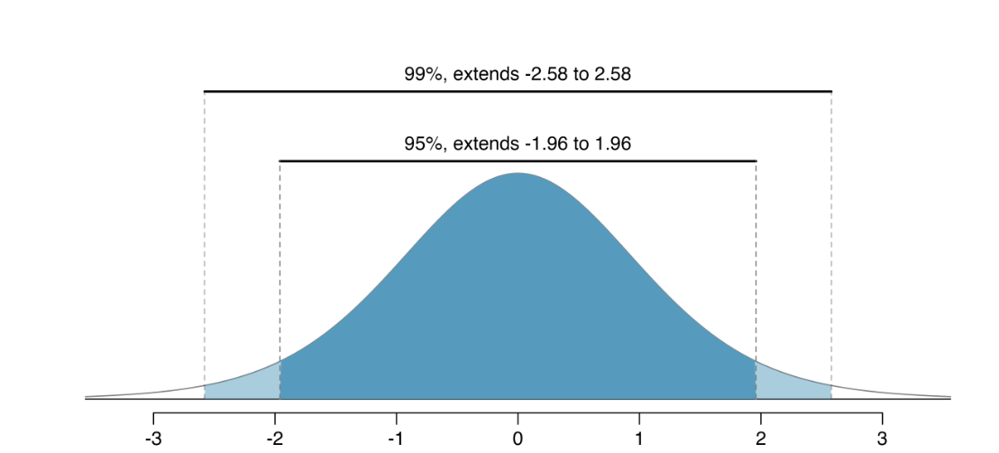

#### Formula sheet 

$df$ = n - 1

$df$ = $min(n_1 - 1, n_2 - 1)$

$s = \sqrt{\frac{\sum_{i=1}^{n}(x_i-\bar{x})^2}{n-1}}$

$\sigma = \sqrt{\frac{\sum_{i=1}^{N}(x_i-\mu)^2}{N}}$

Confidence intervals: 

$\text{statistic} \pm \text{critical value} * \text{standard error}$

Critical value can be $t^*$ or $z^*$ depending on the distribution we are using

$SE(\hat{p}) = \sqrt{\frac{\hat{p}(1-\hat{p})}{n}}$

$SE(\hat{p}_1-\hat{p}_2) = \sqrt{\frac{\hat{p}_1(1-\hat{p}_1)}{n_1}+\frac{\hat{p}_2(1-\hat{p}_2)}{n_2}}$

$SE(\hat{p}) = \sqrt{\frac{p_0(1-p_0)}{n}}$

$SE(\hat{p}1-\hat{p}2) = \sqrt{\frac{\hat{p}{pool}(1-\hat{p}{pool})}{n_1}+\frac{\hat{p}{pool}(1-\hat{p}{pool})}{n_2}}$

$SE(\bar{x}) = \frac{s}{\sqrt{n}}$

$SE(\bar{x}_1-\bar{x}_2) = \sqrt{\frac{s_1^2}{n_1}+\frac{s_2^2}{n_2}}$

{fig-align="center"}