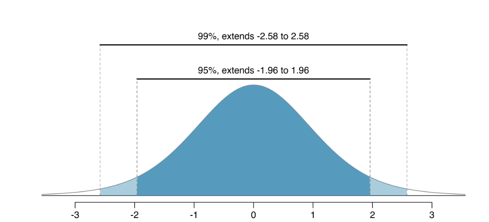

#### Formula sheet 

$df$ = n - 1

$df$ = $min(n_1 - 1, n_2 - 1)$

$df$ = (r-1) * (c-1)

$df$ = k-1 

$df_{\text{numerator}}$ = k-1 

$df_{\text{denominator}}$ = N-k

$\chi^2 = \sum \frac{(O - E)^2}{E}$

$F = \frac{MS_{\text{between}}}{MS_{\text{within}}}$

$F = \frac{SS_{\text{between}}/(k-1)}{SS_{\text{within}}/(n-k)}$

$\text{SS}_{\text{Between}} = \sum_{i=1}^{k} n_i (\bar{X}_i - \bar{X}_{\text{grand}})^2$

$\text{SS}_{\text{Within}} = \sum_{i=1}^{k} \sum_{j=1}^{n_i} (X_{ij} - \bar{X}_i)^2$

$E_{ij} = \frac{(\text{row total}_i)(\text{column total}_j)}{\text{grand total}}$

$E_i = n p_i$

where n is the total sample size and $p_i$ is the hypothesized probability in category i.

all pairwise comparisons: $\frac{k(k-1)}{2}$

{fig-align="center"}