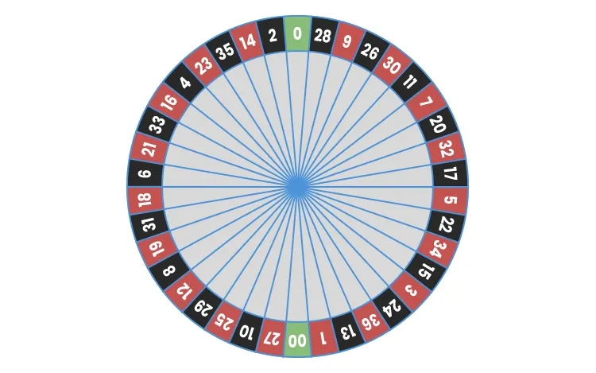

## Instructions on how to start

This is a hand written assignment. Please label your questions as clearly as possible and put your name at the top of your assignment. You may work together on homework, but you are required to turn in your individual work. Unless otherwise specified, please give your answers to 2 decimal places.

**Show your work**. I am happy to assign partial credit that you earn, but this can not be done if you do not show your work. 

## Instructions on how to turn your homework in

You will turn in your assignment on Gradescope. A Gradescope link to Homework-1 can be found on Moodle. Here is a short video by Gradescope on how to turn in your assignment: [Video](https://www.youtube.com/watch?v=nksyA0s-Geo). **Please submit a PDF**. All other file types will not be graded. As the video says, there are several phone apps you can use to create a PDF of your work. You can also you a scanner. If you are having trouble creating a PDF of your work, please reach out to me and we will have a conversation. 

## Exercise-1 (6-points)

In each of the following scenarios, there is something wrong. Describe what is wrong and give a reason for your answer.

a)  If the probability of A is 0.6 and the probability of B is 0.7, the probability of both A and B happening is 1.3.

b)  If the probability of A is 0.55, then the probability of the complement of A is -0.55.

## Exercise-2 (7-points)

All human blood can be "ABO‑typed" as one of O, A, B, or AB, but the distribution of the types varies a bit among groups of people. Here is the distribution of blood types for a randomly chosen person in the United States. The following may be a useful resource for this question: [article](https://www.statisticshowto.com/disjoint-events/)

|                  |      |      |      |     |
|------------------|------|------|------|-----|
| Blood type       | A    | B    | AB   | O   |
| U.S. probability | 0.42 | 0.11 | 0.03 | ?   |

a\) What is the probability of type O blood in the United States?

b\) Explain your answer to part a.

c\) Are events A, B, AB, and O disjoint? Justify your response.

d\) Sasha has type A blood. She can safely receive blood transfusions from people with blood types O and A. What is the probability that a randomly chosen person from the United States can donate blood to Sasha? (This exercise ignores the Rh factor, another classification of blood types that is related to whether one person can donate blood to another.)

## Exercise-3 (10-points)

A roulette wheel has 38 slots, numbered 0, 00, and 1 to 36. The slots 0 and 00 are colored green, 18 of the others are red, and 18 are black. The dealer spins the wheel and, at the same time, rolls a small ball along the wheel in the opposite direction. The wheel is carefully balanced so that the ball is equally likely to land in any slot when the wheel slows. Gamblers can bet on various combinations of numbers and colors.

a)  What is the probability that the ball will land in any one slot? **Give your answer to four decimal places for this question**. 

b)  If you bet on "red," you win if the ball lands in a red slot. What is the probability of winning? Give your answer to four decimal places. Define your event A, and use proper notation when writing your response.

c)  The slot numbers are laid out on a board on which gamblers place their bets. One column of numbers on the board contains all multiples of 3 – that is, 3, 6, 9, …, 36. You place a "column bet" that wins if any of these numbers comes up. What is your probability of winning? **Give your answer to four decimal places for this question**. Define your event B, and use proper notation when writing your response.

## Exercise 4 (40 points)

#### Murderous Nurse

For several years in the 1990s, Kristen Gilbert worked as a nurse in the intensive care unit (ICU) of the Veterans Administration Hospital in Northampton, Massachusetts. Over the course of her time there, other nurses came to suspect that she was killing patients by inject-ing them with the heart stimulant epinephrine. Gilbert was eventually arrested and charged with these murders. Part of the evidence presented against Gilbert at her murder trial was a statistical analysis of 1,641 randomly selected eight-hour shifts during the time Gilbert worked in the ICU. For each of these shifts, researchers recorded two variables: whether Gilbert worked on the shift and whether at least one patient died during the shift.You may use $\alpha = 0.05$ for this question.

a)  What are the observational units. That is, Whom or what exactly are the data being collected off of.

b)  Classify each variable as categorical or quantitative. Additionally, classify if this is our response variable or explanatory variable.

-- Whether Gilbert worked on the shift

-- Whether at least one patient died during the shift

c) Based on the research question in the context of the problem, write out your null and alternative hypotheses below **in both words and in proper notation**. Use informative subscripts.

Ho: 

Ha: 

\newpage

d) The researchers' data can be found below:

|                              |                          |                              |       |
|------------------------------|--------------------------|------------------------------|-------|
|                              | Gilbert working on shift | Gilbert not working on shift | Total |
| Patient died during shift    | 40                       | 34                           | 74    |
| No patient died during shift | 217                      | 1350                         | 1567  |
| Total                        | 257                      | 1384                         | 1641  |

Report your sample statistic in proper notation based on the values from the table. 

e) We are now going to conduct a Z-test to test your null/alternative hypothesis. 

Before conducting this test, justify if we can trust the results of a z-test below? Why or why not. 

f) Regardless of your answer, calculate your z-statistic below. Show your work. 

g) Draw a standard normal distribution, and label your z-statistic on the distribution. Shade in the area of the p-value. 

h) Based on your z-statistic, would you your p-value be large or small? Justify your answer. 

i) Now, write an appropriate decision and conclusion in the context of the problem. 

