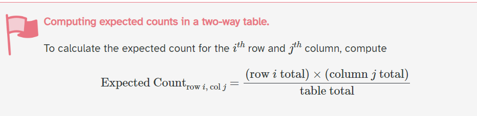
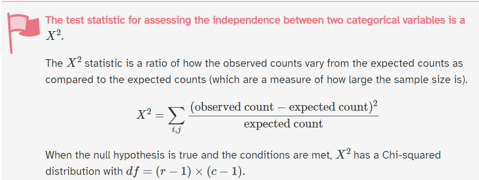

## Checklist{.smaller}
    
-- Don't forget about the Statistics Experience (12-1)

-- Exam-2 is on 10-29

      > Cumulative with emphasis on unit-2
      > Closed notes, bring a calculator you know how to use
      
-- The formula sheet has been posted

-- The how to study guide has been posted

## Checklist 

-- Do you have questions about midterm-2?

-- Let's take a look at the formula sheet!

## Warm up{.smaller} 

Last time: 

Results from an experiment to compare yields as measured by dried weight of plants) obtained under a control and two different treatment conditions. We are interested in seeing if the dried weight of plants is different across the three yields. 

Results from an experiment to compare yields (as measured by dried weight of plants) obtained under a control and two different treatment conditions.

## Anova

```{r}
#| echo: false

anova_model <- aov(weight ~ group, data = PlantGrowth)

summary(anova_model)
```

What does this tell us? 

# so which ones are different?

## Pairwise comparisons 

$\frac{k(k-1)}{2}$

$\frac{3(3-1)}{2} = 3$

We have three pairwise comparisons! 

## Familywise Error Rate{.smaller}

The family-wise error rate (FWER) is the probability of making AT LEAST one Type I error across a family of hypothesis tests.

```{r}
#| echo: false
# Load the ggplot2 library for plotting
library(ggplot2)

# Set the individual test significance level (alpha)
alpha <- 0.05

# Define the range of comparisons (m) from 1 to 10
m_values <- 1:10

# Calculate the Familywise Error Rate (FWER) for each m
# FWER = 1 - (1 - alpha)^m
fwer_values <- 1 - (1 - alpha)^m_values

# Create a data frame for plotting
plot_data <- data.frame(
  m = m_values,
  FWER = fwer_values
)

# Plot the FWER vs. the number of comparisons (m)
ggplot(plot_data, aes(x = m, y = FWER)) +
  
  # Add the line and points for the FWER
  geom_line(color = "blue", linewidth = 1) +
  geom_point(color = "darkblue", size = 3) +
  
  # Add a horizontal line at the nominal alpha level (0.05)
  geom_hline(yintercept = alpha, linetype = "dashed", color = "red") +
  
  # Add labels and title
  labs(
    title = expression(paste("Inflation of Familywise Error Rate (FWER) as m Increases (", alpha, " = 0.05)")),
    x = "Number of Comparisons (m)",
    y = "Familywise Error Rate (FWER)"
  ) +
  
  # Customize scales
  scale_x_continuous(breaks = m_values) +
  scale_y_continuous(breaks = seq(0, max(fwer_values) + 0.05, 0.05)) +
  
  # Apply a clean theme
  theme_minimal()
```


$FWER = 1 - (1-0.05)^3 \approx 0.143$

## Strategies 

-- Tukeys HSD

-- Bonferonni 

## Tukeys HSD

Talk to me about it! 


## Tukeys HSD

Tukeys HSD implements an entirely different distribution than the t-distribution, to help us account for our multiple comparisons! That distribution is the studentized range distribution!

Tukey's Honest Significant Difference (HSD) test is a post hoc test commonly used to assess the significance of differences between pairs of group means. Tukey HSD is often a follow up to one-way ANOVA, when the F-test has revealed the existence of a significant difference between some of the tested groups.

This correction makes sure that our collective type-1 error rate is $\alpha$.

## Other corrections: Bonferonni 

Adjust $\alpha$: $\frac{\alpha}{m}$ 

This makes it harder to reject, and re-calibrates your hypothesis test for multiple comparisons! 

The $\alpha$ (ex. 0.05) is the collective type I error rate across all the tests combined (called the family-wise error rate), not the rate for each individual test.

## When to use which 

Bonferroni: Adjust the significance level or p-values to account for multiple hypothesis tests.

Tukey: Use a procedure specifically designed for comparing all pairs of means.

## Why{.smaller} 

-- Tukey’s HSD is generally more powerful (reject correctly) when testing every single pair of means.

-- Bonferroni is more conservative, especially as the number of comparisons grows large. Bonferroni haveis designed to have more power if you are only testing a tiny, select number of specific comparisons rather than all possible pairs

## Example{.smaller}

The uncorrected p-values can be seen below. **Suppose we wanted to only look at the comparison of the control vs the other two treatments**. A Bonferonni correction may be more appropriate! We would compare $\frac{\alpha}{2}$ to the two p-values below. 

```{r}
pairwise.t.test(
  PlantGrowth$weight,
  PlantGrowth$group,
  p.adjust.method = "none"
)
```

We now compare those two p-values vs an $\alpha = 0.025$!

# Questions

## Confidence Intervals 

You can also calculate confidence intervals with Bonferonni if you would like!


## Example: 3 groups

With 3 groups, there are

$m = \binom{3}{2} = 3$

pairwise comparisons. To obtain 95% familywise confidence:

$\alpha^* = \frac{0.05}{3} = 0.0167$

Each interval is therefore constructed at approximately 98.33% confidence, using a $t^*$ critical value with $0.0167/2$ in each tail.

This controls the familywise error rate to be 95%


# Questions 

## Review! 

-- Errors & Power 

-- One-way ANOVA 

-- Chi-square

## Errors & Power 

Identify the appropriate slot for Type-1, Type-2, and Power


|                       | $H_o$ is True | $H_o$ is False |
|-----------------------|---------------|----------------|
| Reject $H_o$          | ____________  | ____________ |
| Fail to Reject $H_o$  | ____________  | _____________ |

## Errors & Power 

Identify the appropriate slot for Type-1, Type-2, and Power


|                       | $H_o$ is True | $H_o$ is False |
|-----------------------|---------------|----------------|
| Reject $H_o$          | Type I Error  | Power! |
| Fail to Reject $H_o$  | ____________  | Type II Error |

Each of these are probabilities that depend on certain characteristics of our study. 

## Type-I Error 

Probability that we reject $H_o$ when $H_o$ is actually true. 

How do we calculate this probability?

## Type-I Error 

Probability that we reject $H_o$ when $H_o$ is actually true. 

How do we calculate this probability?

$\alpha$

We set this! 

-- What are you comfortable with?

-- What does your field consider acceptable? 

## Type-II Error and Power 

We can't calculate these probabilities without talking about an effect size. 

What is an effect size? 

## Effect size 

"what if" value... 

A quantitative measure of the magnitude of a difference, relationship, or effect at the population. 


"what if" the true effect size at the population level is ___. What would my power be?  

## Example{.smaller} 

Researchers want to determine whether tomato plants grown with fertilizer produce a different average number of tomatoes than plants grown without fertilizer. Assume the conditions for a two-sample t-test are satisfied. Use a significance level of $\alpha = 0.05$. Based on previous literature, a significant difference would be an average of 3 tomatoes. 

| Summary statistic | Fertilizer | No fertilizer |
|:------------------|-----------:|--------------:|
| Sample size ($n$) | 25 | 25 |
| Sample mean ($\bar{x}$) | 32 tomatoes | 27 tomatoes |
| Sample standard deviation ($s$) | 6 tomatoes | 5 tomatoes |

## Tomatoes

Based on the context of the problem, what do we already know? 

-- Probability of a Type-1 error

-- Probability of a Type-2 error 

-- Power 

## Tomatoes 

```{r}
#| echo: false
# Shading data: define each region separately

library(tidyverse)

# Summary statistics
n_f <- 25
n_n <- 25
mean_f <- 32
mean_n <- 27
sd_f <- 6
sd_n <- 5

alpha <- 0.05
effect <- 3

# Standard error for the difference in means
se <- sqrt(sd_f^2 / n_f + sd_n^2 / n_n)

# Welch degrees of freedom
df <- (sd_f^2 / n_f + sd_n^2 / n_n)^2 /
  ((sd_f^2 / n_f)^2 / (n_f - 1) +
     (sd_n^2 / n_n)^2 / (n_n - 1))

# Critical values for a two-sided t-test
lower <- qt(alpha / 2, df) * se
upper <- qt(1 - alpha / 2, df) * se

# Create null and alternative curves
x <- seq(-7, 10, length.out = 2000)

null_curve <- data.frame(
  x = x,
  density = dnorm(x, mean = 0, sd = se),
  distribution = "Null distribution"
)

alt_curve <- data.frame(
  x = x,
  density = dnorm(x, mean = effect, sd = se),
  distribution = "Alternative distribution"
)

curves <- bind_rows(null_curve, alt_curve)

library(tidyverse)

type1 <- null_curve %>%
  filter(x <= lower | x >= upper) %>%
  mutate(
    region = "Type I error (alpha)",
    group_id = if_else(x < lower, "left", "right")
  )

type2 <- alt_curve %>%
  filter(x >= lower, x <= upper) %>%
  mutate(
    region = "Type II error (beta)",
    group_id = "beta"
  )

power <- alt_curve %>%
  filter(x <= lower | x >= upper) %>%
  mutate(
    region = "Power (1 - beta)",
    group_id = if_else(x < lower, "left", "right")
  )

ggplot() +
  # Shade Type II error under the alternative
  geom_area(
    data = type2,
    aes(x = x, y = density, fill = region, group = group_id),
    alpha = 0.55
  ) +
  # Shade power under the alternative
  geom_area(
    data = power,
    aes(x = x, y = density, fill = region, group = group_id),
    alpha = 0.55
  ) +
  # Draw Type I error last, so it is visible in the left tail
  geom_area(
    data = type1,
    aes(x = x, y = density, fill = region, group = group_id),
    alpha = 0.55
  ) +
  # Overlay both curves
  geom_line(
    data = curves,
    aes(x = x, y = density, color = distribution),
    linewidth = 1
  ) +
  geom_vline(
    xintercept = c(lower, upper),
    linetype = "dashed"
  ) +
  geom_vline(
    xintercept = c(0, effect),
    linetype = "dotted"
  ) +
  scale_color_manual(
    values = c(
      "Null distribution" = "blue",
      "Alternative distribution" = "darkgreen"
    )
  ) +
  scale_fill_manual(
    values = c(
      "Type I error (alpha)" = "red",
      "Type II error (beta)" = "orange",
      "Power (1 - beta)" = "darkgreen"
    )
  ) +
  labs(
    title = "Null and Alternative Distributions",
    subtitle = "Two-sided test; alpha = 0.05; effect size = 3 tomatoes",
    x = "",
    y = "Density",
    color = "Distribution",
    fill = "Shaded region"
  ) +
  coord_cartesian(xlim = c(-7, 10)) +
  theme_minimal() +
  theme(legend.position = "bottom")
```

## Power and Type II

Probability of a Type-II error ~ 53.15%

Power ~ 46.85%

Why is power small? What could we do to increase power? 

## On the exam 

For the homework, I had you actually calculate power/probability of a Type-II error with the help of software! This was to help improve your conceptual understanding of the material. You don't have software for the exam. 

-- Know the definitions 

-- Know their relationships with each other 

-- Know their relationships with other aspects of the study 

-- Know the graph 

... along with things like effect sizes, etc. 

[previous slides](https://st312-fall26.github.io/class/13-power.html#/in-summary)

# Questions 

## One-way ANOVA{.smaller} 

For this study, each animal received one of three dose levels of vitamin C (0.5, 1, and 2 mg/day). The research was interested in seeing if the mean length of odontoblasts (cells responsible for tooth growth) differed based on the dose levels.

```{r}
#| echo: false
ToothGrowth |>
  group_by(dose) |>
  summarize(mean = mean(len),
            sd = sd(len))
```

$Ho:$

$Ha:$

## What do we check? 

... and why do we check it? 

## Assumptions 

-- Independence

-- Normality (of residuals)

-- Equal variance 

## Normality 

```{r}
#| echo: false
library(tidyverse)

data(ToothGrowth)

ToothGrowth$dose <- factor(ToothGrowth$dose)

model <- aov(len ~ dose, data = ToothGrowth)

diagnostics <- ToothGrowth %>%
  mutate(
    residuals = residuals(model),
    fitted = fitted(model)
  )

ggplot(diagnostics, aes(sample = residuals)) +
  stat_qq() +
  stat_qq_line() +
  facet_wrap(~ dose) +
  labs(
    title = "Normal Q-Q Plots by Dose Group",
    x = "Theoretical Quantiles",
    y = "Sample Quantiles"
  ) +
  theme_minimal()
```

## Equal variance

```{r}
#| echo: false
ggplot(diagnostics, aes(x = fitted, y = residuals)) +
  geom_point() +
  geom_hline(yintercept = 0, linetype = "dashed") +
  labs(
    title = "Residuals vs. Fitted Values",
    x = "Fitted Values",
    y = "Residuals"
  ) +
  theme_minimal()
```


## F-statistic{.smaller} 

And we calculate an F-statistic that "follows a F-distribution." This is what I mean...

The F-distribution describes the possible values of the F-statistic we COULD obtain from random samples, assuming the null hypothesis is true and the model assumptions hold.

Although we only collect one sample, probability theory (hard math) tells us what the distribution of F-statistics would look like across all possible random samples. This gives us a reference distribution against which we can compare our observed F-statistic.

## Anova 

```{r}
#| echo: false
# One-way ANOVA for ToothGrowth
data(ToothGrowth)

ToothGrowth$dose <- factor(ToothGrowth$dose)

model <- aov(len ~ dose, data = ToothGrowth)

# ANOVA table
summary(model)
```

What is this telling us? Are we justified for TukeysHSD?

## TukeysHSD{.smaller}

```{r}
# Pairwise comparisons
TukeyHSD(model)
```


## TukeysHSD

-- Why is Tukeys important? 

-- What do we mean by familywise error rate?

## Familywise error rate

Familywise error rate is the probability of making **at least** one type-1 error... in the family of comparisons that we have. In this case, we have 3 comparisons. We know because k = 3 and 

$\frac{3(3-1)}{2}$ = 3

Without accounting for multiple comparisons, our familywise error rate would be much larger!

# Questions 

# Chi-square

## Chi-square test for independence 

The scenario is whether preferred study method is associated with class year among college students.

```{r}
#| echo: false
study_data <- data.frame(
  Class_Year = c("Freshman", "Sophomore", "Junior", "Senior"),
  In_Person = c(35, 28, 22, 30),
  Online = c(25, 32, 28, 20),
  Group_Study = c(40, 30, 35, 25)
)

study_data
```

-- Why is this chi-square?

-- Why is this chi-square test for independence? 

## Independence 

$Ho:$

$Ha:$ 

## Independence 

$Ho:$ Class year and study type are independent at the population level

$Ha:$ Class year and study type are dependent at the population level

## Assumptions 

What are they?

## Assumptions 

-- Independence

-- All expected counts > 5 or "average expected cell count is > 5."

## Expected counts 

## Expected Formula

{fig-align="center"}

This is on your formula sheet

## Let's do the test!


{fig-align="center"}

## p-value 

What would the p-value look like? Draw it!

[Applet](https://www.stapplet.com/x2dist.html)

## Results 

```{r}
#| echo: false
# Create a contingency table
study_table <- as.matrix(study_data[, -1])
rownames(study_table) <- study_data$Class_Year

# Perform the chi-square test
chisq.test(study_table)
```

What does this tell us? 

## Chi-square goodness of fit test

How is goodness of fit different than a test for independence? 

## Chi-square goodness of fit test

One variable vs hypothesized (expected) values from a distribution! 

## Example 

study_table[,1]

Maybe we were interested in seeing if there are an equal number of students in each grade. We could write this as: 

$Ho:$ - the observed counts/frequencies follow a uniform theoretical distribution. All 4 grades have an equal probability 1/4

$Ha:$ - The observed frequencies do not follow the uniform distribution. 

## Assumptions

We check the same assumptions!

-- Expected counts > 5; "average expected cell count is > 5."

-- Independence

Put expected counts are now calculated differently... 

## Expected counts 

These are calculated as $n*p_i$

Where n is our sample size, and $p_i$ is the probability for each group under the assumption of the null hypothesis 

## Expected vs Observed

35 vs (105*.25 = 26.25)

28 vs (105*.25 = 26.25)

22 vs (105*.25 = 26.25)

30 vs (105*.25 = 26.25)

## Formal test

And the chi-square test statistic is calculated the same as before! However, the degrees of freedom for the distribution and different. We don't have rows and columns. We estimate the degrees of freedom by *k-1* = 4-1 = 3

```{r}
#| echo: false
observed <- c(35, 28, 22, 30)
chisq.test(observed, p = c(0.25, 0.25, 0.25, 0.25))
```

## In Summary 

Hypothesis testing

-- Identify the scenario 

-- Set up $Ho$ and $Ha$

-- Check assumptions 

-- Calculate your test statistic

-- Calculate p-value 

-- Talk about it
