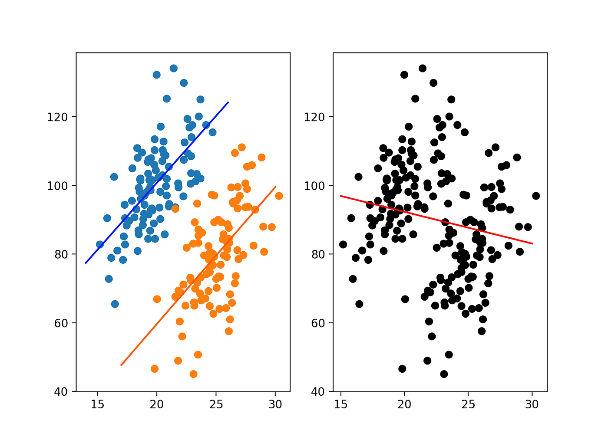

## Checklist{.smaller}

```{r}
#| echo: false

library(tidyverse)
library(palmerpenguins)
library(broom)
library(kableExtra)

model1 <- lm(flipper_length_mm ~ bill_length_mm, data = penguins)

```


-- Homework-3 assigned 11-13; due 11-20

-- Rubric assignment is out now; due 11-27
    
-- Don't forget about the Statistics Experience (12-1)

-- Exam-2 grades are LIVE
      
    > regrade window until Friday at 5pm

-- Final Exam 

    > December 3rd 3:30pm in our classroom
    > Cumulative with a focus on unit-III
    
-- Optional Homework-4 coming 

    > "Graded" for completeness 
    > + 3 EC on the Final 
    > Help you study for regression 
    > key will be posted
    
## Roadmap 

-- Next Tuesday

    > finish all things regression 
    > review 
    
-- Tuesday after break 

    > review for final 
    
# Questions 
    
## Course evaluations

We are going to take 5-minutes to fill out the course evaluation:
http://go.ncsu.edu/cesurvey

These are important!

> I take them very seriously, and will read them after the semester The
> department takes them very seriously

## 

You are my favorite ST 312 class I’ve ever taught at NC State!

{fig-align="center"}

## Confidence intervals 

-- What are they?

-- Why do we make them?

## Confidence intervals 

We can calculate three types of confidence intervals: 

-- Confidence interval for $\beta_1$

-- Confidence interval for the mean response 

-- Prediction interval for a brand new observation 

## Response 

$\hat{\beta}_1 \pm t^*_{n-2} \cdot SE(\hat{\beta}_1)$

$\hat{\mu}_y \pm t^*_{n-2} \cdot SE(\hat{\mu}_y)$

$\hat{y} \pm t^*_{n-2} \cdot SE(\hat{y})$

## For the slope

$\hat{\beta}_1 \pm t^*_{n-2} \cdot SE(\hat{\beta}_1)$

```{r}
tidy(model1) |>
  kbl(digits = 3)
```

$1.690 \pm 1.96(0.105) = (1.4842,\ 1.8958)$

## Interpretation 

We are 95% confident that, if we increase bill length by 1 mm, we estimate the true/population mean flipper length to increase between 1.48 and 1.90mm.

## Prediction vs mean 

```{r}
tidy(model1) |>
  kbl(digits = 3)
```

What is the estimated mean bill flipper length for when a penguin has a bill length of 40 mm? 

What would you predict a new penguin's flipper length be if they had a bill length of 40 mm?

## Standard Errors 

$X_\text{given}$ = What we set x equal to 

$$\text{SE}_{\hat{\mu}_{Y}|X_g} = \sqrt{\hat{\sigma}^2 \left[\frac{1}{n} + \frac{(X_\text{given} - \bar{X})^2}{\sum_{i=1}^{n} (X_i - \bar{X})^2}\right]}$$

$$\text{SE}_{\text{Prediction}} = \sqrt{\hat{\sigma}^2 + \hat{\sigma}^2 \left[ \frac{1}{n} + \frac{(X_\text{given} - \bar{X})^2}{\sum_{i=1}^{n} (X_i - \bar{X})^2} \right]}$$
What's the difference? 

## Standard Errors 

$$\text{SE}_{\hat{\mu}_{Y}|X_g} = \sqrt{\hat{\sigma}^2 \left[\frac{1}{n} + \frac{(X_\text{given} - \bar{X})^2}{\sum_{i=1}^{n} (X_i - \bar{X})^2}\right]}$$

This accounts for the uncertainty of our fitted line

## Standard Errors 

$$\text{SE}_{\text{Prediction}} = \sqrt{\hat{\sigma}^2 + \hat{\sigma}^2 \left[ \frac{1}{n} + \frac{(X_\text{given} - \bar{X})^2}{\sum_{i=1}^{n} (X_i - \bar{X})^2} \right]}$$

This accounts for the uncertainty of our fitted line AND variability of individual data points around the true population regression line

## Output 

95% confidence interval

```{r}
predict(model1,
        newdata = data.frame(bill_length_mm = 40),
        interval = "confidence")
```

## Output 

95% prediction interval 

```{r}
predict(model1,
        newdata = data.frame(bill_length_mm = 40),
        interval = "prediction")
```

## Note: 

You will not be asked to calculate confidence intervals for mean response/prediction, but you may be asked: 

-- to interpret these 

-- know the relationship between 

# Questions 

## Multiple Linear Regression{.smaller}

Multiple linear regression is used to model the relationship between a single dependent/response variable and two or more independent/explanatory variables.

Maybe the relationship is more complex than just Y vs X.... and you want your model to pick up on that!

By including a relevant variable ($X_2$), you move its effect out of the error term and into the model, and now have a better understanding about what's going on. 

**We can use hypothesis testing to find the most appropriate model**

##

{fig-align="center"}

## Types of linear regression 

-- Simple Linear Regression

-- Multiple Linear Regression (additive)

-- Multiple Linear Regression (interaction)

## Multiple linear regression model (additive)

$$\mathbf{\hat{Y} = \hat{\beta}_0 + \hat{\beta}_1 X_1}$$

$$
\hat{Y} = \hat{\beta}_0 + \hat{\beta}_1 X_1 + \hat{\beta}_2 X_2 + \dots + \hat{\beta}_k X_k
$$

## Coefficients{.smaller} 

Simple Linear Regression

```{r}
#| echo: false

model1 <- lm(flipper_length_mm ~ bill_length_mm, data = penguins)

tidy(model1) |> 
  select(term, estimate) |>
  kbl(digits = 3)
```


## Coefficients 

Multiple Linear Regression 

```{r}
#| echo: false
model2 <- lm(flipper_length_mm ~ bill_length_mm + species, data = penguins)

tidy(model2) |> 
  select(term, estimate) |>
  kbl(digits = 3)
```

**Takeaway**: Coefficients are dependent on other variables in the model!

Some of the relationship between bill length and flipper length was attributed to species! 

## Coefficients 

Multiple Linear Regression 

```{r}
#| echo: false
model2 <- lm(flipper_length_mm ~ bill_length_mm + species, data = penguins)

tidy(model2) |> 
  select(term, estimate) |>
  kbl(digits = 3)
```


## We can test for it

The idea is to...

...see if the reduction in unexplained variance (the reduction in Residual Sum of Squares, RSS) when moving from $Model_\text{reduced}$ to $Model_\text{Full}$ is statistically significant.

or, is **species** a good predictor/worth it to include!

This sounds like something we've done before......

## ANOVA

$\mathbf{F} = \frac{\frac{\text{SS}_{\text{Between}}}{k - 1}}{\frac{\text{SS}_{\text{Within}}}{N - k}}$

Now let's do this with regression...

## Regression 

$H_o$: $\beta_2 = \beta_3 = 0$

$H_a$:  At least one of the betas differ from zero

## Test Statistic 

$$F = \frac{(\text{RSS}_R - \text{RSS}_F) / (\text{df}_R - \text{df}_F)}{\text{MSE}_F}$$

## Visually 

```{r}
#| echo: false
library(tidyverse)
library(palmerpenguins)

# 1. Load and prepare data (remove NAs)
penguins_data <- penguins %>%
  drop_na(flipper_length_mm, bill_length_mm) 

# 2. Fit the Reduced Model (MR: Flipper Length ~ Bill Length)
model_reduced <- lm(flipper_length_mm ~ bill_length_mm, data = penguins_data)

# 3. Add model components (fitted values and residuals) to the data frame
plot_data <- penguins_data %>%
  mutate(
    Predicted_FL = predict(model_reduced),
    Residuals = residuals(model_reduced)
  )

# 4. Generate the Plot showing the Residuals as Vertical Lines
ggplot(plot_data, aes(x = bill_length_mm, y = flipper_length_mm)) +
  
  # A. Plot the single regression line for the reduced model
  geom_smooth(method = "lm", se = FALSE, color = "darkred", linewidth = 1) +
  
  # B. Draw the Residuals as vertical lines from the observed Y to the predicted Y
  geom_segment(
    aes(xend = bill_length_mm, yend = Predicted_FL),
    color = "black", 
    linetype = "dotted", 
    alpha = 0.6
  ) +
  
  # C. Plot the original data points
  geom_point(color = "skyblue", size = 2, alpha = 0.7) +
  
  labs(
    title = "Residual Distances for the Reduced Model",
    subtitle = "Model: Flipper Length ~ Bill Length. Vertical lines show model error (residuals).",
    x = "Bill Length (mm)",
    y = "Flipper Length (mm)"
  ) +
  theme_minimal()
```

## Visually 

```{r}
#| echo: false
library(tidyverse)
library(palmerpenguins)

# 1. Load, clean, and prepare data 
penguins_data <- penguins %>%
  drop_na(flipper_length_mm, bill_length_mm, species)

# 2. Fit the Full ADDITIVE Model
# This calculates the single best slope for bill_length_mm and three intercepts.
model_full_additive <- lm(flipper_length_mm ~ bill_length_mm + species, data = penguins_data)

# 3. Add model components (Predicted Y and Residuals) to the data frame
plot_data_additive <- penguins_data %>%
  mutate(
    # Use predict() to get the fitted Y values for each point
    Predicted_FL = predict(model_full_additive, newdata = penguins_data),
    Residuals = residuals(model_full_additive)
  )

# 4. Generate the Plot with Forced Parallel Lines
ggplot(plot_data_additive, aes(x = bill_length_mm, y = flipper_length_mm, color = species)) +
  
  # A. Plot the original data points
  geom_point(size = 2, alpha = 0.7) +
  
  # B. Draw the Residuals as vertical lines
  geom_segment(
    aes(xend = bill_length_mm, yend = Predicted_FL),
    color = "black", 
    linetype = "dotted", 
    alpha = 0.8
  ) +
  
  # C. CRITICAL STEP: Use geom_line to plot the Predicted_FL against the Bill_Length
  # This forces the lines to follow the exact predicted values from the fitted additive model.
  # The lines are guaranteed to be parallel.
  geom_line(aes(y = Predicted_FL), linewidth = 1.5) +
  
  labs(
    title = "Residuals for the FULL ADDITIVE Model (Forced Parallel Lines)",
    subtitle = "Fitted Lines: Flipper Length ~ Bill Length + Species",
    x = "Bill Length (mm)",
    y = "Flipper Length (mm)"
  ) +
  theme_minimal() +
  scale_color_discrete(name = "Penguin Species")
```

## Assumptions 

Check for both models!

-- Independence

-- Linearity 

-- Normality of residuals 

-- Equal Variance 

... and they need to be nested models

## Independence 

How do we check it? 

## Linearity and Equal Variance 

```{r}
#| echo: false

# 📦 Load necessary packages
library(ggplot2)
library(dplyr)
# Assuming palmerpenguins is loaded or you use the built-in dataset

# --- 1. & 2. Fit the model and calculate residuals/fitted values ---
# Filter out rows with NA values in the relevant columns for a clean model
penguin_data_clean <- na.omit(
  palmerpenguins::penguins[, c("flipper_length_mm", "species", "bill_length_mm")]
)

# Fit the additive linear model: flipper_length_mm ~ species + bill_length_mm
model <- lm(
  flipper_length_mm ~ species + bill_length_mm,
  data = penguin_data_clean
)

# --- 3. Combine model results with data ---
# Create a data frame with the original data plus the model's residuals and fitted values
model_data <- data.frame(
  Fitted = fitted(model),
  Residuals = residuals(model)
)

# --- 4. Create the Residuals vs. Fitted plot using ggplot2 ---
ggplot(model_data, aes(x = Fitted, y = Residuals)) +
  # Add scatter plot points
  geom_point(alpha = 0.7) +
  # Add a horizontal line at y=0 to easily assess residual scatter
  geom_hline(yintercept = 0, linetype = "dashed", color = "red", linewidth = 1) +
  # Optional: Add a smooth line (LOESS) to visualize the trend in the residuals
  geom_smooth(method = "loess", se = FALSE, color = "blue") +
  # Set informative labels and title
  labs(
    title = "Residuals vs. Fitted Plot",
    subtitle = "Model: flipper_length_mm ~ species + bill_length_mm",
    x = "Fitted Values (Predicted Flipper Length)",
    y = "Residuals (Error)"
  ) +
  # Apply a clean theme
  theme_minimal()
```

## Violation of Equal Variance

```{r}
library(ggplot2)

# 1. Simulate predictor X
set.seed(42)
N <- 100
X <- runif(N, 1, 10)

# 2. Define the mean relationship (linear)
mu_y <- 5 + 2 * X

# 3. Define the non-constant error/residual standard deviation (Heteroscedasticity)
# The spread increases with X
sd_error <- 0.5 * X 

# 4. Generate the response Y with increasing error
Y <- mu_y + rnorm(N, mean = 0, sd = sd_error)

# 5. Create a data frame and run the linear model
hetero_data <- data.frame(X, Y)
model <- lm(Y ~ X, data = hetero_data)

# Extract residuals and fitted values
hetero_data$Fitted <- fitted(model)
hetero_data$Residuals <- residuals(model)

ggplot(hetero_data, aes(x = Fitted, y = Residuals)) +
  geom_point(alpha = 0.7) +
  geom_hline(yintercept = 0, linetype = "solid", color = "blue", size = 0.8) +
  geom_smooth(method = "loess", se = FALSE, color = "red") + # Loess line to highlight the pattern
  labs(
    title = "Residuals vs. Fitted Plot (Heteroscedasticity)",
    subtitle = "Violation of Constant Variance Assumption",
    x = "Fitted Values (Predicted Y)",
    y = "Residuals (Error)"
  ) +
  theme_minimal()
```

## Violation of linearity 

```{r}
#| echo: false
# Load the necessary library
library(ggplot2)
library(dplyr) # For data manipulation

# --- 1. Generate Non-Linear Data (Quadratic) ---
set.seed(42) # for reproducibility
x <- 1:100
# True relationship is Y = 5 + 0.5*X + 0.02*X^2 + error
y_curved <- 5 + 0.5 * x + 0.02 * x^2 + rnorm(100, 0, 10)
data_curved <- data.frame(x, y_curved)

# --- 2. Fit the INCORRECT Linear Model ---
# This model *assumes* a straight line relationship (linearity)
linear_model <- lm(y_curved ~ x, data = data_curved)

# --- 3. Extract Residuals and Fitted Values ---
# Use the augment() function from the 'broom' package (or just use base R)
# We'll stick to base R to keep it simple, or use the built-in .fitted and .resid
data_curved$Fitted_Values <- fitted(linear_model)
data_curved$Residuals <- residuals(linear_model)

# --- 4. Create the Residuals vs. Fitted Plot in ggplot2 ---
ggplot(data_curved, aes(x = Fitted_Values, y = Residuals)) +
  # Add the points
  geom_point(alpha = 0.7) +
  # Add the horizontal zero line for reference
  geom_hline(yintercept = 0, linetype = "dashed", color = "blue", linewidth = 1) +
  # Add a smoothed curve (LOESS) to highlight the pattern
  # The smoothed line clearly shows the non-linear pattern in the residuals.
  geom_smooth(method = "loess", color = "red", linewidth = 1, se = FALSE) +
  # Set up labels and title
  labs(
    title = "Residuals vs. Fitted Plot: Violation of Linearity",
    subtitle = "U-Shaped Pattern Indicates a Missing Quadratic Term",
    x = "Fitted Values",
    y = "Residuals"
  ) +
  theme_minimal()
```

## Normality 

```{r}
#| echo: false
# 1. Load Libraries
library(ggplot2)
library(dplyr)
library(palmerpenguins) # For the data
library(qqplotr) # For stat_qq_point, stat_qq_line, stat_qq_band

# 2. Clean and Prepare Data
# Remove rows with missing values (NA) in the variables we need
# since the lm() function cannot handle them by default.
penguins_clean <- penguins %>%
  filter(!is.na(flipper_length_mm),
         !is.na(species),
         !is.na(bill_length_mm))

# 3. Fit the Additive Linear Model (LM)
# Flipper Length is the response, Species and Bill Length are predictors
additive_model <- lm(flipper_length_mm ~ species + bill_length_mm, data = penguins_clean)

# 4. Extract Residuals and Prepare Data for Plotting
# We create a new data frame containing only the residuals
residuals_data <- data.frame(
  Residuals = residuals(additive_model)
)

# 5. Create the Normal Q-Q Plot in ggplot2
ggplot(data = residuals_data, aes(sample = Residuals)) +
  # Add the quantile points (the residuals)
  stat_qq_point(alpha = 0.8, color = "darkgreen") +
  # Add the theoretical reference line (perfect normal distribution)
  stat_qq_line(line.colour = "red", linewidth = 1) +
  # Add confidence bands to show the region where points are expected to fall
  # Set up labels and title
  labs(
    title = "Normal Q-Q Plot of Residuals for Flipper Length Model",
    subtitle = "Model: Flipper Length ~ Species + Bill Length",
    x = "Theoretical Quantiles (Normal Distribution)",
    y = "Sample Quantiles (Model Residuals)"
  ) +
  theme_minimal()
```

+ we have a large sample size!

## Nested models

What does it mean to be nested? 

## 

We can perform transformations to help fix equal variance / normality. Your book talks about them.

##

**You need to check assumptions for both models** 

## Output{.smaller} 

```{r}
#| echo: false
# 1. Fit the Reduced Model (MR: Flipper Length ~ Bill Length)
model_reduced <- lm(flipper_length_mm ~ bill_length_mm, data = penguins)

# 2. Fit the Full Model (MF: Flipper Length ~ Bill Length + Species)
model_full <- lm(flipper_length_mm ~ bill_length_mm + species, data = penguins)

# 3. Perform the Model Comparison F-test
anova(model_reduced, model_full)
```

What can we conclude? 

## degrees of freedom 

$df_1 = p_{\text{full}} - p_{\text{reduced}} = 4 - 2 = 2$; this includes all indicator variables in the model (4 = intercept + bill length + chinstrap + gentoo)

$df_2 = n - p_{\text{full}} = 342 - 4 = 338$

$F \sim F_{2,338}$

## Multiple Linear Regression (interaction)

Is it worth it? 

First, let's write out the estimated model.


```{r}
#| echo: false

library(tidyverse)
library(palmerpenguins)

# 1. Load, clean, and prepare data 
penguins_data <- penguins %>%
  drop_na(flipper_length_mm, bill_length_mm, species)

# 2. Generate the Plot showing Three Non-Parallel Lines (Interaction Model)
ggplot(penguins_data, aes(x = bill_length_mm, y = flipper_length_mm, color = species)) +
  
  # A. Plot the original data points
  geom_point(size = 2, alpha = 0.7) +
  
  # B. Plot the three separate fitted lines 
  # geom_smooth(method = "lm") fits a separate line for each color group (species),
  # which correctly reflects the different slopes and intercepts of the interaction model.
  geom_smooth(method = "lm", se = FALSE, linewidth = 1.5) +
  
  labs(
    title = "Fitted Lines for the Full Interaction Model",
    subtitle = "Relationship between Flipper Length and Bill Length differs by Species",
    x = "Bill Length (mm)",
    y = "Flipper Length (mm)"
  ) +
  theme_minimal() +
  scale_color_discrete(name = "Penguin Species")
```

## Model Output{.smaller}

```{r}
#| echo: false
model3 <- lm(flipper_length_mm ~ species*bill_length_mm, data = penguins)

tidy(model3)
```


## Visually (interaction)

```{r}
library(tidyverse)
library(palmerpenguins)

# 1. Load, clean, and prepare data 
penguins_data <- penguins %>%
  drop_na(flipper_length_mm, bill_length_mm, species)

# 2. Fit the FULL INTERACTION Model
# The '*' operator specifies main effects AND the interaction term.
# This model fits three lines with different slopes AND different intercepts.
model_full_interaction <- lm(flipper_length_mm ~ bill_length_mm * species, data = penguins_data)

# 3. Add model components (Predicted Y and Residuals) to the data frame
plot_data_interaction <- penguins_data %>%
  mutate(
    # Use predict() to get the fitted Y values for each point
    Predicted_FL = predict(model_full_interaction, newdata = penguins_data),
    Residuals = residuals(model_full_interaction)
  )

# 4. Generate the Plot showing Three Non-Parallel Lines (Interaction Model)
ggplot(plot_data_interaction, aes(x = bill_length_mm, y = flipper_length_mm, color = species)) +
  
  # A. Draw the Residuals as vertical lines (error relative to its own species line)
  geom_segment(
    aes(xend = bill_length_mm, yend = Predicted_FL),
    color = "black", 
    linetype = "dotted", 
    alpha = 1
  ) +
  
  # B. Plot the original data points
  geom_point(size = 2, alpha = 0.7) +
  
  # C. Plot the three separate fitted lines 
  # geom_smooth(method = "lm") correctly uses the global color=species aesthetic
  # to fit and display three different lines, reflecting the interaction model.
  geom_smooth(method = "lm", se = FALSE, linewidth = 1.5) +
  
  labs(
    title = "Residuals for the FULL INTERACTION Model",
    subtitle = "Fitted Lines: Flipper Length ~ Bill Length * Species (Different Slopes and Intercepts)",
    x = "Bill Length (mm)",
    y = "Flipper Length (mm)"
  ) +
  theme_minimal() +
  scale_color_discrete(name = "Penguin Species")
```


## Visually (additive)

```{r}
#| echo: false
library(tidyverse)
library(palmerpenguins)

# 1. Load, clean, and prepare data 
penguins_data <- penguins %>%
  drop_na(flipper_length_mm, bill_length_mm, species)

# 2. Fit the Full ADDITIVE Model
# This calculates the single best slope for bill_length_mm and three intercepts.
model_full_additive <- lm(flipper_length_mm ~ bill_length_mm + species, data = penguins_data)

# 3. Add model components (Predicted Y and Residuals) to the data frame
plot_data_additive <- penguins_data %>%
  mutate(
    # Use predict() to get the fitted Y values for each point
    Predicted_FL = predict(model_full_additive, newdata = penguins_data),
    Residuals = residuals(model_full_additive)
  )

# 4. Generate the Plot with Forced Parallel Lines
ggplot(plot_data_additive, aes(x = bill_length_mm, y = flipper_length_mm, color = species)) +
  
  # A. Plot the original data points
  geom_point(size = 2, alpha = 0.7) +
  
  # B. Draw the Residuals as vertical lines
  geom_segment(
    aes(xend = bill_length_mm, yend = Predicted_FL),
    color = "black", 
    linetype = "dotted", 
    alpha = 0.8
  ) +
  
  # C. CRITICAL STEP: Use geom_line to plot the Predicted_FL against the Bill_Length
  # This forces the lines to follow the exact predicted values from the fitted additive model.
  # The lines are guaranteed to be parallel.
  geom_line(aes(y = Predicted_FL), linewidth = 1.5) +
  
  labs(
    title = "Residuals for the FULL ADDITIVE Model (Forced Parallel Lines)",
    subtitle = "Fitted Lines: Flipper Length ~ Bill Length + Species",
    x = "Bill Length (mm)",
    y = "Flipper Length (mm)"
  ) +
  theme_minimal() +
  scale_color_discrete(name = "Penguin Species")
```

## Test Statistic 

$$F = \frac{(\text{RSS}_R - \text{RSS}_F) / (\text{df}_R - \text{df}_F)}{\text{MSE}_F}$$

## Test statistic{.smaller}

```{r}
#| echo: false
# 1. Fit the Reduced Model (MR: Flipper Length ~ Bill Length)
model_reduced <- lm(flipper_length_mm ~ bill_length_mm + species, data = penguins)

# 2. Fit the Full Model (MF: Flipper Length ~ Bill Length + Species)
model_full <- lm(flipper_length_mm ~ bill_length_mm * species, data = penguins)

# 3. Perform the Model Comparison F-test
anova(model_reduced, model_full)
```

## degrees of freedom 

$df_1 = p_{\text{interaction}} - p_{\text{additive}} = 6 - 4 = 2$

$df_2 = n - p_{\text{interaction}} = 342 - 6 = 336$

$F \sim F_{2,336}$

# other variables 

## Additive model{.smaller}

```{r}
#| echo: false 
#| warning: false 


# install.packages(c("tidyverse", "plotly", "palmerpenguins"))
library(tidyverse)
library(plotly)
library(palmerpenguins)

# 1. Prepare Data
plot_data <- penguins %>%
  select(flipper_length_mm, bill_length_mm, bill_depth_mm, species) %>%
  drop_na()

# 2. Fit the Additive Model
# Flipper Length (Z) as a function of Bill Length (X) and Bill Depth (Y)
model_3d <- lm(flipper_length_mm ~ bill_length_mm + bill_depth_mm, data = plot_data)
summary(model_3d)
```

## Visually{.smaller}

```{r}
#| echo: false 
#| warning: false
# 3. Create a Grid for the Fitted Plane
# We need points to define the predicted plane across the range of the predictors.
x_range <- range(plot_data$bill_length_mm)
y_range <- range(plot_data$bill_depth_mm)

x_grid <- seq(x_range[1], x_range[2], length.out = 30)
y_grid <- seq(y_range[1], y_range[2], length.out = 30)

# Create a data frame for the plane's prediction grid
plane_data <- expand.grid(bill_length_mm = x_grid, bill_depth_mm = y_grid)

# Predict Flipper Length (Z) for every point on the grid
plane_data$z_plane <- predict(model_3d, newdata = plane_data)

# Convert the predicted Z values into a matrix format required by add_surface
z_matrix <- matrix(plane_data$z_plane, nrow = 30, ncol = 30, byrow = TRUE)

# 4. Create the Interactive 3D Plot
plot_ly(plot_data, x = ~bill_length_mm, y = ~bill_depth_mm, z = ~flipper_length_mm, 
        color = ~species, marker = list(size = 4, opacity = 0.7)) %>%
  
  # Add the Scatter Points
  add_markers(name = "Observed Data") %>%
  
  # Add the Fitted Regression Plane
  add_surface(z = z_matrix, 
              x = x_grid, 
              y = y_grid, 
              opacity = 0.5, 
              colors = "lightblue", 
              name = "Fitted Plane") %>%
              
  # Set Axis Titles
  layout(scene = list(
    xaxis = list(title = "Bill Length (X)"),
    yaxis = list(title = "Bill Depth (Y)"),
    zaxis = list(title = "Flipper Length (Z)")
  ))
```

## Interaction model{.smaller} 

```{r}
#| echo: false 
#| warning: false
# install.packages(c("tidyverse", "plotly", "palmerpenguins"))
library(tidyverse)
library(plotly)
library(palmerpenguins)

# 1. Prepare Data
plot_data <- penguins %>%
  select(flipper_length_mm, bill_length_mm, bill_depth_mm, species) %>%
  drop_na()

# 2. Fit the Full Interaction Model
# This model allows the slopes (effect of bill_length and bill_depth) to vary by species.
model_interaction <- lm(flipper_length_mm ~ bill_length_mm * bill_depth_mm, data = plot_data)

tidy(model_interaction)
```

## Interaction Model 

```{r}
#| echo: false
#| warning: false

# 1. Create the interaction model
model_3d <- lm(flipper_length_mm ~ bill_length_mm * bill_depth_mm,
               data = plot_data)

# 2. Create a Grid for the Fitted Plane
x_range <- range(plot_data$bill_length_mm)
y_range <- range(plot_data$bill_depth_mm)

x_grid <- seq(x_range[1], x_range[2], length.out = 30)
y_grid <- seq(y_range[1], y_range[2], length.out = 30)

# 3. Create a data frame for the plane's prediction grid
plane_data <- expand.grid(
  bill_length_mm = x_grid,
  bill_depth_mm = y_grid
)

# 4. Predict Flipper Length (Z) for every point on the grid
plane_data$z_plane <- predict(model_3d, newdata = plane_data)

# 5. Convert predicted Z values into a matrix
z_matrix <- matrix(
  plane_data$z_plane,
  nrow = 30,
  ncol = 30,
  byrow = TRUE
)

# 6. Create the Interactive 3D Plot
plot_ly(
  plot_data,
  x = ~bill_length_mm,
  y = ~bill_depth_mm,
  z = ~flipper_length_mm,
  color = ~species,
  marker = list(size = 4, opacity = 0.7)
) %>%

  add_markers(name = "Observed Data") %>%

  add_surface(
    z = z_matrix,
    x = x_grid,
    y = y_grid,
    opacity = 0.5,
    colors = "lightblue",
    name = "Interaction Model"
  ) %>%

  layout(scene = list(
    xaxis = list(title = "Bill Length (X)"),
    yaxis = list(title = "Bill Depth (Y)"),
    zaxis = list(title = "Flipper Length (Z)")
  ))
```

