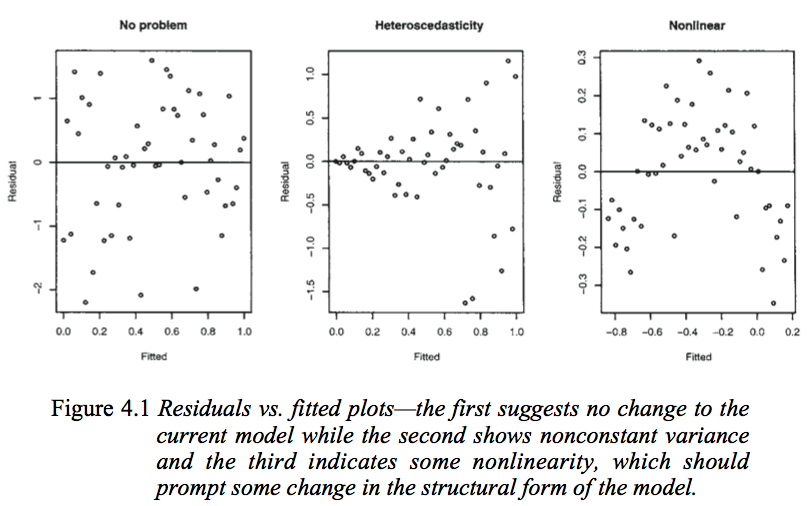

## Checklist{.smaller}

```{r}
#| echo: false

library(tidyverse)
library(palmerpenguins)
library(broom)
library(kableExtra)
```


-- Homework-3 assigned 11-13; due 11-20

-- Rubric assignment is out now; due 11-27
    
-- Don't forget about the Statistics Experience (12-1)

-- Exam-2 grades are LIVE
      
    > regrade window until Friday at 5pm

-- Final Exam 

    > December 3rd 3:30pm in our classroom
    > Cumulative with a focus on unit-III
    
## Last time 

```{r}
#| echo: false
penguins |>
  ggplot(
    aes(x = bill_length_mm, y = flipper_length_mm)) + 
  geom_point() + 
  labs(title = "Penguins Data",
       x = "bill length (mm)",
       y = "flipper length (mm)") + 
  geom_smooth(method = "lm" , se = F)
```

-- What type of regression is this called?

-- How was this line fit? 

## In-R {.smaller}

```{r}
model1 <- lm(flipper_length_mm ~ bill_length_mm, data = penguins)

tidy(model1) |> 
  select(term, estimate) |>
  kbl(digits = 3)
```


Write out this model. 

## Writing out our model

$\hat{y} = \hat{\beta_o} + \hat{\beta_1}*x$

$\widehat{\text{flipper length}} = 126.68 + 1.69*\text{bill length}$

## Estimating SLR parameters (10.1){.smaller} 

I'm going to interchange $b_1$ and $\hat{\beta_1}$

b1 = $r\frac{s_y}{s_x}$

```{r}
penguins |>
  filter(!is.na(flipper_length_mm)) |>
  summarise(sd_bill = sd(bill_length_mm, na.rm = T),
            sd_flip = sd(flipper_length_mm, na.rm = T), 
            cor = cor(flipper_length_mm, bill_length_mm))
```

## Hypothesis Test 

I want to test if there is some relationship between bill length and flipper length. 

What would my null and alternative hypotheses be? 

## Null and alternative

$H_o: \beta_1$ = 0

$H_a: \beta_1 \neq 0$

There is no linear relationship between bill length and flipper length in the population (given everything else in the model)

There is a linear relationship between bill length and flipper length in the population (given everything else in the model)

(given everything else in the model) <- this is not important in simple linear regression, but it will be!

# now what...

## Assumptions 

-- Independence 

-- Linear relationship 

-- Equal Variance 

-- Normality or residuals 

## Linear relationship 

```{r}
#| echo: false
penguins |>
  ggplot(
    aes(x = bill_length_mm, y = flipper_length_mm)) + 
  geom_point() + 
  labs(title = "Penguins Data",
       x = "bill length (mm)",
       y = "flipper length (mm)") + 
  geom_smooth(method = "lm" , se = F)
```

## Equal Variance (and linearity)

Fitted = Predicted 

```{r}
# Load necessary libraries
library(palmerpenguins)
library(ggplot2)
library(dplyr)

# 1. Fit the Linear Regression Model
# Remove NA values needed for the model to run
penguins_clean <- penguins |>
  filter(!is.na(bill_length_mm) & !is.na(flipper_length_mm))

model <- lm(flipper_length_mm ~ bill_length_mm, data = penguins_clean)

# 2. Extract Diagnostic Data (Using Raw Residuals)
# The 'resid(model)' function extracts the raw residuals (Y_i - Y_hat_i)
model_diagnostic_data <- penguins_clean |>
  mutate(
    Fitted_Values = predict(model),         # Predicted (Fitted) values (Y-hat)
    Raw_Residuals = resid(model)            # Raw residuals (e_i)
  )

# 3. Create the Residuals vs. Fitted Plot (Equal Variance Assessment)
equal_variance_plot <- model_diagnostic_data |>
  ggplot(aes(x = Fitted_Values, y = Raw_Residuals)) +
  
  # Scatter plot of residuals against fitted values
  geom_point(alpha = 0.6) +
  
  # Horizontal line at y=0 (The mean of the residuals is always zero)
  geom_hline(yintercept = 0, linetype = "dashed", color = "red") +
  
  labs(
    title = "Residuals vs. Fitted Plot (Raw Residuals)",
    subtitle = "Assessing Homoscedasticity for Flipper Length Regression",
    x = "Fitted Values of Flipper Length (mm)",
    y = "Raw Residuals (Observed - Fitted)"
  ) +
  theme_minimal()

# Display the plot
print(equal_variance_plot)
```


Homoscedasticity means "having the same variance"

## Equal Variance (and linearity)

{fig-align="center"}

## Normal q-q plots

```{r}
# Load necessary libraries
library(palmerpenguins)
library(ggplot2)
library(dplyr)

# 1. Fit the Linear Regression Model
# Ensure NA values are filtered for the model fit
penguins_clean <- penguins |>
  filter(!is.na(bill_length_mm) & !is.na(flipper_length_mm))

model <- lm(flipper_length_mm ~ bill_length_mm, data = penguins_clean)

# 2. Extract Raw Residuals
# Create a data frame containing only the raw residuals
residuals_df <- data.frame(Raw_Residuals = resid(model))

# 3. Create the Normal Q-Q Plot
qq_plot_raw <- residuals_df |>
  ggplot(aes(sample = Raw_Residuals)) +
  
  # Scatter plot: Raw residuals (Y) vs. Theoretical Quantiles (X)
  geom_qq(alpha = 0.6) + 
  
  # The red line represents the expected relationship for normal data
  geom_qq_line(color = "red") + 
  
  labs(
    title = "Normal Q-Q Plot",
    subtitle = "Assessing Normality Assumption",
    x = "Theoretical Quantiles (Standard Normal)",
    y = "Raw Residuals"
  ) +
  theme_minimal()

# Display the plot
print(qq_plot_raw)
```

## How to fix this

For now, it's beyond the scope of this course...

... but I'll post resources for you if you are interested

## Normality 

The standard $p$-values and confidence intervals calculated for your slope and intercept coefficients (which rely on the $t$-distribution and the normality assumption) may be inaccurate....

But our sample size is large, making our hypothesis test more "robust" to this assumption (vs the others)

## Test statistic 

t 

## Test statistic{.smaller} 

$$t = \frac{\hat{\beta}_1 - \beta_{\text{null}}}{\text{SE}(\hat{\beta}_1)}$$

$$\text{SE}(\hat{\beta}_1) = \sqrt{\frac{\hat{\sigma}^2}{\sum_{i=1}^{n} (X_i - \bar{X})^2}}$$

$$\hat{\sigma}^2 = \frac{\text{RSS}}{n - 2}$$

Where $\mathbf{\bar{X}}$ is the Sample Mean of the Predictor Variable 

## Output{.smaller} 

```{r}
model1 <- lm(flipper_length_mm ~ bill_length_mm, data = penguins)

tidy(model1) |>
  kbl(digits = 3)
```

And this t-statistic follows a t-distribution with n-2 degrees of freedom (-2 because we estimate the population slope and intercept)


-- Recreate the statistic

-- Draw out what the p-value would look like

## 

What does all of this mean?

## Confidence intervals 

How do you think we should go about this? 

## Confidence intervals 

We can calculate three types of confidence intervals: 

-- Confidence interval for $\beta_1$

-- Confidence interval for the mean response 

-- Prediction interval for a brand new observation 

## Response 

$\hat{\beta}_1 \pm t^*_{n-2} \cdot SE(\hat{\beta}_1)$

$\hat{\mu}_y \pm t^*_{n-2} \cdot SE(\hat{\mu}_y)$

$\hat{y} \pm t^*_{n-2} \cdot SE(\hat{y})$

## For the slope

$\hat{\beta}_1 \pm t^*_{n-2} \cdot SE(\hat{\beta}_1)$

```{r}
tidy(model1) |>
  kbl(digits = 3)
```

Calculate a 95% confidence interval using the output above!

## For the slope 

$1.690 \pm 1.96(0.105) = (1.4842,\ 1.8958)$

Interpret this confidence interval

Does this agree with our hypothesis test?


# if time: prediction vs mean 

## Prediction vs mean 

```{r}
tidy(model1) |>
  kbl(digits = 3)
```

What is the estimated mean bill flipper length for when a penguin has a bill length of 40 mm? 

What would you predict a new penguin's flipper length be if they had a bill length of 40 mm?

## Standard Errors 

$X_\text{given}$ = What we set x equal to 

$$\text{SE}_{\hat{\mu}_{Y}|X_g} = \sqrt{\hat{\sigma}^2 \left[\frac{1}{n} + \frac{(X_\text{given} - \bar{X})^2}{\sum_{i=1}^{n} (X_i - \bar{X})^2}\right]}$$

$$\text{SE}_{\text{Prediction}} = \sqrt{\hat{\sigma}^2 + \hat{\sigma}^2 \left[ \frac{1}{n} + \frac{(X_\text{given} - \bar{X})^2}{\sum_{i=1}^{n} (X_i - \bar{X})^2} \right]}$$
What's the difference? 

## Standard Errors 

$$\text{SE}_{\hat{\mu}_{Y}|X_g} = \sqrt{\hat{\sigma}^2 \left[\frac{1}{n} + \frac{(X_\text{given} - \bar{X})^2}{\sum_{i=1}^{n} (X_i - \bar{X})^2}\right]}$$

This accounts for the uncertainty of our fitted line

## Standard Errors 

$$\text{SE}_{\text{Prediction}} = \sqrt{\hat{\sigma}^2 + \hat{\sigma}^2 \left[ \frac{1}{n} + \frac{(X_\text{given} - \bar{X})^2}{\sum_{i=1}^{n} (X_i - \bar{X})^2} \right]}$$

This accounts for the uncertainty of our fitted line AND variability of individual data points around the true population regression line

## Output 

95% confidence interval

```{r}
predict(model1,
        newdata = data.frame(bill_length_mm = 40),
        interval = "confidence")
```

## Output 

95% prediction interval 

```{r}
predict(model1,
        newdata = data.frame(bill_length_mm = 40),
        interval = "prediction")
```

## Note: 

You will not be asked to calculate confidence intervals for mean response/prediction, but you may be asked: 

-- to interpret these 

-- know the relationship between 

# Questions

## Review 

What happens to these intervals when... 

-- n goes up?

-- Confidence level goes down? 

# We won't get here

## Correlation 

We can also do a hypothesis test for correlation 

$\rho$ = population correlation 

r = sample correlation 

What would our null and alternative hypothesis be? 

## Null and alternative 

$H_o: \rho = 0$

$H_a: \rho \neq 0$

## Statsitic 

```{r}
penguins |>
  filter(!is.na(flipper_length_mm)) |>
  summarise(cor = cor(bill_length_mm, flipper_length_mm))
```


## Assumptions 

-- Independence 

-- Normality 

-- Linearity 

## Normality 

```{r}
# Load necessary libraries
library(palmerpenguins)
library(ggplot2)
library(dplyr)
library(patchwork) # For arranging the two plots side-by-side
library(tidyr)     # To help with filtering NAs

# 1. Prepare and Clean Data
# We need to ensure we don't have NAs in the variables we are plotting
penguins_clean <- penguins |>
  select(bill_length_mm, flipper_length_mm) |>
  drop_na()

# 2. Plot Bill Length (mm)
plot_bill_qq <- penguins_clean |>
  ggplot(aes(sample = bill_length_mm)) +
  geom_qq(alpha = 0.6) + 
  geom_qq_line(color = "blue") + 
  labs(
    title = "Normal Q-Q Plot: Bill Length",
    x = "Theoretical Quantiles",
    y = "Bill Length (mm) Sample Quantiles"
  ) +
  theme_minimal()

# 3. Plot Flipper Length (mm)
plot_flipper_qq <- penguins_clean |>
  ggplot(aes(sample = flipper_length_mm)) +
  geom_qq(alpha = 0.6) + 
  geom_qq_line(color = "red") + 
  labs(
    title = "Normal Q-Q Plot: Flipper Length",
    x = "Theoretical Quantiles",
    y = "Flipper Length (mm) Sample Quantiles"
  ) +
  theme_minimal()

# 4. Display Plots Side-by-Side using patchwork
# This allows for easy comparison
plot_bill_qq 

plot_flipper_qq
```

## Test Statistic 

$t = \frac{r\sqrt{n-2}}{\sqrt{1 - r^2}}$

$$t = \frac{0.65626 \sqrt{342 - 2}}{\sqrt{1 - 0.65626^2}} = 16.034$$

## The connection 

$\frac{b1}{SE_\text{b1}} = \frac{r\sqrt{n-2}}{\sqrt{1 - r^2}}$

The statistic is the same! It comes down to your research question. 