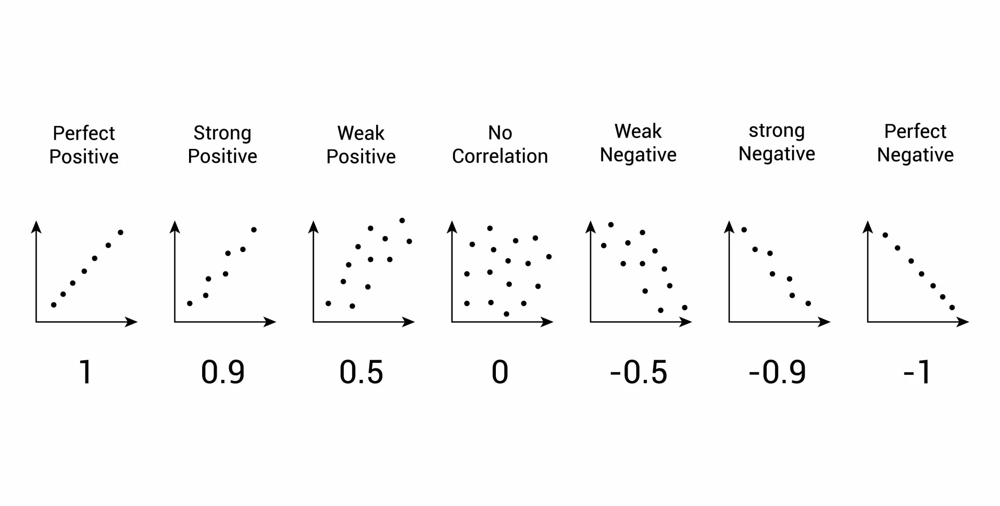

## Checklist{.smaller}

```{r}
#| echo: false

library(tidyverse)
library(palmerpenguins)
library(broom)
library(kableExtra)
```


-- Homework-3 assigned 11-13; due 11-20

-- Rubric assignment is out now; due 11-27
    
-- Don't forget about the Statistics Experience (12-1)

-- Final Exam 

    > December 3rd 3:30pm in our classroom
    > Cumulative with a focus on unit-III

## Last Time 

$Ho:$ The effect of Sex is the same at all levels of factor Species on flipper length at the population level

$Ha:$ The effect of Sex depends on the levels of Species on flipper length at the population level

## Picture

```{r}
#| echo: false
library(tidyverse)
library(palmerpenguins)

# 1. Load and fit the Interaction Model
penguins_data <- penguins %>%
  drop_na(flipper_length_mm, species, sex)

model_interaction <- lm(flipper_length_mm ~ species * sex, data = penguins_data)

# 2. Create Prediction Grid for fitted lines
prediction_grid_interaction <- expand.grid(
  species = unique(penguins_data$species),
  sex = unique(penguins_data$sex)
)
prediction_grid_interaction$Predicted_FL <- predict(model_interaction, newdata = prediction_grid_interaction)

# 3. Select one observation to highlight
highlight_observation <- penguins_data %>%
  filter(species == "Gentoo", sex == "female") %>%
  slice(5) 

predicted_for_highlight <- prediction_grid_interaction %>%
  filter(species == highlight_observation$species, sex == highlight_observation$sex) %>%
  pull(Predicted_FL)

# 4. Generate the Plot
ggplot(penguins_data, aes(x = species, y = flipper_length_mm, color = sex)) +
  
  # A. Plot all original data points with jitter (for context)
  geom_point(position = position_jitter(width = 0.2), 
             size = 1.5, 
             alpha = 0.5) +
  
  # B. Add the non-parallel fitted lines
  geom_line(data = prediction_grid_interaction, 
            aes(y = Predicted_FL, group = sex), 
            linewidth = 1.2) +
  
  # C. Add points for the *predicted* means (the fitted line's points)
  geom_point(data = prediction_grid_interaction, 
             aes(y = Predicted_FL, group = sex), 
             size = 4, 
             shape = 15) +
  theme_minimal() +
  scale_color_manual(values = c("female" = "#F8766D", "male" = "#00BFC4")) +
  theme(
    plot.title = element_text(hjust = 0.5, face = "bold"),
    plot.subtitle = element_text(hjust = 0.5),
    legend.position = "bottom"
  )
```

## Assumptions 

-- Independence of observations 

-- Normality of Residuals 

-- Equal Variance 

## Residuals 

Observed - Predicted still applies!

```{r}
#| echo: false
library(tidyverse)
library(palmerpenguins)

# 1. Load and fit the Interaction Model
penguins_data <- penguins %>%
  drop_na(flipper_length_mm, species, sex)

model_interaction <- lm(flipper_length_mm ~ species * sex, data = penguins_data)

# 2. Create Prediction Grid for fitted lines
prediction_grid_interaction <- expand.grid(
  species = unique(penguins_data$species),
  sex = unique(penguins_data$sex)
)
prediction_grid_interaction$Predicted_FL <- predict(model_interaction, newdata = prediction_grid_interaction)

# 3. Select one observation to highlight
highlight_observation <- penguins_data %>%
  filter(species == "Gentoo", sex == "female") %>%
  slice(5) 

predicted_for_highlight <- prediction_grid_interaction %>%
  filter(species == highlight_observation$species, sex == highlight_observation$sex) %>%
  pull(Predicted_FL)

# 4. Generate the Plot
ggplot(penguins_data, aes(x = species, y = flipper_length_mm, color = sex)) +
  
  # A. Plot all original data points with jitter (for context)
  geom_point(position = position_jitter(width = 0.2), 
             size = 1.5, 
             alpha = 0.5) +
  
  # B. Add the non-parallel fitted lines
  geom_line(data = prediction_grid_interaction, 
            aes(y = Predicted_FL, group = sex), 
            linewidth = 1.2) +
  
  # C. Add points for the *predicted* means (the fitted line's points)
  geom_point(data = prediction_grid_interaction, 
             aes(y = Predicted_FL, group = sex), 
             size = 4, 
             shape = 15) +
  
  # D. Highlight the specific observed point (Observed Value)
  geom_point(data = highlight_observation, 
             aes(x = species, y = flipper_length_mm), 
             color = "black", size = 5, shape = 21, fill = "gold", stroke = 1.5) +
  
  # E. Illustrate the residual: Vertical line from Observed to Predicted
  # NOTE: Using highlight_observation as data source and mapping X to 'species'
  # ensures the line stays precisely on the categorical X position.
  geom_segment(data = highlight_observation, 
               aes(x = species,
                   xend = species,
                   y = flipper_length_mm, 
                   yend = predicted_for_highlight),
               color = "black", linetype = "solid", linewidth = 1.5, inherit.aes = FALSE) + 
  
  labs(
    title = "Residual Illustration: Observed Value - Predicted Mean",
    subtitle = paste0("The vertical black line is the residual for a ", highlight_observation$sex, " ", highlight_observation$species, " penguin."),
    x = "Penguin Species",
    y = "Flipper Length (mm)",
    color = "Sex"
  ) +
  theme_minimal() +
  scale_color_manual(values = c("female" = "#F8766D", "male" = "#00BFC4")) +
  theme(
    plot.title = element_text(hjust = 0.5, face = "bold"),
    plot.subtitle = element_text(hjust = 0.5),
    legend.position = "bottom"
  )
```


## Normality of residuals

```{r}
#| echo: false 

library(tidyverse)
library(palmerpenguins)

# 1. Load and Clean Data
penguins_data <- penguins %>%
  drop_na(flipper_length_mm, species, sex)

# 2. Fit the Interaction Model
# Flipper Length is the response; Species and Sex are explanatory factors.
model_interaction <- lm(flipper_length_mm ~ species * sex, data = penguins_data)

# 3. Extract Residuals and Store in a Data Frame
residuals_data <- data.frame(
  Residuals = residuals(model_interaction)
)

# 4. Generate the Normal Q-Q Plot using ggplot2
ggplot(residuals_data, aes(sample = Residuals)) +
  # Add the quantile points
  geom_qq(color = "darkgreen", size = 2) + 
  # Add the reference line (where the points should lie if normal)
  geom_qq_line(color = "red", linewidth = 1) + 
  labs(
    title = "Normal Q-Q Plot of Residuals for Flipper Length Interaction Model",
    subtitle = "Model: Flipper Length ~ Species * Sex",
    x = "Theoretical Quantiles (Standard Normal)",
    y = "Sample Quantiles (Model Residuals)"
  ) +
  theme_minimal()
```


## Equal Variance 

```{r}
#| echo: false
library(tidyverse)
library(palmerpenguins)

# 1. Load and fit the Interaction Model
penguins_data <- penguins %>%
  drop_na(flipper_length_mm, species, sex)

model_interaction <- lm(flipper_length_mm ~ species * sex, data = penguins_data)

# 2. Extract Fitted Values and Residuals
# The augment() function from the broom package is the easiest way to get these,
# but using base R/tidyverse functions is more direct for a quick plot.
plot_data <- data.frame(
  Fitted_Values = fitted(model_interaction),
  Residuals = residuals(model_interaction)
)

# 3. Generate the Residuals vs. Fitted Plot
ggplot(plot_data, aes(x = Fitted_Values, y = Residuals)) +
  
  # Add points for each residual
  geom_point(alpha = 0.6) +
  
  # Add a horizontal line at Residual = 0 (the reference line)
  geom_hline(yintercept = 0, color = "red", linetype = "dashed", linewidth = 1) +
  
  # Add a locally weighted smoothing (LOWESS) line to check for non-linearity
  # This line should be flat and close to zero if the linearity assumption holds.
  geom_smooth(method = "loess", color = "blue", se = FALSE, linewidth = 1) +
  
  labs(
    title = "Residuals vs. Fitted Plot for Flipper Length Interaction Model",
    subtitle = "Checks for Homoscedasticity (equal variance)",
    x = "Fitted Values (Predicted Mean Flipper Length)",
    y = "Residuals (Observed - Fitted)"
  ) +
  theme_minimal()

```

## Our statistic 

$$F_{A \times B} = \frac{MS_{A \times B}}{MS_{Error}}$$


$$MS_{A \times B} = \frac{SS_{A \times B}}{df_{A \times B}}$$

$$MS_{A \times B} = \frac{SS_{error}}{df_{error}}$$

## Break it down{.smaller} 

$$
SS_{\text{AxB}} =
n\sum_{i=1}^{a}\sum_{j=1}^{b}
\left(
\bar{Y}_{ij,\text{interaction}}
-
\bar{Y}_{ij,\text{additive}}
\right)^2
$$

$SS_{A \times B}$ - 

$$\mathbf{SS_{Error} = \sum_{i=1}^{a} \sum_{j=1}^{b} \sum_{k=1}^{n} (Y_{ijk} - \bar{Y}_{ij})^2}$$

$SS_{error}$ - 

## Output 

Additive Model

```{r}
#| echo: false
m1 <- lm(flipper_length_mm ~ species + sex, data = penguins)
m2 <- lm(flipper_length_mm ~ species * sex, data = penguins)

tidy(m1) |>
  select(term, estimate, std.error)
```


## Picture 

```{r}
#| echo: false
library(tidyverse)
library(palmerpenguins)

# 1. Load and fit the Additive Model
penguins_data <- penguins %>%
  drop_na(flipper_length_mm, species, sex)

model_additive <- lm(flipper_length_mm ~ species + sex, data = penguins_data)

# 2. Create Prediction Grid for fitted lines
prediction_grid_additive <- expand.grid(
  species = unique(penguins_data$species),
  sex = unique(penguins_data$sex)
)

prediction_grid_additive$Predicted_FL <- predict(
  model_additive,
  newdata = prediction_grid_additive
)

# 3. Select one observation to highlight
highlight_observation <- penguins_data %>%
  filter(species == "Gentoo", sex == "female") %>%
  slice(5)

predicted_for_highlight <- prediction_grid_additive %>%
  filter(
    species == highlight_observation$species,
    sex == highlight_observation$sex
  ) %>%
  pull(Predicted_FL)

# 4. Generate the Plot
ggplot(penguins_data, aes(x = species, y = flipper_length_mm, color = sex)) +

  # A. Plot all original data points with jitter
  geom_point(
    position = position_jitter(width = 0.2),
    size = 1.5,
    alpha = 0.5
  ) +

  # B. Add parallel fitted lines
  geom_line(
    data = prediction_grid_additive,
    aes(y = Predicted_FL, group = sex),
    linewidth = 1.2
  ) +

  # C. Add points for the predicted means
  geom_point(
    data = prediction_grid_additive,
    aes(y = Predicted_FL, group = sex),
    size = 4,
    shape = 15
  ) +

  theme_minimal() +
  scale_color_manual(
    values = c("female" = "#F8766D", "male" = "#00BFC4")
  ) +
  theme(
    plot.title = element_text(hjust = 0.5, face = "bold"),
    plot.subtitle = element_text(hjust = 0.5),
    legend.position = "bottom"
  )
```

## Output 

Interaction model

```{r}
tidy(m2) |>
  select(term, estimate, std.error)
```

## Picture

```{r}
#| echo: false
library(tidyverse)
library(palmerpenguins)

# 1. Load and fit the Interaction Model
penguins_data <- penguins %>%
  drop_na(flipper_length_mm, species, sex)

model_interaction <- lm(flipper_length_mm ~ species * sex, data = penguins_data)

# 2. Create Prediction Grid for fitted lines
prediction_grid_interaction <- expand.grid(
  species = unique(penguins_data$species),
  sex = unique(penguins_data$sex)
)
prediction_grid_interaction$Predicted_FL <- predict(model_interaction, newdata = prediction_grid_interaction)

# 3. Select one observation to highlight
highlight_observation <- penguins_data %>%
  filter(species == "Gentoo", sex == "female") %>%
  slice(5) 

predicted_for_highlight <- prediction_grid_interaction %>%
  filter(species == highlight_observation$species, sex == highlight_observation$sex) %>%
  pull(Predicted_FL)

# 4. Generate the Plot
ggplot(penguins_data, aes(x = species, y = flipper_length_mm, color = sex)) +
  
  # A. Plot all original data points with jitter (for context)
  geom_point(position = position_jitter(width = 0.2), 
             size = 1.5, 
             alpha = 0.5) +
  
  # B. Add the non-parallel fitted lines
  geom_line(data = prediction_grid_interaction, 
            aes(y = Predicted_FL, group = sex), 
            linewidth = 1.2) +
  
  # C. Add points for the *predicted* means (the fitted line's points)
  geom_point(data = prediction_grid_interaction, 
             aes(y = Predicted_FL, group = sex), 
             size = 4, 
             shape = 15) +
  theme_minimal() +
  scale_color_manual(values = c("female" = "#F8766D", "male" = "#00BFC4")) +
  theme(
    plot.title = element_text(hjust = 0.5, face = "bold"),
    plot.subtitle = element_text(hjust = 0.5),
    legend.position = "bottom"
  )
```

## Results


```{r}
#| echo: false
library(tidyverse)
library(palmerpenguins)

# 1. Load and clean the data
# We drop rows with NAs in our variables of interest
penguins_data <- penguins %>%
  drop_na(flipper_length_mm, species, sex)

# 2. Fit the Two-Way ANOVA Interaction Model
# The asterisk (*) represents the main effects (species and sex) PLUS their interaction.
# Model Formula: flipper_length_mm ~ species + sex + species:sex
model_anova <- aov(flipper_length_mm ~ species * sex, data = penguins_data)

# 3. Generate the ANOVA Summary Table
# This table contains the Sums of Squares (SS), Degrees of Freedom (df), 
# Mean Squares (MS), F-statistics, and p-values for all effects.
summary(model_anova)
```


What is the distribution our F-statistic follows? 

## Distribution 

F-distribution 

$$\mathbf{df_{A \times B} = (a - 1)(b - 1)}$$

$$\mathbf{df_{Error} = ab(n - 1)}$$

## What does this tell us? 

-- Reject the null hypothesis

-- Strong evidence to conclude that the relationship between Species and Flipper Length does depend on the Sex of the Penguin. 

## Note

If there is evidence of an interaction effect, this is where we stop! 

The questions below don't make sense if we have evidence of an interaction!

---------------------------------------------------------------------

-- We can test for the significance of main effect A (given B is in the model) 

-- We can test for the significance of main effect B (given A is in the model)

## Research Questions 

For demonstration purposes, we are going to remove the interaction term from the model, and test the main effect!

-- We can test for the significance of main effect A (given B is in the model) <- Let's do this now

-- We can test for the significance of main effect B (given A is in the model)

**RQ: Is there a relationship between Sex and Flipper Length, give Species is in our model?**

## Research Questions 

For demonstration purposes, we are going to remove the interaction term from the model, and test the main effect!

-- We can test for the significance of main effect A (given B is in the model) <- Let's do this now

-- We can test for the significance of main effect B (given A is in the model)

**RQ: Is there a relationship between Sex and Flipper Length, give Species is in our model?**

## What does this look like?

```{r}
#| echo: false
library(tidyverse)
library(palmerpenguins)

library(tidyverse)
library(palmerpenguins)

# Remove missing observations
penguins_clean <- penguins %>%
  drop_na(flipper_length_mm, sex, species)

# Additive model: Sex + Species
model_add <- lm(flipper_length_mm ~ sex + species,
                data = penguins_clean)

# Predicted means for each combination
pred_add <- expand_grid(
  species = levels(penguins_clean$species),
  sex = levels(penguins_clean$sex)
) %>%
  mutate(predicted = predict(model_add, newdata = .))

# Predicted means for Female Adelie and Chinstrap
adelie_female <- pred_add %>%
  filter(species == "Adelie", sex == "female") %>%
  pull(predicted)

# Plot: Additive Model
plot_add <- ggplot(pred_add,
                   aes(x = species, y = predicted,
                       color = sex, group = sex)) +

  geom_line(linewidth = 1.2) +
  geom_point(size = 3) +

  # Horizontal arrow showing the main effect of Species
  annotate("segment",
           x = 1, xend = 3,
           y = adelie_female,
           yend = adelie_female,
           arrow = arrow(length = unit(0.2, "cm")),
           linewidth = 1,
           color = "black") +

  annotate("text",
           x = 2,
           y = adelie_female + 8,
           label = "Main effect of Species",
           hjust = 0.5,
           size = 3.5) +

  labs(
    title = "Additive Model: Flipper Length ~ Sex + Species",
    x = "Species",
    y = "Predicted Flipper Length (mm)",
    color = "Sex"
  ) +

  theme_minimal()

plot_add
```

## vs 

```{r}
#| echo: false
# Model without Species
model_sex <- lm(flipper_length_mm ~ sex,
                data = penguins_clean)

# Predicted means for each species and sex
pred_sex <- expand_grid(
  species = levels(penguins_clean$species),
  sex = levels(penguins_clean$sex)
) %>%
  mutate(predicted = predict(model_sex, newdata = .))

# Plot: Model without Species
plot_sex <- ggplot(pred_sex,
                   aes(x = species, y = predicted,
                       color = sex, group = sex)) +
  geom_line(linewidth = 1.2) +
  geom_point(size = 3) +
  labs(
    title = "Model: Flipper Length ~ Sex",
    subtitle = "Species is not included in the model",
    x = "Species",
    y = "Predicted Flipper Length (mm)",
    color = "Sex"
  ) +
  theme_minimal()

# Display plot
plot_sex
```


## Model notation 

Additive model: $$\mathbf{Y_{ijk} = \mu + \alpha_i + \beta_j  + \epsilon_{ijk}}$$

Write out the null and alternative hypothesis to test to see if Species has a significant impact on flipper length, given Sex is in the model.

## Hypothesis

Ho: $\alpha_i = 0$, given sex is in the model.

Ha: At least one $\alpha_i \neq 0$, given sex is in the model.

where i = Adelie, Chinstrap, Gentoo 

## Assumptions

What are they?

## Equal Variance

```{r}
#| echo: false
library(tidyverse)
library(palmerpenguins)

# --- 1. Data Cleaning ---
# Ensure data is clean for the model
penguins_clean <- penguins %>%
  drop_na(flipper_length_mm, species, sex)

# --- 2. Model Fitting (Additive ANOVA: Flipper Length ~ Species + Sex) ---
model_additive <- lm(flipper_length_mm ~ species + sex, data = penguins_clean)

# --- 3. Prepare Data for Plotting ---
plot_data <- penguins_clean %>%
  mutate(
    fitted_values = fitted(model_additive),
    residuals = resid(model_additive)
  )

# --- 4. Generate the ggplot Visualization ---
ggplot(plot_data, aes(x = fitted_values, y = residuals)) +
  
  # Scatter plot of residuals vs. fitted values. 
  # Color is mapped to 'species' but the legend will be suppressed.
  geom_point(alpha = 0.6, aes(color = species)) +
  
  # Add the reference line at y = 0
  geom_hline(yintercept = 0, linetype = "dashed", color = "red", linewidth = 1) +
  
  labs(
    title = "Residuals vs. Fitted Values Plot for Flipper Length Model",
    subtitle = "Model: Flipper Length ~ Species + Sex (Points grouped by species, but legend removed)",
    x = "Fitted Values (Predicted Flipper Length in mm)",
    y = "Residuals (Observed - Predicted)"
  ) +
  theme_minimal() +
  # --- CRITICAL LINE: Suppresses the legend for the 'color' aesthetic ---
  guides(color = "none") +
  theme(plot.title = element_text(face = "bold"))
```

## Normality 

```{r}
#| echo: false

library(tidyverse)
library(palmerpenguins)

# --- 1. Data Cleaning and Model Fitting ---
penguins_clean <- penguins %>%
  drop_na(flipper_length_mm, species, sex)

model_additive <- lm(flipper_length_mm ~ species + sex, data = penguins_clean)

# --- 2. Prepare Data for Plotting ---
plot_data <- penguins_clean %>%
  mutate(
    residuals = resid(model_additive)
  )

# --- 3. Generate the ggplot Visualization ---
ggplot(plot_data, aes(sample = residuals)) +
  stat_qq(color = 'darkgreen') +
  stat_qq_line(color = 'black', linewidth = 1) +
  labs(
    title = "Normal Q-Q Plot of Residuals",
    subtitle = "Model: Flipper Length ~ Species + Sex",
    x = "Theoretical Quantiles (Normal Distribution)",
    y = "Sample Quantiles (Model Residuals)"
  ) +
  theme_minimal() +
  theme(plot.title = element_text(face = "bold"))
```


## F-statistic 

$$F_A = \frac{\mathbf{MS}_A}{\mathbf{MS}_{Error}}$$

$$\mathbf{MS}_A = \frac{\mathbf{SS}_A}{\mathbf{df}_A}$$

$$\mathbf{MS}_{Error} = \frac{\mathbf{SS}_{Error}}{\mathbf{df}_{Error}}$$

Graphically, what does this look like? 

## 

```{r}
#| echo: false

library(tidyverse)
library(palmerpenguins)

# --- 1. Prepare Data and Calculate Means ---
penguins_clean <- penguins %>%
  drop_na(flipper_length_mm, species, sex) 

grand_mean <- mean(penguins_clean$flipper_length_mm)

marginal_species_means <- penguins_clean %>%
  group_by(species) %>%
  summarise(
    marginal_mean_flipper = mean(flipper_length_mm),
    .groups = 'drop'
  )

cell_means <- penguins_clean %>%
  group_by(species, sex) %>%
  summarise(
    cell_mean_flipper = mean(flipper_length_mm),
    .groups = 'drop'
  )

plot_data <- penguins_clean %>%
  left_join(marginal_species_means, by = "species") %>%
  mutate(grand_mean = grand_mean) %>%
  left_join(cell_means, by = c("species", "sex"))

# --- 2. Generate the Minimalist ggplot Visualization ---
ggplot(plot_data, aes(x = species, y = flipper_length_mm)) +
  
  # A. Plot individual data points (color-coded by Factor B: Sex)
  geom_point(aes(color = sex), 
             position = position_jitter(width = 0.2), 
             alpha = 0.5, size = 1.5) +
  
  # B. Draw the Cell Means (Y-bar_ij) as thin lines
  stat_summary(aes(y = cell_mean_flipper, color = sex), 
               geom = "crossbar", 
               fun.data = function(x) data.frame(ymin = mean(x), ymax = mean(x), y = mean(x)),
               width = 0.5, 
               linewidth = 0.5) +
  
  # C. Draw the Grand Mean (Y-bar)
  geom_hline(aes(yintercept = grand_mean), 
             color = "red", linewidth = 1.2, linetype = "dashed") +
  
  # D. Draw the Marginal Species Means (Y-bar_i dot) as thick black segments
  geom_segment(data = marginal_species_means,
               aes(y = marginal_mean_flipper, yend = marginal_mean_flipper, 
                   x = as.numeric(species) - 0.4, 
                   xend = as.numeric(species) + 0.4),
               inherit.aes = FALSE,
               color = "black", linewidth = 3) +
  
  # E. Labels (X and Y axis labels restored)
  labs(
    x = "Penguin Species (Factor A)",
    y = "Flipper Length (mm)",
    color = "Sex" # Restored 'color' legend title
  ) +
  theme_minimal() +
  # Keep axis text, but remove title/subtitle/legend title
  theme(plot.title = element_blank(),
        plot.subtitle = element_blank())
```


## 


```{r}
#| echo: false
library(tidyverse)
library(palmerpenguins)

# --- 1. Prepare Data and Calculate Means ---
penguins_clean <- penguins %>%
  drop_na(flipper_length_mm, species, sex) 

# Calculate Grand Mean
grand_mean <- mean(penguins_clean$flipper_length_mm)

# Calculate Marginal Species Means (Factor A, ignoring B)
marginal_species_means <- penguins_clean %>%
  group_by(species) %>%
  summarise(
    marginal_mean_flipper = mean(flipper_length_mm),
    .groups = 'drop'
  )

# 🆕 Calculate Cell Means (Species * Sex Interaction)
cell_means <- penguins_clean %>%
  group_by(species, sex) %>%
  summarise(
    cell_mean_flipper = mean(flipper_length_mm),
    .groups = 'drop'
  )

# Join the calculated means back to the plot data
plot_data <- penguins_clean %>%
  left_join(marginal_species_means, by = "species") %>%
  mutate(grand_mean = grand_mean) %>%
  left_join(cell_means, by = c("species", "sex"))

# --- 2. Generate the ggplot Visualization ---
ggplot(plot_data, aes(x = species, y = flipper_length_mm)) +
  
  # A. Plot individual data points (color-coded by Factor B: Sex)
  geom_point(aes(color = sex), 
             position = position_jitter(width = 0.2), 
             alpha = 0.5, size = 1.5) +
  
  # 🆕 B. Draw the Cell Means (Y-bar_ij) as thin, gray lines
  # We use stat_summary(geom="crossbar") to draw a short line at the mean for each group (Species x Sex)
  stat_summary(aes(y = cell_mean_flipper, color = sex), 
               geom = "crossbar", 
               fun.data = function(x) data.frame(ymin = mean(x), ymax = mean(x), y = mean(x)),
               width = 0.5, # Controls the length of the crossbar
               linewidth = 0.5) +
  
  # C. Draw the Grand Mean (Y-bar)
  geom_hline(aes(yintercept = grand_mean), 
             color = "red", linewidth = 1.2, linetype = "dashed") +
  
  # D. Draw the Marginal Species Means (Y-bar_i dot) as thick black segments (Factor A effect)
  geom_segment(data = marginal_species_means,
               aes(y = marginal_mean_flipper, yend = marginal_mean_flipper, 
                   x = as.numeric(species) - 0.4, 
                   xend = as.numeric(species) + 0.4),
               inherit.aes = FALSE,
               color = "black", linewidth = 3) +
  
  # E. Visualize SS_A: Draw segments from the Marginal Mean to the Grand Mean
  geom_segment(data = marginal_species_means,
               aes(x = species, 
                   xend = species, 
                   y = marginal_mean_flipper, 
                   yend = grand_mean),
               color = "black", 
               linewidth = 1, 
               arrow = arrow(length = unit(0.02, "npc"), ends = "both"),
               inherit.aes = FALSE) +
  
  # F. Label the Grand Mean
  geom_text(aes(x = 3.5, y = grand_mean), 
            label = "Grand Mean (Y-bar)", 
            color = "red", 
            hjust = 1, vjust = 1.5, size = 4) +
  
  labs(
    title = "SS_A (Species Marginal Means) vs. Cell Means (Species x Sex)",
    subtitle = "Thick black bars show Marginal Means (SS_A focus). Thin colored bars show Cell Means.",
    x = "Penguin Species (Factor A)",
    y = "Flipper Length (mm)",
    color = "Sex (Factor B)"
  ) +
  theme_minimal()
```

## 

```{r}
#| echo: false
library(tidyverse)
library(palmerpenguins)

# 1. Prepare Data
penguins_clean <- penguins %>%
  drop_na(flipper_length_mm, species, sex)

# Calculate Grand Mean
grand_mean <- mean(penguins_clean$flipper_length_mm)

# Calculate Marginal Species Means
marginal_species_means <- penguins_clean %>%
  group_by(species) %>%
  summarise(
    marginal_mean_flipper = mean(flipper_length_mm),
    .groups = "drop"
  )

# Calculate Cell Means (Species x Sex)
cell_means <- penguins_clean %>%
  group_by(species, sex) %>%
  summarise(
    cell_mean_flipper = mean(flipper_length_mm),
    .groups = "drop"
  )

# Join Means Back to Plot Data
plot_data <- penguins_clean %>%
  left_join(marginal_species_means, by = "species") %>%
  mutate(grand_mean = grand_mean) %>%
  left_join(cell_means, by = c("species", "sex"))

# Select One Example Observation for Each Species x Sex Combination
example_points <- plot_data %>%
  group_by(species, sex) %>%
  slice(1) %>%
  ungroup()

# 2. Generate Plot
ggplot(plot_data, aes(x = species, y = flipper_length_mm)) +

  # Individual observations
  geom_point(
    aes(color = sex),
    position = position_jitter(width = 0.2),
    alpha = 0.5,
    size = 1.5
  ) +

  # Cell Means (Species x Sex)
  geom_segment(
    data = cell_means,
    aes(
      x = as.numeric(species) - 0.25,
      xend = as.numeric(species) + 0.25,
      y = cell_mean_flipper,
      yend = cell_mean_flipper,
      color = sex
    ),
    inherit.aes = FALSE,
    linewidth = 1.2
  ) +

  # Grand Mean
  geom_hline(
    yintercept = grand_mean,
    color = "black",
    linewidth = 1,
    linetype = "dashed"
  ) +

  # Marginal Species Means
  geom_segment(
    data = marginal_species_means,
    aes(
      y = marginal_mean_flipper,
      yend = marginal_mean_flipper,
      x = as.numeric(species) - 0.4,
      xend = as.numeric(species) + 0.4
    ),
    inherit.aes = FALSE,
    color = "black",
    linewidth = 3
  ) +

  # Example SSE Arrows: Observation to Corresponding Cell Mean
  geom_segment(
    data = example_points,
    aes(
      x = species,
      xend = species,
      y = flipper_length_mm,
      yend = cell_mean_flipper,
      color = sex
    ),
    inherit.aes = FALSE,
    linewidth = 1,
    arrow = arrow(
      length = unit(0.12, "inches"),
      ends = "both"
    )
  ) +

  # Highlight Example Observations
  geom_point(
    data = example_points,
    aes(x = species, y = flipper_length_mm, color = sex),
    inherit.aes = FALSE,
    size = 4
  ) +

  labs(
    title = "Sums of Squares Error (SSE)",
    subtitle = "Arrows illustrate the distance from individual observations to their Species x Sex cell means",
    x = "Penguin Species",
    y = "Flipper Length (mm)",
    color = "Sex"
  ) +

  theme_minimal()
```


## F-statistic 

The $F$-test for Factor A determines if the variation explained by Factor A ($MS_A$) is significantly greater than the variation due to random error ($MS_{Error}$).

$$F_A = \frac{\text{Variability due to Factor A}}{\text{Variability due to Random Error}}$$


# Compare this to one-way ANOVA{.smaller}

## one-way

```{r}
#| echo: false
library(tidyverse)
library(palmerpenguins)

# 1. Load and clean the data
# We drop rows with NAs in our variables of interest
penguins_data <- penguins %>%
  drop_na(flipper_length_mm, species, sex)

# 2. Fit the Two-Way ANOVA Interaction Model
# The asterisk (*) represents the main effects (species and sex) PLUS their interaction.
# Model Formula: flipper_length_mm ~ species + sex + species:sex
model_anova <- aov(flipper_length_mm ~ species, data = penguins_data)

# 3. Generate the ANOVA Summary Table
# This table contains the Sums of Squares (SS), Degrees of Freedom (df), 
# Mean Squares (MS), F-statistics, and p-values for all effects.
summary(model_anova)
```


## two-way

```{r}
#| echo: false
library(tidyverse)
library(palmerpenguins)

# 1. Load and clean the data
# We drop rows with NAs in our variables of interest
penguins_data <- penguins %>%
  drop_na(flipper_length_mm, species, sex)

# 2. Fit the Two-Way ANOVA Interaction Model
# The asterisk (*) represents the main effects (species and sex) PLUS their interaction.
# Model Formula: flipper_length_mm ~ species + sex + species:sex
model_anova <- aov(flipper_length_mm ~ species + sex, data = penguins_data)

# 3. Generate the ANOVA Summary Table
# This table contains the Sums of Squares (SS), Degrees of Freedom (df), 
# Mean Squares (MS), F-statistics, and p-values for all effects.
summary(model_anova)
```


## Takeaway

SSa is the same, regardless if we have B in the model or not. 

However! The SS error term is different (smaller), giving us a more direct (precise?) comparison between A and the response.

## Precision

What is precision in ANOVA?

## Precision

It's all about reducing the standard error! 

We typically don't see the SE in the ANOVA table, but here it is: 

$$\mathbf{SE}(\mathbf{\bar{Y}_1}) = \sqrt{\frac{\mathbf{MS}_{\text{Error}}}{n_1}}$$

it's a function of the MS error! Which we saw decrease in going from one-way to two-way ANOVA!


## Why is it good?

In general...more precision = 

-- more "honest" / direct comparisons (isolate the true effect)

-- smaller confidence intervals 

-- More power (given you are looking at the same hypothesis test)


## Summary 

Controlling Confounders: When you add a control variable (like Sex) to reduce the Sum of Squares Error ($\mathbf{SS}_{\text{Error}}$), you gain precision. This means you do a better job at isolating the unique effect of your primary predictor (Species) from the confounding influence of the control variable.


## two-way

```{r}
#| echo: false
library(tidyverse)
library(palmerpenguins)

# 1. Load and clean the data
# We drop rows with NAs in our variables of interest
penguins_data <- penguins %>%
  drop_na(flipper_length_mm, species, sex)

# 2. Fit the Two-Way ANOVA Interaction Model
# The asterisk (*) represents the main effects (species and sex) PLUS their interaction.
# Model Formula: flipper_length_mm ~ species + sex + species:sex
model_anova <- aov(flipper_length_mm ~ species + sex, data = penguins_data)

# 3. Generate the ANOVA Summary Table
# This table contains the Sums of Squares (SS), Degrees of Freedom (df), 
# Mean Squares (MS), F-statistics, and p-values for all effects.
summary(model_anova)
```


What is this telling us? 

# Questions 

## New Scenario 

I want to know if there is a relationship between the flipper length of a penguin, and the bill length of a penguin. Specifically, I'm interested if bill length can help us explain the changes in flipper length. 

How is this different than before? 

## Learning objectives{.smaller}

-- Review of regression

-- How a line of best fit is made

-- How to talk about the line of best fit

## Regression!

Plot the data

```{r}
penguins |>
  ggplot(
    aes(x = bill_length_mm, y = flipper_length_mm)) +
  geom_point()
```

How can we summarize these data?

## Summary statistics

-- correlation (r)

-- slope + intercept (fit a line)

## Correlation

-- Is bounded between \[-1, 1\]

-- Measures the strength + direction of a **linear** relationship

What do I mean by linear relationship?

What do I mean by strength?

What do I mean by direction?

## 

{fig-align="center"}

## Guessing Game

[Applet](https://www.rossmanchance.com/applets/2021/guesscorrelation/GuessCorrelation.html)

## 

```{r}
#| echo: false
penguins |>
  ggplot(
    aes(x = bill_length_mm, y = flipper_length_mm)) + 
  geom_point() + 
  labs(title = "Penguins Data",
       x = "bill length (mm)",
       y = "flipper length (mm)")
  
```

## 

Let's find the correlation coefficient between our two variables

`syntax: cor(x, y)`

```{r}
penguins |> 
  summarise(corr = cor(bill_length_mm, flipper_length_mm, use = "complete.obs"))
```

## Summary statistics

-- correlation (r) ✔️

-- slope + intercept (fit a line)

## Fit a line

```{r}
#| echo: false
penguins |>
  ggplot(
    aes(x = bill_length_mm, y = flipper_length_mm)) + 
  geom_point() + 
  labs(title = "Penguins Data",
       x = "bill length (mm)",
       y = "flipper length (mm)") + 
  geom_smooth(method = "lm" , se = F)
```

How do we suppose that this line was fit?

## Residual

$e_i = y - \hat{y}$

where y is an observed value, and $\hat{y}$ is the predicted value based on the line!

Minimize the residual sums of squares: $\sum (y_i - \hat{y_i})^2$

## Residual

```{r}
#| echo: false
penguins %>%
  lm(flipper_length_mm ~ bill_length_mm, data = .) %>% 
  augment() %>% 
  ggplot(aes(bill_length_mm, flipper_length_mm)) + 
  geom_point() + 
  geom_smooth(method = "lm", se = FALSE, color = "purple") + 
  geom_segment(aes(xend = bill_length_mm, yend = .fitted)) +
  labs(title = "Residuals",
       x = "bill length (mm)",
       y = "flipper length (mm)")
```

# What can we do with this line?

## Why do you suppose we fit a line?

-- Prediction

-- Interpretation

-- Hypothesis testing to test for a relationship (inference)

## The equation

Have you heard of $y = mx + b$ ?

## The equation

Let me introduce you to:

Population level: $y = \beta_o + \beta_1*x + \epsilon$

Sample: $\hat{y} = \hat{\beta_o} + \hat{\beta_1}*x$

## The equation

$\hat{y}$ (yhat) = predicted value of y

$\hat{\beta_o}$ (b) = estimated intercept

$\hat{\beta_1}$ (b1) = estimated slope

$x$ = explanatory variable

## Terms

-- What is an intercept?

-- What is a slope coefficient?

## In-R {.smaller}

```{r}
model1 <- lm(flipper_length_mm ~ bill_length_mm, data = penguins)

tidy(model1)
```

## Writing out our model

$\hat{y} = \hat{\beta_o} + \hat{\beta_1}*x$

$\widehat{\text{flipper length}} = 126.68 + 1.69*\text{bill length}$

How do we interpret the intercept? How do we interpret the slope coefficient?

## Slope coefficient {.smaller}

bill length of 1

$\widehat{\text{flipper length}} = 126.68 + 1.69*\text{bill length}$

$\widehat{\text{flipper length}} = 126.68 + 1.69*1$

$\widehat{\text{flipper length}} = 128.37$

## Slope coefficient {.smaller}

bill length of 2

$\widehat{\text{flipper length}} = 126.68 + 1.69*2$

$\widehat{\text{flipper length}} = 126.68 + 3.38$

$\widehat{\text{flipper length}} = 130.06$

130.06 - 128.37 = 1.69 (The amount we move up as bill length increased by 1 mm)

## Interpretation

For a **1 mm increase in bill length** we **estimate** a 1.69 mm increase in **mean** flipper length

For a **1 mm increase in bill length**, we **estimate on average**, a 1.69 mm increase in flipper length.

## Why mean flipper length?{.smaller}

We are estimating the mean flipper length, because our model is calculating the **expected value** of flipper length at a given bill length.

The response variable in regression (denoted as $Y$) is considered a random variable because, for any given set of predictor values ($X_1, X_2, \dots$), the observed value of $Y$ is subject to uncertainty or random error

Population level: $y = \beta_o + \beta_1*x + \epsilon$

Sample: $\hat{y} = \hat{\beta_o} + \hat{\beta_1}*x$

Sample: $E(\hat{y}) = \hat{\beta_o} + \hat{\beta_1}*x$

## Why mean flipper length?

{fig-align="center"}

The phrase **expected value** is a synonym for mean value in the long run (meaning for many repeats or a large sample size).

## Intercept {.smaller}

$\widehat{\text{flipper length}} = 126.68 + 1.69*\text{bill length}$

$\widehat{\text{flipper length}} = 126.68 + 1.69*0$

$\widehat{\text{flipper length}} = 126.68 + 0$

$\widehat{\text{flipper length}} = 126.68$

We $\widehat{estimate}$ a **mean** flipper length of 126.68 mm for a penguin that has a bill length of 0 mm.

## Prediction

How would we use this line for prediction? What would we predict a penguin's flipper length to be if a penguin had a bill length of 50mm?

## Prediction

$\widehat{\text{flipper length}} = 126.68 + 1.69*\text{bill length}$

$\widehat{\text{flipper length}} = 126.68 + 1.69*50$

= 211.18mm

We would predict a penguin with a bill length of 50 mm to have an average flipper length of 211.18 mm.

# What if we add another variable? 

## Should we consider other variables?

Do we think that bill length is the only explanatory variable we should use to under flipper length?

What others might be good?

## Should we consider other variables?

Do we think the relationship between bill length and flipper length depends on the species of penguin? Let's investigate!

## Before 

```{r}
#| echo: false
penguins |>
  ggplot(
    aes(x = bill_length_mm, y = flipper_length_mm)) + 
  geom_point() + 
  labs(title = "Penguins Data",
       x = "bill length (mm)",
       y = "flipper length (mm)") + 
  geom_smooth(method = "lm" , se = F)
```

## Species 

```{r}
#| echo: false

# 1. Prepare and Fit the Model
# Filter NAs to ensure the model fitting and prediction work correctly
penguins_clean <- penguins |>
  filter(!is.na(bill_length_mm) & !is.na(flipper_length_mm) & !is.na(species))

model <- lm(flipper_length_mm ~ bill_length_mm + species, data = penguins_clean)

# 2. Calculate Predicted Values
# Add the fitted (predicted) value for *every* observation back to the tibble
penguins_predictions <- penguins_clean |>
  mutate(
    predicted_flipper_length = predict(model, newdata = penguins_clean)
  )

# 3. Create the Plot
final_plot <- penguins_predictions |>
  ggplot(aes(x = bill_length_mm, y = flipper_length_mm, color = species)) +
  
  # A. Plot the Raw Data
  geom_point(alpha = 0.5) +
  
  # B. Plot the Predicted Lines using geom_line()
  # We map the y-aesthetic to the calculated predicted values.
  # The key is to map the 'group' aesthetic to 'species' to ensure 
  # geom_line() draws three separate lines.
  geom_line(aes(y = predicted_flipper_length, group = species),
            linewidth = 1.5) + # Use geom_line for calculated values
  
  # C. Set labels and theme
  labs(title = "Penguins Data",
       x = "bill length (mm)",
       y = "flipper length (mm)",
       color = "Species")

# Print the plot
print(final_plot)

```


## Species 

```{r}
#| echo: false
penguins |>
  ggplot(
    aes(x = bill_length_mm, y = flipper_length_mm, color = species)) + 
  geom_point() + 
  labs(title = "Penguins Data",
       x = "bill length (mm)",
       y = "flipper length (mm)") + 
  geom_smooth(method = "lm" , se = F)
```

## Difference 

Visually, what's the difference? 

## Where we are going 

Regression equations are used for: 

-- Exploratory analysis 

-- Inference 

We can estimate slopes and talk about them..... 

... but we can also use inference techniques to test if

-- a slope coefficient is statistically different than 0 

-- if an interaction effect is needed 

-- etc. 

# Questions?

